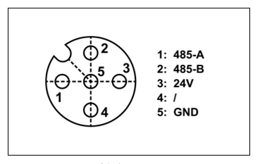
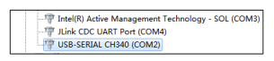
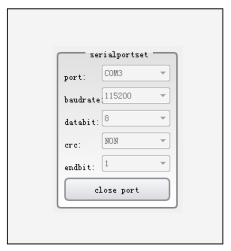
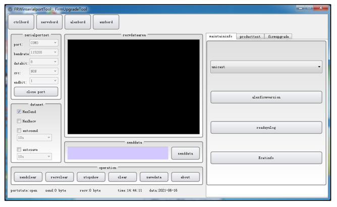
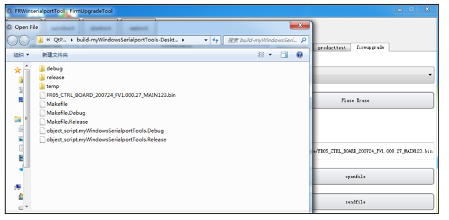
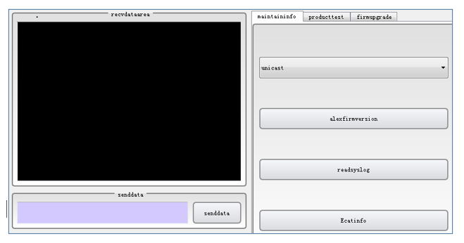
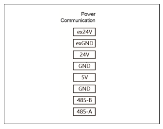

Dodatek
========

.. toctree:: 
  :maxdepth: 5

Dodatek 1: Błędy kontrolera ruchu i sposoby ich rozwiązywania
-------------------------------------------------------------------

.. csv-table:: 
   :header: "Główny kod usterki", "Podkod usterki", "Opis"
   :widths: 20, 10, 70

   "0-Brak usterki", "0", "Brak usterki"
   "1-Błąd punktu polecenia", "1", "Błąd punktu polecenia przegubu, resetowalny"
   "1-Błąd punktu polecenia", "2", "Błąd punktu docelowego linii (w tym niezgodność narzędzia), resetowalny"
   "1-Błąd punktu polecenia", "3", "Błąd punktu pośredniego łuku (w tym niezgodność narzędzia), resetowalny"
   "1-Błąd punktu polecenia", "4", "Błąd punktu docelowego łuku (w tym niezgodność narzędzia), resetowalny"
   "1-Błąd punktu polecenia", "5", "Odstęp punktów polecenia łuku zbyt mały, resetowalny"
   "1-Błąd punktu polecenia", "6", "Błąd punktu pośredniego 1 pełnego okręgu/helisy (w tym niezgodność narzędzia), resetowalny"
   "1-Błąd punktu polecenia", "7", "Błąd punktu pośredniego 2 pełnego okręgu/helisy (w tym niezgodność narzędzia), resetowalny"
   "1-Błąd punktu polecenia", "8", "Błąd punktu pośredniego 3 pełnego okręgu/helisy (w tym niezgodność narzędzia), resetowalny"
   "1-Błąd punktu polecenia", "9", "Odstęp punktów polecenia pełnego okręgu/helisy zbyt mały, resetowalny"
   "1-Błąd punktu polecenia", "10", "Błąd punktu polecenia TPD, resetowalny"
   "1-Błąd punktu polecenia", "11", "Narzędzie polecenia TPD nie odpowiada bieżącemu narzędziu, resetowalny"
   "1-Błąd punktu polecenia", "12", "Odchylenie między bieżącym poleceniem TPD a punktem początkowym następnego polecenia zbyt duże, resetowalny"
   "1-Błąd punktu polecenia", "13", "Błąd przełączania narzędzia wewnętrznego/zewnętrznego, resetowalny"
   "1-Błąd punktu polecenia", "14", "Błąd punktu początkowego nowej helisy, resetowalny"
   "1-Błąd punktu polecenia", "15", "Błąd punktu polecenia nowej krzywej splajnu, resetowalny"
   "1-Błąd punktu polecenia", "17", "Polecenie przegubu PTP przekracza limit, resetowalny"
   "1-Błąd punktu polecenia", "18", "Polecenie przegubu TPD przekracza limit, resetowalny"
   "1-Błąd punktu polecenia", "19", "Polecenie przegubu wydane przez LIN/ARC przekracza limit, resetowalny"
   "1-Błąd punktu polecenia", "20", "Przekroczenie prędkości polecenia w przestrzeni kartezjańskiej, nie resetowalny"
   "1-Błąd punktu polecenia", "21", "Polecenie momentu przekracza limit w przestrzeni przegubów, resetowalny"
   "1-Błąd punktu polecenia", "22", "Polecenie przegubu JOG przekracza limit, resetowalny"
   "1-Błąd punktu polecenia", "23", "Prędkość polecenia w przestrzeni przegubów osi 1 przekracza limit, resetowalny"
   "1-Błąd punktu polecenia", "24", "Prędkość polecenia w przestrzeni przegubów osi 2 przekracza limit, resetowalny"
   "1-Błąd punktu polecenia", "25", "Prędkość polecenia w przestrzeni przegubów osi 3 przekracza limit, resetowalny"
   "1-Błąd punktu polecenia", "26", "Prędkość polecenia w przestrzeni przegubów osi 4 przekracza limit, resetowalny"
   "1-Błąd punktu polecenia", "27", "Prędkość polecenia w przestrzeni przegubów osi 5 przekracza limit, resetowalny"
   "1-Błąd punktu polecenia", "28", "Prędkość polecenia w przestrzeni przegubów osi 6 przekracza limit, resetowalny"
   "1-Błąd punktu polecenia", "29", "Prędkość sprzężenia zwrotnego przegubów przekracza limit, nie resetowalny"
   "1-Błąd punktu polecenia", "30", "Odchylenie między poleceniem przegubu a sprzężeniem zwrotnym zbyt duże, nie resetowalny, wymagany restart"
   "1-Błąd punktu polecenia", "31", "Błąd punktu docelowego DMP (w tym niezgodność narzędzia), resetowalny"
   "1-Błąd punktu polecenia", "33", "Zmieniono konfigurację przegubów następnego polecenia (następne polecenie ma pozę osobliwą, użyj polecenia PTP lub zmień punkt następnego polecenia), resetowalny"
   "1-Błąd punktu polecenia", "34", "Zmieniono konfigurację przegubów bieżącego polecenia (następne polecenie ma pozę osobliwą, użyj polecenia PTP lub zmień punkt następnego polecenia), resetowalny"
   "1-Błąd punktu polecenia", "35", "Prędkość przegubów przekracza limit w poleceniu LIN, resetowalny"
   "1-Błąd punktu polecenia", "36", "Prędkość adaptacyjna polecenia LIN przekracza próg, resetowalny"
   "1-Błąd punktu polecenia", "37", "W trajektorii istnieje punkt nieosiągalny, resetowalny"
   "1-Błąd punktu polecenia", "38", "W trajektorii istnieje punkt nieosiągalny - poza osobliwa, resetowalny"
   "1-Błąd punktu polecenia", "49", "Błąd polecenia, między ARCSTART i ARCEND dozwolone są tylko polecenia LIN i ARC, resetowalny"
   "1-Błąd punktu polecenia", "50", "Błąd polecenia, między WEAVESTART i WEAVEEND dozwolone są tylko polecenia LIN i ARC, resetowalny"
   "1-Błąd punktu polecenia", "51", "Błąd parametrów splatania, resetowalny"
   "1-Błąd punktu polecenia", "52", "Odstęp punktów polecenia splatania zbyt mały, resetowalny"
   "1-Błąd punktu polecenia", "53", "W trajektorii splatania istnieje punkt nieosiągalny - poza osobliwa, resetowalny"
   "1-Błąd punktu polecenia", "54", "W trajektorii splatania istnieje punkt nieosiągalny - polecenie przegubu przekracza limit, resetowalny"
   "1-Błąd punktu polecenia", "55", "W trajektorii splatania istnieje punkt nieosiągalny - wyjątek planowania (kąt między z narzędzia a x kierunku ruchu pokrywają się), resetowalny"
   "1-Błąd punktu polecenia", "56", "W trajektorii splatania istnieje punkt nieosiągalny - wyjątek planowania (błąd punktu trasy łuku), resetowalny"
   "1-Błąd punktu polecenia", "65", "Odchylenie polecenia czujnika laserowego zbyt duże, resetowalny"
   "1-Błąd punktu polecenia", "66", "Polecenie czujnika laserowego przerwane, śledzenie spoiny zakończone przedwcześnie, resetowalny"
   "1-Błąd punktu polecenia", "81", "Prędkość polecenia osi zewnętrznej przekracza limit, resetowalny"
   "1-Błąd punktu polecenia", "82", "Odchylenie między poleceniem a sprzężeniem zwrotnym osi zewnętrznej zbyt duże, nie resetowalny, wymagane zerowanie lub restart"
   "1-Błąd punktu polecenia", "83", "Nieprawidłowa komunikacja peryferii rozszerzonych (oś zewnętrzna/IO), resetowalny"
   "1-Błąd punktu polecenia", "84", "Nieprawidłowa komunikacja peryferii rozszerzonych (spawarka), resetowalny"
   "1-Błąd punktu polecenia", "85", "Prędkość polecenia w przestrzeni przegubów rozszerzonej osi 1 przekracza limit, resetowalny"
   "1-Błąd punktu polecenia", "86", "Prędkość polecenia w przestrzeni przegubów rozszerzonej osi 2 przekracza limit, resetowalny"
   "1-Błąd punktu polecenia", "87", "Prędkość polecenia w przestrzeni przegubów rozszerzonej osi 3 przekracza limit, resetowalny"
   "1-Błąd punktu polecenia", "88", "Prędkość polecenia w przestrzeni przegubów rozszerzonej osi 4 przekracza limit, resetowalny"
   "1-Błąd punktu polecenia", "89", "Nieprawidłowa komunikacja peryferii rozszerzonych (UDP), resetowalny"
   "1-Błąd punktu polecenia", "90", "Nieprawidłowa utrata pakietów w komunikacji peryferii rozszerzonych (UDP), resetowalny"
   "1-Błąd punktu polecenia", "97", "Śledzenie przenośnika - zbyt duża zmiana pozy między punktem początkowym a punktem odniesienia, resetowalny"
   "1-Błąd punktu polecenia", "113", "Sterowanie stałą siłą - kierunek X przekracza maksymalną odległość regulacji, resetowalny"
   "1-Błąd punktu polecenia", "114", "Sterowanie stałą siłą - kierunek Y przekracza maksymalną odległość regulacji, resetowalny"
   "1-Błąd punktu polecenia", "115", "Sterowanie stałą siłą - kierunek Z przekracza maksymalną odległość regulacji, resetowalny"
   "1-Błąd punktu polecenia", "116", "Sterowanie stałą siłą - kierunek RX przekracza maksymalny kąt regulacji, resetowalny"
   "1-Błąd punktu polecenia", "117", "Sterowanie stałą siłą - kierunek RY przekracza maksymalny kąt regulacji, resetowalny"
   "1-Błąd punktu polecenia", "118", "Sterowanie stałą siłą - kierunek RZ przekracza maksymalny kąt regulacji, resetowalny"
   "1-Błąd punktu polecenia", "119", "Błąd danych zewnętrznego czujnika, resetowalny"
   "1-Błąd punktu polecenia", "120", "Niepowodzenie ruchu eksploracji helikalnej, resetowalny"
   "1-Błąd punktu polecenia", "121", "Niepowodzenie ruchu wstawiania obrotowego, resetowalny"
   "1-Błąd punktu polecenia", "122", "Niepowodzenie ruchu wstawiania liniowego, resetowalny"
   "1-Błąd punktu polecenia", "123", "Niepowodzenie ruchu pozycjonowania powierzchni, resetowalny"
   "1-Błąd punktu polecenia", "129", "Przekroczono maksymalną liczbę punktów rejestracji momentu, resetowalny"
   "1-Błąd punktu polecenia", "130", "Błąd przełączania prędkości, resetowalny"
   "1-Błąd punktu polecenia", "131", "Kierunek narzędzia przekracza limit, resetowalny"
   "1-Błąd punktu polecenia", "132", "Pęd przekracza limit, resetowalny"
   "1-Błąd punktu polecenia", "133", "Moc przekracza limit, resetowalny"
   "1-Błąd punktu polecenia", "134", "Nieprawidłowa diagnostyka STL-Flash, resetowalny"
   "1-Błąd punktu polecenia", "135", "Nieprawidłowa diagnostyka STL-RAM, resetowalny"
   "1-Błąd punktu polecenia", "136", "Nieprawidłowa diagnostyka STL-CPU, resetowalny"
   "1-Błąd punktu polecenia", "137", "Nieprawidłowe dane bezpieczeństwa ECAT płyty bezpieczeństwa II, resetowalny"
   "1-Błąd punktu polecenia", "138", "Nieprawidłowe dane bezpieczeństwa ECAT osi 1, resetowalny"
   "1-Błąd punktu polecenia", "139", "Nieprawidłowe dane bezpieczeństwa ECAT osi 2, resetowalny"
   "1-Błąd punktu polecenia", "140", "Nieprawidłowe dane bezpieczeństwa ECAT osi 3, resetowalny"
   "1-Błąd punktu polecenia", "141", "Nieprawidłowe dane bezpieczeństwa ECAT osi 4, resetowalny"
   "1-Błąd punktu polecenia", "142", "Nieprawidłowe dane bezpieczeństwa ECAT osi 5, resetowalny"
   "1-Błąd punktu polecenia", "143", "Nieprawidłowe dane bezpieczeństwa ECAT osi 6, resetowalny"
   "1-Błąd punktu polecenia", "145", "Nieprawidłowa komunikacja między płytą bezpieczeństwa a skrzynką sterowniczą, resetowalny"
   "1-Błąd punktu polecenia", "146", "Błąd śledzenia ogniska, resetowalny"
   "1-Błąd punktu polecenia", "147", "Prędkość orientacji przekracza limit, resetowalny"
   "1-Błąd punktu polecenia", "148", "Nieprawidłowe słowo stanu przegubu, resetowalny"
   "1-Błąd punktu polecenia", "149", "Konflikt funkcji lub ustawienia, resetowalny"
   "2-Usterka sterownika", "1", "Usterka sterownika osi 1, nie resetowalny"
   "2-Usterka sterownika", "2", "Usterka sterownika osi 2, nie resetowalny"
   "2-Usterka sterownika", "3", "Usterka sterownika osi 3, nie resetowalny"
   "2-Usterka sterownika", "4", "Usterka sterownika osi 4, nie resetowalny"
   "2-Usterka sterownika", "5", "Usterka sterownika osi 5, nie resetowalny"
   "2-Usterka sterownika", "6", "Usterka sterownika osi 6, nie resetowalny"
   "3-Usterka przekroczenia limitu soft", "1", "Usterka przekroczenia limitu soft osi 1, resetowalny"
   "3-Usterka przekroczenia limitu soft", "2", "Usterka przekroczenia limitu soft osi 2, resetowalny"
   "3-Usterka przekroczenia limitu soft", "3", "Usterka przekroczenia limitu soft osi 3, resetowalny"
   "3-Usterka przekroczenia limitu soft", "4", "Usterka przekroczenia limitu soft osi 4, resetowalny"
   "3-Usterka przekroczenia limitu soft", "5", "Usterka przekroczenia limitu soft osi 5, resetowalny"
   "3-Usterka przekroczenia limitu soft", "6", "Usterka przekroczenia limitu soft osi 6, resetowalny"
   "4-Usterka kolizji", "1", "Usterka kolizji osi 1, resetowalny"
   "4-Usterka kolizji", "2", "Usterka kolizji osi 2, resetowalny"
   "4-Usterka kolizji", "3", "Usterka kolizji osi 3, resetowalny"
   "4-Usterka kolizji", "4", "Usterka kolizji osi 4, resetowalny"
   "4-Usterka kolizji", "5", "Usterka kolizji osi 5, resetowalny"
   "4-Usterka kolizji", "6", "Usterka kolizji osi 6, resetowalny"
   "4-Usterka kolizji", "7", "Usterka kolizji końcówki, resetowalny"
   "4-Usterka kolizji", "8", "Usterka kolizji osi zewnętrznej, resetowalny"
   "5-Błąd liczby aktywnych slave'ów", "1", "Błąd liczby aktywnych slave'ów, nie resetowalny"
   "6-Błąd slave'a", "1", "Slave offline, nie resetowalny"
   "6-Błąd slave'a", "2", "Stan slave'a niezgodny z ustawioną wartością, nie resetowalny"
   "6-Błąd slave'a", "3", "Slave nieskonfigurowany, nie resetowalny"
   "6-Błąd slave'a", "4", "Błąd konfiguracji slave'a, nie resetowalny"
   "6-Błąd slave'a", "5", "Błąd inicjalizacji slave'a, nie resetowalny"
   "6-Błąd slave'a", "6", "Błąd inicjalizacji komunikacji mailbox slave'a, nie resetowalny"
   "7-Błąd IO", "1", "Błąd kanału, resetowalny"
   "7-Błąd IO", "2", "Błąd wartości, resetowalny"
   "7-Błąd IO", "3", "Przekroczenie czasu oczekiwania WaitDI, resetowalny"
   "7-Błąd IO", "4", "Przekroczenie czasu oczekiwania WaitAI, resetowalny"
   "7-Błąd IO", "5", "Przekroczenie czasu oczekiwania WaitAxleDI, resetowalny"
   "7-Błąd IO", "6", "Przekroczenie czasu oczekiwania WaitAxleAI, resetowalny"
   "7-Błąd IO", "7", "Błąd funkcji już skonfigurowanej na kanale, resetowalny"
   "7-Błąd IO", "8", "Przekroczenie czasu rozpoczęcia łuku, resetowalny"
   "7-Błąd IO", "9", "Przekroczenie czasu zakończenia łuku, resetowalny"
   "7-Błąd IO", "10", "Przekroczenie czasu szukania spoiny, resetowalny"
   "7-Błąd IO", "11", "Przekroczenie czasu detekcji IO przenośnika, resetowalny"
   "7-Błąd IO", "12", "Przekroczenie czasu oczekiwania WaitAuxDI, resetowalny"
   "7-Błąd IO", "13", "Przekroczenie czasu oczekiwania WaitAuxAI, resetowalny"
   "7-Błąd IO", "14", "Przekroczenie czasu szukania spoiny drutu, resetowalny"
   "7-Błąd IO", "15", "Zatrzymanie bezpieczeństwa wyzwolone, resetowalny"
   "7-Błąd IO", "16", "Ochrona przed zwarciem 24V modułu DO, nie resetowalny"
   "7-Błąd IO", "17", "Ochrona utrzymania pozycji (awaria hamulca), nie resetowalny"
   "7-Błąd IO", "18", "Przekroczenie czasu oczekiwania DI płyty, resetowalny"
   "7-Błąd IO", "19", "Przekroczenie czasu oczekiwania AI płyty, resetowalny"
   "8-Błąd chwytaka", "1", "Błąd przekroczenia czasu ruchu chwytaka, resetowalny"
   "9-Błąd pliku", "1", "Błąd wersji pliku konfiguracji zbt, błąd inicjalizacji - nie resetowalny"
   "9-Błąd pliku", "2", "Niepowodzenie wczytania pliku konfiguracji zbt, błąd inicjalizacji - nie resetowalny"
   "9-Błąd pliku", "3", "Błąd wersji pliku konfiguracji user, błąd inicjalizacji - nie resetowalny"
   "9-Błąd pliku", "4", "Niepowodzenie wczytania pliku konfiguracji user, błąd inicjalizacji - nie resetowalny"
   "9-Błąd pliku", "5", "Błąd wersji pliku konfiguracji exaxis, błąd inicjalizacji - nie resetowalny"
   "9-Błąd pliku", "6", "Niepowodzenie wczytania pliku konfiguracji exaxis, błąd inicjalizacji - nie resetowalny"
   "9-Błąd pliku", "7", "Niezgodny model robota, wymagana ponowna konfiguracja - nie resetowalny"
   "9-Błąd pliku", "8", "Błąd wersji pliku konfiguracji dhpara, błąd inicjalizacji - nie resetowalny"
   "9-Błąd pliku", "9", "Niepowodzenie wczytania pliku konfiguracji dhpara, błąd inicjalizacji - nie resetowalny"
   "9-Błąd pliku", "10", "Model robota nie ustawiony - nie resetowalny"
   "9-Błąd pliku", "11", "Błąd wersji pliku konfiguracji load, błąd inicjalizacji - nie resetowalny"
   "9-Błąd pliku", "12", "Niepowodzenie wczytania pliku konfiguracji load, błąd inicjalizacji - nie resetowalny"
   "9-Błąd pliku", "13", "Błąd wersji pliku konfiguracji speed, błąd inicjalizacji - nie resetowalny"
   "9-Błąd pliku", "14", "Niepowodzenie wczytania pliku konfiguracji speed, błąd inicjalizacji - nie resetowalny"
   "9-Błąd pliku", "15", "Błąd wersji pliku konfiguracji weavepara, błąd inicjalizacji - nie resetowalny"
   "9-Błąd pliku", "16", "Niepowodzenie wczytania pliku konfiguracji weavepara, błąd inicjalizacji - nie resetowalny"
   "9-Błąd pliku", "17", "Błąd wersji pliku konfiguracji interfere, błąd inicjalizacji - nie resetowalny"
   "9-Błąd pliku", "18", "Niepowodzenie wczytania pliku konfiguracji interfere, błąd inicjalizacji - nie resetowalny"
   "9-Błąd pliku", "19", "Błąd wersji pliku konfiguracji dynamic, błąd inicjalizacji - nie resetowalny"
   "9-Błąd pliku", "20", "Niepowodzenie wczytania pliku konfiguracji dynamic, błąd inicjalizacji - nie resetowalny"
   "10-Poza osobliwa", "1", "Poza osobliwa"
   "11-Błąd komunikacji sterownika", "1", "Błąd komunikacji sterownika osi 1, nie resetowalny"
   "11-Błąd komunikacji sterownika", "2", "Błąd komunikacji sterownika osi 2, nie resetowalny"
   "11-Błąd komunikacji sterownika", "3", "Błąd komunikacji sterownika osi 3, nie resetowalny"
   "11-Błąd komunikacji sterownika", "4", "Błąd komunikacji sterownika osi 4, nie resetowalny"
   "11-Błąd komunikacji sterownika", "5", "Błąd komunikacji sterownika osi 5, nie resetowalny"
   "11-Błąd komunikacji sterownika", "6", "Błąd komunikacji sterownika osi 6, nie resetowalny"
   "12-Limit soft osi zewnętrznej", "1", "Przekroczenie limitu soft osi 1, resetowalny"
   "12-Limit soft osi zewnętrznej", "2", "Przekroczenie limitu soft osi 2, resetowalny"
   "12-Limit soft osi zewnętrznej", "3", "Przekroczenie limitu soft osi 3, resetowalny"
   "12-Limit soft osi zewnętrznej", "4", "Przekroczenie limitu soft osi 4, resetowalny"
   "13-Błąd ustawienia parametru", "1", "Numer narzędzia przekracza limit, resetowalny"
   "13-Błąd ustawienia parametru", "2", "Błąd progu zakończenia pozycjonowania, resetowalny"
   "13-Błąd ustawienia parametru", "3", "Błąd poziomu kolizji, resetowalny"
   "13-Błąd ustawienia parametru", "4", "Błąd masy ładunku, resetowalny"
   "13-Błąd ustawienia parametru", "5", "Błąd środka masy X ładunku, resetowalny"
   "13-Błąd ustawienia parametru", "6", "Błąd środka masy Y ładunku, resetowalny"
   "13-Błąd ustawienia parametru", "7", "Błąd środka masy Z ładunku, resetowalny"
   "13-Błąd ustawienia parametru", "8", "Błąd czasu filtrowania DI, resetowalny"
   "13-Błąd ustawienia parametru", "9", "Błąd czasu filtrowania AxleDI, resetowalny"
   "13-Błąd ustawienia parametru", "10", "Błąd czasu filtrowania AI, resetowalny"
   "13-Błąd ustawienia parametru", "11", "Błąd czasu filtrowania AxleAI, resetowalny"
   "13-Błąd ustawienia parametru", "12", "Błąd zakresu poziomu wysokiego/niskiego DI, resetowalny"
   "13-Błąd ustawienia parametru", "13", "Błąd zakresu poziomu wysokiego/niskiego DO, resetowalny"
   "13-Błąd ustawienia parametru", "14", "Numer przedmiotu obrabianego przekracza limit, resetowalny"
   "13-Błąd ustawienia parametru", "15", "Numer osi zewnętrznej przekracza limit, resetowalny"
   "13-Błąd ustawienia parametru", "16", "Błąd kanału enkodera przenośnika, resetowalny"
   "13-Błąd ustawienia parametru", "17", "Błąd numeru osi przedmiotu obrabianego przenośnika, resetowalny"
   "13-Błąd ustawienia parametru", "18", "Błąd metody instalacji FR30L - nie montaż pionowy, resetowalny"

Załącznik 2: Tabela Usterek Szafy Sterowniczej Szerokiego Napięcia
---------------------------------------------------------------------------------

.. list-table::
   :widths: 20 40 80
   :header-rows: 0
   :align: center

   * - **Kod Usterki**
     - **Nazwa Usterki**
     - **Metoda Postępowania**

   * - 3
     - MCU pomocniczy offline
     - | 1. Ponownie wgrać oprogramowanie MCU pomocniczego
       | 2. Naprawić MCU pomocniczy lub wymienić szafę sterowniczą  

   * - 4
     - Niezgodność wejścia awaryjnego MCU głównego i pomocniczego
     - | 1. Sprawdzić wiązkę przycisku awaryjnego skrzynki przycisków lub wymienić zespół skrzynki przycisków
       | 2. Sprawdzić dwie wiązki zwarciowe przycisku awaryjnego na zaciskach szafy sterowniczej  
       | 3. Jeśli usterka nadal występuje, naprawić lub wymienić szafę sterowniczą 

   * - 5
     - Niezgodność wejścia bezpieczeństwa MCU głównego i pomocniczego
     - | 1. Sprawdzić dwie wiązki zwarciowe bezpieczeństwa na zaciskach szafy sterowniczej
       | 2. Jeśli usterka nadal występuje, naprawić lub wymienić szafę sterowniczą

   * - 6
     - Niezgodność wejścia awaryjnego i przycisku zezwalającego 3-pozycyjnego MCU głównego i pomocniczego
     - | 1. Sprawdzić przełącznik zezwalający 3-pozycyjny na panelu operatorskim i wiązkę panelu operatorskiego
       | 2. Wymienić zespół panelu operatorskiego
       | 3. Sprawdzić, czy Web jest w trybie panelu operatorskiego i czy panel operatorski jest podłączony
       | 4. Jeśli usterka nadal występuje, naprawić lub wymienić szafę sterowniczą

   * - 7
     - Niezgodność wejścia/wyjścia STO głównego
     - | 1. Sprawdzić, czy wtyk przewodu ciężkiego szafy sterowniczej i wiązka STO są pewnie podłączone
       | 2. Sprawdzić, czy napęd obsługuje funkcję STO
       | 3. Dla konfiguracji certyfikowana szafa sterownicza szerokiego napięcia + robot niecertyfikowany, sprawdzić czy włączono tryb bezpieczeństwa funkcjonalnego
       | 4. Certyfikowana szafa sterownicza szerokiego napięcia w trybie certyfikacji włącza funkcję wykrywania usterek STO; robot niecertyfikowany nie obsługuje trybu bezpieczeństwa funkcjonalnego
       | 5. Jeśli usterka nadal występuje, naprawić lub wymienić szafę sterowniczą

   * - 8
     - Niezgodność wejścia/wyjścia STO pomocniczego
     - | 1. Sprawdzić, czy wtyk przewodu ciężkiego szafy sterowniczej i wiązka STO są pewnie podłączone
       | 2. Sprawdzić, czy napęd obsługuje funkcję STO
       | 3. Dla konfiguracji certyfikowana szafa sterownicza szerokiego napięcia + robot niecertyfikowany, sprawdzić czy włączono tryb bezpieczeństwa funkcjonalnego
       | 4. Certyfikowana szafa sterownicza szerokiego napięcia w trybie certyfikacji włącza funkcję wykrywania usterek STO; robot niecertyfikowany nie obsługuje trybu bezpieczeństwa funkcjonalnego
       | 5. Jeśli usterka nadal występuje, naprawić lub wymienić szafę sterowniczą

   * - 9
     - MCU główny wykrywa niezgodność wejścia/wyjścia przekaźnika 48V
     - | 1. Sprawdzić wejście i sprzężenie zwrotne przekaźnika wymuszonego w szafie sterowniczej
       | 2. Sprawdzić, czy przekaźnik 48V w szafie sterowniczej nie jest zablokowany
       | 3. Sprawdzić, czy obwód sprzężenia zwrotnego przekaźnika 48V w szafie sterowniczej działa prawidłowo
       | 4. Jeśli usterka nadal występuje, naprawić lub wymienić szafę sterowniczą

   * - 10
     - MCU pomocniczy wykrywa niezgodność wejścia/wyjścia przekaźnika 48V
     - | 1. Sprawdzić wejście i sprzężenie zwrotne przekaźnika wymuszonego w szafie sterowniczej
       | 2. Sprawdzić, czy przekaźnik 48V w szafie sterowniczej nie jest zablokowany
       | 3. Sprawdzić, czy obwód sprzężenia zwrotnego przekaźnika 48V w szafie sterowniczej działa prawidłowo
       | 4. Jeśli usterka nadal występuje, naprawić lub wymienić szafę sterowniczą

   * - \
     - Szafa sterownicza wyłączona, brak napięcia 48V
     - | 1. Sprawdzić obwód układu zabezpieczenia przed zwarciem 24V i sprawdzić, czy nie ma zwarć na 24V
       | 2. Sprawdzić wiązki zwarciowe zacisków wejścia awaryjnego i wejścia bezpieczeństwa
       | 3. Sprawdzić, czy płytka pomocnicza zasilania 24V w szafie sterowniczej dostarcza napięcie 24V
       | 4. Jeśli usterka nadal występuje, naprawić lub wymienić szafę sterowniczą

Dodatek 3: Tabela kodów awarii serwonapędu
------------------------------------------------

.. list-table::
   :widths: 20 40 80
   :header-rows: 0
   :align: center

   * - **Kod awarii**
     - **Nazwa awarii**
     - **Sposób rozwiązania**

   * - 1
     - Awaria przetężenia programowego
     - | 1. Sprawdź, czy obciążenie lub opór stawu nie wzrosły lub nie są nieprawidłowe
       | 2. Jeśli awaria nie zostanie usunięta, napraw lub wymień płytę sterującą napędu

   * - 2
     - Awaria przepięcia
     - Zmniejsz prędkość lub przyspieszenie robota

   * - 3
     - Awaria napięcia
     - | 1. Sprawdź, czy napięcie wyjściowe zasilacza 48V w skrzynce sterowniczej jest nieprawidłowe
       | 2. Sprawdź, czy płyta sterująca napędu i obudowa stawu nie są zwarte
       | 3. Jeśli awaria nie zostanie usunięta, napraw lub wymień płytę sterującą napędu

   * - 4
     - Awaria przegrzania
     - Zmniejsz obciążenie robota lub zmniejsz prędkość robota

   * - 5
     - Awaria przeciążenia
     - Zmniejsz obciążenie robota lub zmniejsz prędkość robota

   * - 6
     - Awaria nadmiernej prędkości
     - | 1. Sprawdź, czy śruba ustalająca między zespołem enkodera magnetycznego a wałem silnika nie jest poluzowana
       | 2. Wykonaj ponownie zerowanie enkodera
       | 3. Jeśli awaria nie zostanie usunięta, napraw lub wymień zespół enkodera magnetycznego

   * - 7
     - Awaria nieprawidłowego parametru
     - Napraw lub wymień płytę sterującą napędu

   * - 8
     - Awaria "lotu" (niekontrolowany ruch)
     - | 1. Sprawdź, czy śruba ustalająca między zespołem enkodera magnetycznego a wałem silnika nie jest poluzowana
       | 2. Wykonaj ponownie zerowanie enkodera
       | 3. Jeśli awaria nie zostanie usunięta, napraw lub wymień zespół enkodera magnetycznego

   * - 9
     - Awaria błędu pozycji
     - | 1. Sprawdź, czy obciążenie lub opór stawu nie wzrosły lub nie są nieprawidłowe
       | 2. Jeśli awaria nie zostanie usunięta, napraw lub wymień płytę sterującą napędu

   * - 10
     - Awaria przepełnienia pozycji
     - | 1. Sprawdź, czy twardy ogranicznik nie jest poluzowany
       | 2. Wykonaj ponownie zerowanie robota

   * - 11
     - Awaria przetężenia sprzętowego
     - Napraw lub wymień płytę sterującą napędu

   * - 12
     - Awaria blokady napędu
     - Nieaktywowane

   * - 13
     - Awaria blokowania silnika
     - | 1. Sprawdź, czy elektromagnes hamulca jest zaciągnięty
       | 2. Sprawdź, czy nie uderzono w twardy ogranicznik
       | 3. Jeśli awaria nie zostanie usunięta, napraw lub wymień płytę sterującą napędu

   * - 14
     - Awaria zasilania mocy
     - Nieaktywowane

   * - 15
     - Awaria STO
     - Nieaktywowane

   * - 16
     - Awaria zerowania AD prądu fazowego
     - Napraw lub wymień płytę sterującą napędu

   * - 17
     - Awaria EEPROM
     - Napraw lub wymień płytę sterującą napędu

   * - 18
     - Awaria Halla
     - | 1. Sprawdź, czy wiązka Halla jest dobrze podłączona, czy nie ma zwarcia lub przerwy
       | 2. Jeśli awaria nie zostanie usunięta, napraw lub wymień staw

   * - 19
     - Awaria enkodera
     - Napraw lub wymień zespół enkodera magnetycznego

   * - 20
     - Awaria zerowania enkodera
     - | 1. Wykonaj ponownie zerowanie enkodera
       | 2. Jeśli awaria nie zostanie usunięta, napraw lub wymień zespół enkodera magnetycznego
   
   * - 21
     - Awaria utraty sygnału Z enkodera
     - Nieaktywowane

   * - 22
     - Awaria zliczania enkodera
     - Nieaktywowane

   * - 23
     - Awaria przepełnienia danych wieloobrotowych enkodera
     - Nieaktywowane

   * - 24
     - Awaria zegara zewnętrznego
     - Napraw lub wymień płytę sterującą napędu

   * - 25
     - Awaria sekwencji faz UVW
     - Nieaktywowane

   * - 26
     - Awaria FPGA
     - Nieaktywowane

   * - 27
     - Awaria powrotu do zera
     - Nieaktywowane

   * - 28
     - Awaria enkodera magnetycznego
     - | 1. Sprawdź, czy śruba ustalająca między zespołem enkodera magnetycznego a wałem silnika nie jest poluzowana
       | 2. Jeśli awaria nie zostanie usunięta, napraw lub wymień zespół enkodera magnetycznego

   * - 29
     - Awaria przerwy w przewodzie zasilania silnika
     - | 1. Sprawdź, czy przewód zasilania silnika jest dobrze podłączony, czy nie ma zwarcia lub przerwy
       | 2. Jeśli awaria nie zostanie usunięta, napraw lub wymień płytę sterującą napędu

   * - 30
     - Awaria EtherCAT
     - | 1. Sprawdź, czy kabel sieciowy jest dobrze podłączony, czy nie ma zwarcia lub przerwy
       | 2. Jeśli awaria nie zostanie usunięta, napraw lub wymień płytę sterującą napędu

   * - 31
     - Awaria EtherCAT_SM_DOG
     - | 1. Sprawdź, czy kabel sieciowy jest dobrze podłączony, czy nie ma zwarcia lub przerwy
       | 2. Jeśli awaria nie zostanie usunięta, napraw lub wymień płytę sterującą napędu

   * - 32
     - Awaria EtherCAT_FATALSYNC
     - | 1. Sprawdź, czy kabel sieciowy jest dobrze podłączony, czy nie ma zwarcia lub przerwy
       | 2. Jeśli awaria nie zostanie usunięta, napraw lub wymień płytę sterującą napędu

   * - 33
     - Awaria EtherCAT_SYNC
     - | 1. Sprawdź, czy kabel sieciowy jest dobrze podłączony, czy nie ma zwarcia lub przerwy
       | 2. Jeśli awaria nie zostanie usunięta, napraw lub wymień płytę sterującą napędu

   * - 34
     - Awaria EtherCAT_RFT
     - | 1. Sprawdź, czy kabel sieciowy jest dobrze podłączony, czy nie ma zwarcia lub przerwy
       | 2. Jeśli awaria nie zostanie usunięta, napraw lub wymień płytę sterującą napędu

   * - 35
     - Awaria adresu osi napędu
     - | 1. Wykonaj ponownie konfigurację adresu osi napędu
       | 2. Jeśli awaria nie zostanie usunięta, napraw lub wymień płytę sterującą napędu

   * - 36
     - Awaria zerowania robota
     - | 1. Wykonaj ponownie zerowanie robota
       | 2. Najpierw użyj JLINK, aby wymazać FLASH, a następnie pobierz ponownie program i wykonaj zerowanie
       | 3. Jeśli awaria nie zostanie usunięta, napraw lub wymień płytę sterującą napędu

   * - 37
     - Awaria komunikacji enkodera
     - | 1. Sprawdź, czy wiązka enkodera jest dobrze podłączona, czy nie ma zwarcia lub przerwy
       | 2. Jeśli awaria nie zostanie usunięta, napraw lub wymień zespół enkodera magnetycznego

   * - 40
     - Awaria modułu enkodera magnetycznego - błąd zerowania
     - | 1. Wykonaj ponownie zerowanie zespołu enkodera magnetycznego
       | 2. Jeśli awaria nie zostanie usunięta, napraw lub wymień zespół enkodera magnetycznego

   * - 41
     - Awaria modułu enkodera magnetycznego - błąd wieloobrotowy
     - | 1. Sprawdź, czy śruba ustalająca między zespołem enkodera magnetycznego a wałem silnika nie jest poluzowana
       | 2. Jeśli awaria nie zostanie usunięta, napraw lub wymień zespół enkodera magnetycznego

   * - 42
     - Awaria modułu enkodera magnetycznego - awaria małego enkodera wieloobrotowego
     - | 1. Sprawdź, czy układ małego enkodera wieloobrotowego nie jest nieprawidłowy
       | 2. Jeśli awaria nie zostanie usunięta, napraw lub wymień zespół enkodera magnetycznego

   * - 43
     - Awaria modułu enkodera magnetycznego - awaria dużego enkodera wieloobrotowego
     - | 1. Sprawdź, czy układ dużego enkodera wieloobrotowego nie jest nieprawidłowy
       | 2. Jeśli awaria nie zostanie usunięta, napraw lub wymień zespół enkodera magnetycznego

   * - 44
     - Awaria modułu enkodera magnetycznego - awaria enkodera pojedynczego obrotu
     - | 1. Sprawdź, czy układ enkodera pojedynczego obrotu nie jest nieprawidłowy
       | 2. Jeśli awaria nie zostanie usunięta, napraw lub wymień zespół enkodera magnetycznego

   * - 45
     - Awaria modułu enkodera magnetycznego - awaria enkodera optycznego
     - | 1. Sprawdź, czy tarcza enkodera optycznego nie jest zabrudzona lub źle przyklejona
       | 2. Jeśli awaria nie zostanie usunięta, napraw lub wymień zespół enkodera magnetycznego

   * - 46
     - Błąd konfiguracji typu robota
     - | 1. Bez wyłączania zasilania sprawdzić numer wersji oprogramowania napędu z usterką
       | 2. Ponownie skonfigurować typ robota
       | 3. Jeśli usterka nadal występuje, wymienić lub naprawić płytkę napędu

   * - 47
     - Błąd wykrywania napięcia hamulca
     - | 1. Sprawdzić, czy okablowanie hamulca jest nieprawidłowe
       | 2. Sprawdzić, czy obwód hamulca jest nieprawidłowy

   * - 50
     - Błąd polecenia pozycji
     - | 1. Sprawdzić, czy polecenie pozycji wysłane przez komputer nadrzędny (kontroler) jest nieprawidłowe (lub mutacja polecenia pozycji)

   * - 51
     - Błąd modułu enkodera magnetycznego - błąd enkodera optycznego
     - | 1. Sprawdzić, czy okablowanie czujnika momentu obrotowego jest nieprawidłowe
       | 2. Jeśli usterka nadal występuje, naprawić lub wymienić czujnik momentu obrotowego

Dodatek 4: Aktualizacja 485 płyty końcowej
------------------------------------------------

Podczas użytkowania w terenie może zaistnieć konieczność aktualizacji oprogramowania sprzętowego w celu spełnienia nowych wymagań. Dostarczony zostanie nowy plik aktualizacji (XX_XX_MAIN.bin). Aktualizacja płyty końcowej odbywa się przez interfejs 485 (wymagany jest moduł USB na 485). Kroki aktualizacji są następujące:

**Krok 1: Podłączenie 485**, Na końcu robota znajduje się 5-stykowe złącze komunikacyjne typu lotniczego. Rozmieszczenie pinów złącza lotniczego oraz opis pinów przedstawiono na Wykresie 1. Podłącz 485-A i 485-B na końcu robota odpowiednio do A i B narzędzia USB-485 za pomocą skrętki.

.. centered:: Wykres 18.3-1 Rozmieszczenie pinów złącza lotniczego

**Krok 2: Połączenie sprzętowe**, Podłącz końcówkę USB narzędzia USB-485 do komputera PC. W Menedżerze urządzeń komputera PC, jeśli narzędzie USB-485 zostanie rozpoznane, pojawi się następujący interfejs.

.. centered:: Wykres 18.3-2 Opis rozpoznawania portu USB-485

**Krok 3: Narzędzie do aktualizacji**, Po zakończeniu podłączania otwórz "Asystenta portu szeregowego FAIRINO", kliknij przycisk "Płyta końcowa", w funkcji "Ustawienia parametrów portu szeregowego" wybierz rozpoznany powyżej port szeregowy, prędkość 115200, 8 bitów danych, brak bitu parzystości, 1 bit stopu, a następnie otwórz port szeregowy. Po pomyślnym wykonaniu pojawi się komunikat "Port szeregowy otwarty pomyślnie".

.. centered:: Wykres 18.3-3 Ustawienia parametrów portu szeregowego

**Krok 4: Aktualizacja oprogramowania sprzętowego**, Wybierz "Płyta końcowa", kliknij "Aktualizacja oprogramowania sprzętowego", jak pokazano na wykresie:

.. centered:: Wykres 18.3-4 Aktualizacja oprogramowania sprzętowego płyty końcowej

-  Najpierw kliknij "Flash擦除" (Kasowanie Flash). Po pomyślnym skasowaniu, w obszarze odbierania danych pojawi się komunikat o pomyślnym skasowaniu.

-  Otwórz plik (plik do aktualizacji), wybierz ścieżkę przechowywania, jak poniżej. Po wybraniu nazwa pliku do aktualizacji pojawi się w polu wyświetlania nazwy pliku.

.. centered:: Wykres 18.3-5 Wybór pliku aktualizacji

-  Kliknij "发送文件" (Wyślij plik). Gdy pasek postępu wskaże 100%, oznacza to, że wysyłanie pliku aktualizacji zostało zakończone.

**Krok 5: Weryfikacja aktualizacji**, Uruchom ponownie system. W zakładce "Informacje konserwacyjne" wybierz "Zapytaj o wersję oprogramowania sprzętowego płyty końcowej". W "Obszarze odbierania danych" wyświetli się informacja o wersji oprogramowania sprzętowego. Jeśli jest zgodna z wersją pliku aktualizacji, aktualizacja powiodła się. W przeciwnym razie aktualizacja nie powiodła się.

.. centered:: Wykres 18.3-6 Zapytanie o wersję oprogramowania sprzętowego

Dodatek 5: Aktualizacja 485 skrzynki sterowniczej
-------------------------------------------------------

W skrzynce sterowniczej robota znajduje się interfejs "Zasilanie i komunikacja". Podłącz odpowiednio A i B narzędzia USB-485 do "485-A" i "485-B" tego interfejsu.

Proces aktualizacji jest taki sam jak w przypadku płyty końcowej, należy odpowiednio wybrać oprogramowanie. Nie będzie to tutaj powtarzane.

.. centered:: Wykres 18.4-1 Interfejs zasilania i komunikacji

Dodatek 6: Lista części zamiennych i części zużywających się
-----------------------------------------------------------------

.. list-table::
   :widths: 40 40 20
   :header-rows: 0
   :align: center

   * - **Część**
     - **Numer**
     - **Ilość**

   * - Śruba M8*30
     - 4.0.08.2006185
     - 4

   * - Sworzeń cylindryczny typ A 8*20
     - 4.5.00.2013076
     - 2

   * - Bezpiecznik 5x20 6A
     - 
     - 1