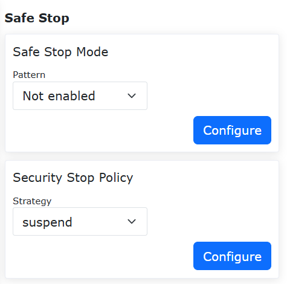
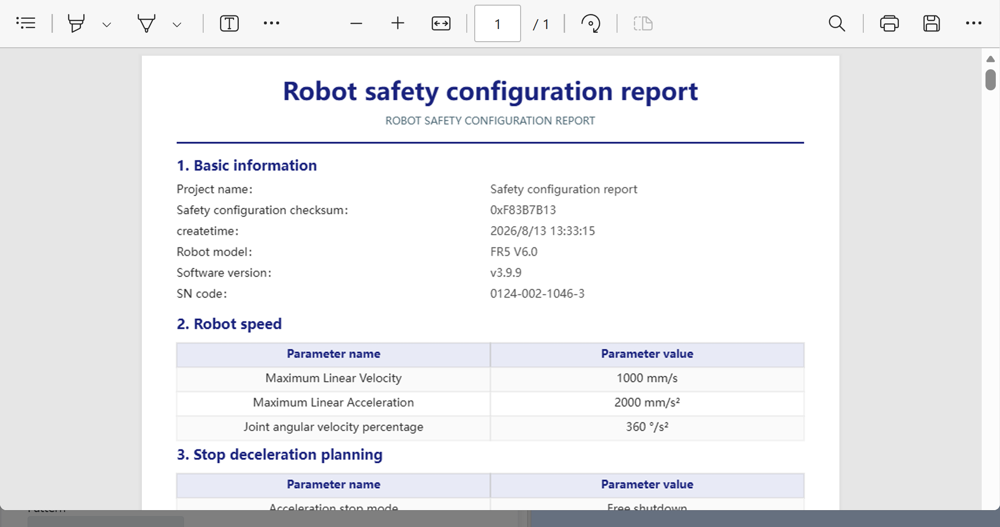
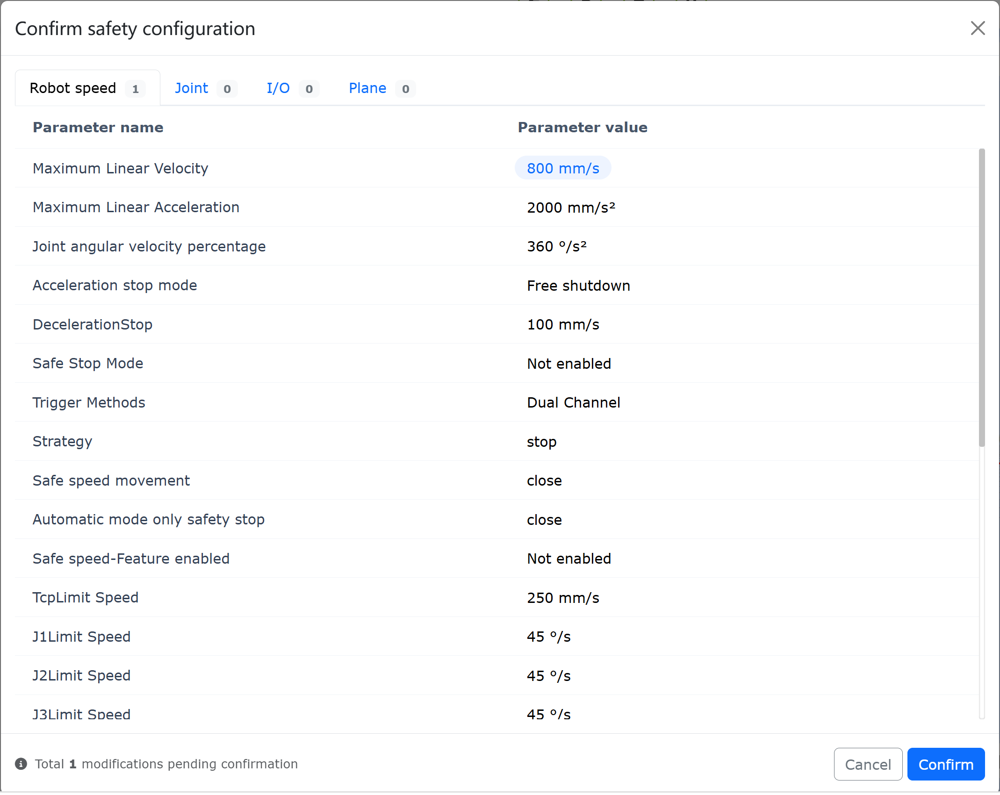
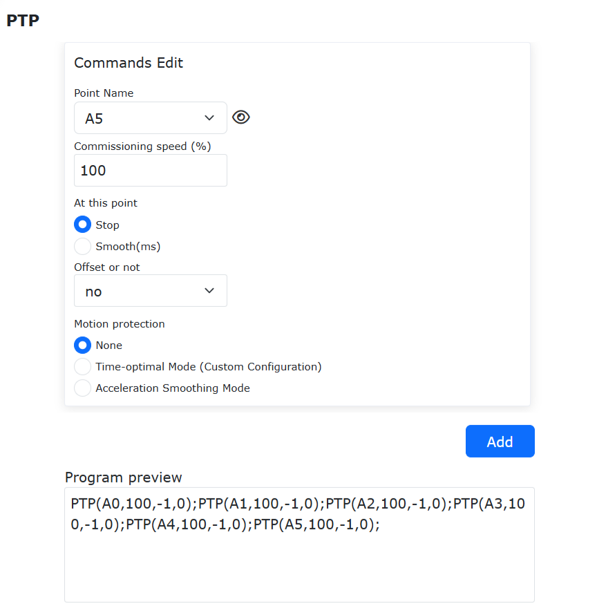
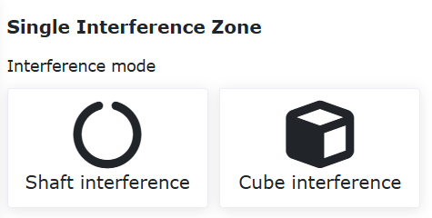
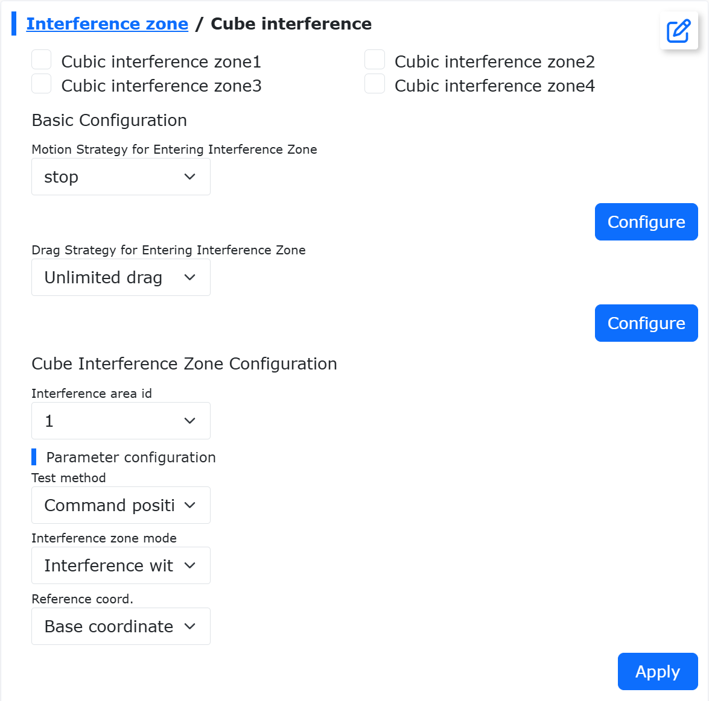
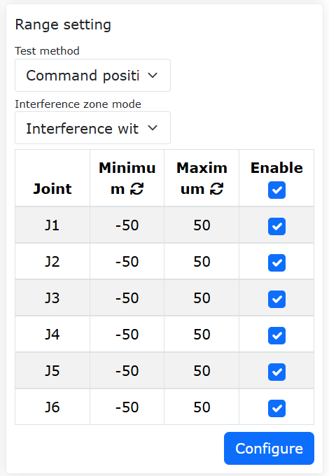

Bezpieczeństwo
===============

.. toctree:: 
   :maxdepth: 6

Tło
------------------------------------------------
Jako kluczowa jednostka wykonawcza w rozwoju inteligentnej produkcji przemysłowej, wydajność bezpieczeństwa robotów przemysłowych stała się kluczowym elementem w zarządzaniu całym cyklem życia urządzeń. Obecnie branża ogólnie wymaga, aby parametry związane z funkcjami bezpieczeństwa były stałe i niezmienne oraz aby ustanowiono kompletny i możliwy do śledzenia mechanizm weryfikacji, aby spełnić rygorystyczne wymagania audytu zgodności bezpieczeństwa.
Integratorzy systemów i użytkownicy końcowi w Europie postawili dalsze wyraźne wymagania dotyczące przejrzystości i weryfikowalności konfiguracji bezpieczeństwa podczas rzeczywistego odbioru projektów. W szczególności, po zakończeniu debugowania funkcji bezpieczeństwa, system powinien być w stanie automatycznie wygenerować raport konfiguracji bezpieczeństwa zawierający sumę kontrolną (Checksum) integralności, a ta suma kontrolna musi być wyświetlana w czasie rzeczywistym w interfejsie zarządzania Web urządzenia. Mechanizm ten ma na celu zapewnienie, że wszelkie modyfikacje parametrów bezpieczeństwa mogą być skutecznie identyfikowane i rejestrowane, dostarczając w ten sposób wiarygodnej podstawy do oceny stanu bezpieczeństwa urządzenia, odbioru na miejscu i późniejszej konserwacji.
W związku z tym, projekt architektury bezpieczeństwa tego urządzenia nie tylko spełnia odpowiednie międzynarodowe normy bezpieczeństwa, ale także posiada wbudowane funkcje eksportu konfiguracji bezpieczeństwa i wyświetlania sumy kontrolnej w czasie rzeczywistym, aby pomóc operatorom i menedżerom bezpieczeństwa w wygodny i niezawodny sposób zakończyć potwierdzanie konfiguracji i prace związane z certyfikacją zgodności.

Suma Kontrolna Konfiguracji Bezpieczeństwa
------------------------------------------------

Otwórz stronę internetową. Suma kontrolna bezpieczeństwa znajduje się w prawym górnym rogu strony, reprezentowana przez 8-cyfrową liczbę szesnastkową. Suma kontrolna bezpieczeństwa jest unikalna; gdy parametry konfiguracji bezpieczeństwa ulegną zmianie, suma kontrolna bezpieczeństwa zmienia się odpowiednio.

.. centered:: Rysunek 7.1-1 Wyświetlanie Sumy Kontrolnej Konfiguracji Bezpieczeństwa

Kliknij na sumę kontrolną bezpieczeństwa, aby wyświetlić zestaw parametrów konfiguracji bezpieczeństwa reprezentowanych przez bieżącą sumę kontrolną.

.. image:: safety/002.png
   :width: 6in
   :align: center

.. centered:: Rysunek 7.1-2 Parametry Konfiguracji Bezpieczeństwa

Parametry konfiguracji bezpieczeństwa obsługują eksport raportów PDF. Kliknij Pobierz, aby wyświetlić podgląd raportu PDF, a także obsługuje eksport. Kliknij przycisk Zapisz, aby pobrać raport PDF.

.. centered:: Rysunek 7.1-3 Podgląd PDF Raportu Konfiguracji Bezpieczeństwa

Zarządzanie Parametrami Konfiguracji Bezpieczeństwa
------------------------------------------------

Wszystkie parametry konfiguracji bezpieczeństwa związane z robotem są zarządzane jednolicie na stronie internetowej "Ustawienia Początkowe" -> "Bezpieczeństwo". Modyfikacja parametrów konfiguracji bezpieczeństwa wymaga najpierw wprowadzenia "Hasła Konfiguracji Bezpieczeństwa" do weryfikacji. Dopiero po pomyślnej weryfikacji można dokonać modyfikacji konfiguracji parametrów bezpieczeństwa.

.. image:: safety/004.png
   :width: 4in
   :align: center

.. centered:: Rysunek 7.2-1 Weryfikacja Hasła Konfiguracji Bezpieczeństwa

Po modyfikacji parametrów konfiguracji bezpieczeństwa kliknij "Zastosuj". Wymagane jest drugie potwierdzenie zmodyfikowanych parametrów konfiguracji bezpieczeństwa. Kliknij "Potwierdź", aby zastosować parametry. Po pomyślnym zastosowaniu parametrów suma kontrolna konfiguracji bezpieczeństwa zostanie odpowiednio zaktualizowana.

.. centered:: Rysunek 7.2-2 Drugie Potwierdzenie Parametrów Konfiguracji Bezpieczeństwa

Zarządzanie Hasłem Konfiguracji Bezpieczeństwa
------------------------------------------------

Hasło konfiguracji bezpieczeństwa można zmienić w "Ustawieniach Systemu" -> "Tryb Konserwacji" -> "Konfiguracja Parametrów Bezpieczeństwa". Domyślne hasło to 12345678. Zmiana hasła wymaga weryfikacji starego hasła. Nowe i stare hasło nie mogą być identyczne. Długość hasła wynosi minimum 1 znak i maksimum 8 znaków, i rozróżnia wielkość liter oraz symbole.

.. image:: safety/006.png
   :width: 4in
   :align: center

.. centered:: Rysunek 7.3-1 Zarządzanie Hasłem Konfiguracji Bezpieczeństwa

Jeśli zapomnisz starego hasła, skontaktuj się z odpowiednim personelem technicznym FAIRINO.

Parametry Konfiguracji Bezpieczeństwa
--------------------------------------------------------------------------------------------------

Parametry Bezpieczeństwa Robota
~~~~~~~~~~~~~~~~~~~~~~~~~~~~~~~~~~~~~~~~~~~~~~~~~~~~~~~~~~~~~~~~~~~~~~~

Prędkość Robota
++++++++++++++++++++++++++++++++++++++++++++++++++++++++++++++

Kliknij na pasku menu "Ustawienia Początkowe" -> "Bezpieczeństwo" i kliknij podmenu "Prędkość Robota", aby przejść do interfejsu konfiguracji.

Prędkość robota jest używana do ograniczania maksymalnej prędkości liniowej, przyspieszenia liniowego i przyspieszenia kątowego stawów robota.

.. image:: safety/007.png
   :width: 4in
   :align: center

.. centered:: Rysunek 7.4-1 Prędkość Robota
 
Planowanie Opóźnienia Zatrzymania
++++++++++++++++++++++++++++++++++++++++++++++++++++++++++++++

Kliknij na pasku menu "Ustawienia Początkowe" -> "Bezpieczeństwo" i kliknij podmenu "Planowanie Opóźnienia Zatrzymania", aby przejść do interfejsu konfiguracji.

- Swobodne Zatrzymanie: Po wejściu w stan zatrzymania, prędkość kątowa każdej osi zwalnia i zatrzymuje się zgodnie z ustawionym procentem opóźnienia zatrzymania pomnożonym przez maksymalne przyspieszenie stawu;
- Zsynchronizowane Zatrzymanie: Po wejściu w stan zatrzymania, prędkość pozy TCP zwalnia i zatrzymuje się zgodnie z ustawionym procentem opóźnienia zatrzymania pomnożonym przez maksymalne przyspieszenie pozy;

Opóźnienie zatrzymania jest procentem przyspieszenia.

.. image:: safety/008.png
   :width: 6in
   :align: center

.. centered:: Rysunek 7.4-2 Planowanie Opóźnienia Zatrzymania Robota

Bezpieczne Zatrzymanie
++++++++++++++++++++++++++++++++++++++++++++++++++++++++++++++

Kliknij na pasku menu "Ustawienia Początkowe" -> "Bezpieczeństwo" i kliknij "Bezpieczne Zatrzymanie", aby przejść do interfejsu konfiguracji w celu ustawienia trybu bezpiecznego zatrzymania i parametrów strategii bezpiecznego zatrzymania.

Gdy tryb wyzwalania bezpiecznego zatrzymania jest ustawiony na "Dwukanałowy", oba kanały muszą zostać wyczyszczone, a ostrzeżenie musi zostać ręcznie usunięte na interfejsie operacyjnym, zanim robot będzie mógł zostać zresetowany. Ponadto dodano opcję trybu zmniejszonego w konfiguracji strategii. Gdy użytkownik wybierze tę strategię, robot przejdzie do ruchu w trybie zmniejszonym.

**Krok 1**: Kliknij "Ustawienia Początkowe" -> "Bezpieczeństwo" -> "Bezpieczne Zatrzymanie". Tryb wyzwalania można wybrać jako "Domyślny" lub "Dwukanałowy". Różnica między nimi polega na tym, że w trybie "Domyślnym" błąd interfejsu jest automatycznie usuwany po wyzwoleniu i przywróceniu; w trybie "Dwukanałowym" błąd interfejsu musi być ręcznie usunięty po wyzwoleniu i przywróceniu. "Strategia Bezpiecznego Zatrzymania" może być wybrana jako "Zatrzymaj", "Wstrzymaj", "Tryb Zmniejszony Poziom 1" i "Tryb Zmniejszony Poziom 2". Szczegółowe opisy są następujące: gdy wybrano "Zatrzymaj", robot zatrzyma bieżący ruch; gdy wybrano "Wstrzymaj", robot wstrzyma bieżący ruch, a po przywróceniu i usunięciu błędu wznowi wstrzymanie; gdy wybrano "Tryb Zmniejszony Poziom 1", robot przejdzie do ruchu w trybie zmniejszonym poziomu 1; gdy wybrano "Tryb Zmniejszony Poziom 2", robot przejdzie do ruchu w trybie zmniejszonym poziomu 2.

.. image:: safety/009.png
   :width: 6in
   :align: center

.. centered:: Rysunek 7.4-3 Planowanie Opóźnienia Zatrzymania Robota

**Krok 2**: Gdy tryb wyzwalania jest ustawiony na "Domyślny", błąd interfejsu może być automatycznie usunięty po przywróceniu wyzwolenia. Gdy tryb wyzwalania jest ustawiony na "Dwukanałowy", operacja jest następująca: po przywróceniu wyzwolenia, ręcznie kliknij "Wyczyść" w prawym górnym rogu, aby zresetować robota.

Prędkość Bezpieczeństwa
++++++++++++++++++++++++++++++++++++++++++++++++++++++++++++++

Kliknij na pasku menu "Ustawienia Początkowe" -> "Bezpieczeństwo" i kliknij "Prędkość Bezpieczeństwa", aby przejść do interfejsu konfiguracji w celu ustawienia prędkości bezpieczeństwa. Zakres ręcznej prędkości TCP wynosi 1-1500mm/s.

Funkcja prędkości bezpieczeństwa robota jest używana w środowiskach współpracy człowiek-robot lub dynamicznych, aby aktywnie ograniczać prędkość operacyjną robota, kontrolując energię kinetyczną i siłę uderzenia w granicach bezpieczeństwa, zapobiegając w ten sposób obrażeniom personelu w przypadku przypadkowego kontaktu i skutecznie chroniąc sprzęt i przedmioty obrabiane przed uszkodzeniami spowodowanymi kolizją.

**Krok 1**: Kliknij "Ustawienia Początkowe" -> "Bezpieczeństwo" -> "Prędkość Bezpieczeństwa", aby ustawić parametry prędkości bezpieczeństwa, głównie trzy części: "Włączenie Funkcji", "Ograniczenie Prędkości" i "Tryb Po Przekroczeniu Prędkości".

Wśród nich, Włączenie Funkcji można wybrać jako "Wyłącz", "Włącz w Trybie Ręcznym" i "Włącz we Wszystkich Trybach";

W Ograniczeniu Prędkości ustaw limit prędkości. Gdy prędkość liniowa robota osiągnie ten limit, zostanie przetworzona zgodnie z parametrami ustawionymi w "Trybie Po Przekroczeniu Prędkości". "Tryb Po Przekroczeniu Prędkości" można wybrać jako "Zatrzymaj i Alarm", "Automatyczne Ograniczenie Prędkości" i "Wyłącz Po Zatrzymaniu i Alarmie". Automatyczne ograniczenie prędkości jest dostępne tylko w "Włącz w Trybie Ręcznym".

Po ustawieniu wymaganych parametrów nie są potrzebne żadne dodatkowe operacje. Ruch robota będzie przetwarzany zgodnie z ustawionymi parametrami. Ustawienia parametrów są pokazane na rysunku.

.. image:: safety/010.png
   :width: 4in
   :align: center

.. centered:: Rysunek 7.4-4 Ustawienia Parametrów Prędkości Bezpieczeństwa

Awaryjne Zatrzymanie
++++++++++++++++++++++++++++++++++++++++++++++++++++++++++++++

Kliknij na pasku menu "Ustawienia Początkowe" -> "Bezpieczeństwo" i kliknij "Awaryjne Zatrzymanie", aby przejść do interfejsu konfiguracji.

Typy awaryjnego zatrzymania 0, 1a, 1b, 2 mogą być ustawione, limit czasu zatrzymania może być ustawiony, a limit odległości zatrzymania może być ustawiony.

Poprzez kontroler wysyłający do płytki szafy sterowniczej, awaryjne zatrzymanie typu 0 bezpośrednio odcina zasilanie płytki szafy sterowniczej;

- Awaryjne zatrzymanie typu 1a: po zatrzymaniu z opóźnieniem, odcina zasilanie korpusu robota;
- Awaryjne zatrzymanie typu 1b: po zatrzymaniu z opóźnieniem, nie odcina zasilania korpusu robota, ale wyłącza korpus robota;
- Awaryjne zatrzymanie typu 2: po naciśnięciu awaryjnego zatrzymania, robot zwalnia do zatrzymania i pozostaje włączony. Po zwolnieniu awaryjnego zatrzymania, robot powinien być w stanie normalnie działać.

.. image:: safety/011.png
   :width: 4in
   :align: center

.. centered:: Rysunek 7.4-5 Ustawienia Awaryjnego Zatrzymania

Ochronne Zatrzymanie
++++++++++++++++++++++++++++++++++++++++++++++++++++++++++++++

Kliknij na pasku menu "Ustawienia Początkowe" -> "Bezpieczeństwo" i kliknij podmenu "Ochronne Zatrzymanie", aby przejść do interfejsu konfiguracji.

Typy ochronnego zatrzymania 0, 1, 2. Ochronne zatrzymanie typu 0 bezpośrednio odcina zasilanie płytki szafy sterowniczej. Ochronne zatrzymanie typu 1: płytka szafy sterowniczej najpierw powiadamia kontroler, aby kontrolował zatrzymanie robota, następnie kontroler przekazuje informację zwrotną do płytki szafy sterowniczej w celu odcięcia zasilania. Ochronne zatrzymanie typu 2: płytka szafy sterowniczej powiadamia kontroler, aby kontrolował zatrzymanie robota.

.. image:: safety/012.png
   :width: 4in
   :align: center

.. centered:: Rysunek 7.4-6 Konfiguracja Ochronnego Zatrzymania

Automatyczne Włączanie przy Starcie
++++++++++++++++++++++++++++++++++++++++++++++++++++++++++++++

Kliknij na pasku menu "Ustawienia Początkowe" -> "Bezpieczeństwo" i kliknij podmenu "Włączanie Robota", aby przejść do interfejsu konfiguracji. Możesz wybrać, czy robot włącza się automatycznie przy starcie, czy nie.

.. image:: safety/013.png
   :width: 4in
   :align: center

.. centered:: Rysunek 7.4-7 Automatyczne Włączanie przy Starcie

Ograniczenie Orientacji Narzędzia (Używane tylko w systemie LA)
++++++++++++++++++++++++++++++++++++++++++++++++++++++++++++++

Kliknij na pasku menu "Ustawienia Początkowe" -> "Bezpieczeństwo" i kliknij podmenu "Ograniczenie Orientacji Narzędzia", aby przejść do interfejsu konfiguracji.

Ograniczenie orientacji narzędzia jest funkcją ochronną działającą w przestrzeni kartezjańskiej końcówki narzędzia robota, mającą na celu ograniczenie zakresu ruchu postawy końcówki robota. Obejmuje ustawienie włączenia funkcji, ustawienie referencyjnego kierunku narzędzia i ustawienie maksymalnego kąta odchylenia. Maksymalny kąt odchylenia definiuje maksymalną wartość graniczną kąta między osią Z kartezjańskiego układu współrzędnych końcówki narzędzia a referencyjnym kierunkiem narzędzia, co zwykle można rozumieć jako przestrzeń stożkową.

.. image:: safety/014.png
   :width: 4in
   :align: center

.. centered:: Rysunek 7.4-8 Ograniczenie Orientacji Narzędzia

Ograniczenia Robota (Używane tylko w systemie LA)
++++++++++++++++++++++++++++++++++++++++++++++++++++++++++++++

Kliknij na pasku menu "Ustawienia Początkowe" -> "Bezpieczeństwo" i kliknij podmenu "Ograniczenia Robota", aby przejść do interfejsu konfiguracji.

Ograniczenia robota obejmują pęd i moc, gdzie ograniczenie pędu jest używane do ograniczania maksymalnego pędu robota, a ograniczenie mocy jest używane do ograniczania pracy mechanicznej wykonywanej przez robota.

.. image:: safety/015.png
   :width: 4in
   :align: center

.. centered:: Rysunek 7.4-9 Ograniczenia Robota

Stawy
~~~~~~~~~~~~~~~~~~~~~~~~~~~~~~~~~~~~~~~~~~~~~

Miękkie Ograniczenia Stawów
++++++++++++++++++++++++++++++++++++++++++++++++++++++++++++++

Na pasku menu "Ustawienia Początkowe" -> "Bezpieczeństwo" -> "Stawy" kliknij "Miękkie Ograniczenia Stawów", aby przejść do interfejsu miękkich ograniczeń.

W zakresie ruchu robota mogą znajdować się inne urządzenia. Kąty ograniczeń mogą przeprowadzić miękkie ograniczenie robota, zapobiegając przemieszczaniu się robota poza określone wartości współrzędnych i zapobiegając kolizjom. Wyzwolenie miękkiego ograniczenia powoduje automatyczne zatrzymanie robota, bez odległości zatrzymania.

Administratorzy mogą używać wartości domyślnych lub wprowadzać wartości kątowe. Wprowadzając wartości kątowe, dodatnie i ujemne kąty stawów robota mogą być ograniczane oddzielnie. Gdy wprowadzona wartość przekracza wartości kątów miękkich ograniczeń stawów robota wymienione w tabeli podstawowych parametrów robota w Sekcji 2.1-Podstawowe Parametry, kąt ograniczenia zostanie dostosowany do maksymalnej wartości możliwej do ustawienia. Gdy robot zgłosi błąd przekroczenia limitu polecenia stawu, należy przejść do trybu przeciągania i przeciągnąć staw robota z powrotem w zakres kąta ograniczenia.

Funkcja ochrony miękkich ograniczeń stawów jest aktywnym mechanizmem ochrony, który monitoruje stan ruchu stawów ramienia robota w czasie rzeczywistym i dynamicznie ogranicza operatora przed przekroczeniem ustawionego zakresu miękkich ograniczeń podczas nauczania przez przeciąganie. Ta funkcja sprawia, że miękkie ograniczenia mają znaczenie nawet w nauczaniu przez przeciąganie, zwiększając w ten sposób bezpieczeństwo współpracy człowieka z robotem.

- **Krok 1**: Zaloguj się do interfejsu internetowego i kliknij kolejno "Ustawienia Początkowe" -> "Bezpieczeństwo" -> "Stawy" -> "Miękkie Ograniczenia Stawów", aby przejść do modułu ustawiania miękkich ograniczeń robota.
- **Krok 2**: Na podstawie rzeczywistego zakresu pracy robota, racjonalnie ustaw miękkie ograniczenia dla każdego stawu. W tym momencie sprawdź, czy bieżąca pozycja kątowa każdego stawu robota mieści się w zakresie wstępnie ustawionych miękkich ograniczeń. Jeśli tak, kliknij "Zastosuj", aby wysłać wstępnie ustawione miękkie ograniczenia. Jeśli nie, przesuń każdy staw w zakres wstępnie ustawiony; w przeciwnym razie po kliknięciu "Zastosuj" pojawi się komunikat o przekroczeniu limitu, jak pokazano na poniższym rysunku. W tym momencie możesz przesunąć lub przeciągnąć przekroczony staw w kierunku zakresu miękkich ograniczeń, aby usunąć błąd.
- **Krok 3**: Po pomyślnym ustawieniu zakresu miękkich ograniczeń, wybierz "Włącz" dla "Ochrony Miękkich Ograniczeń Stawów", aby aktywować tę funkcję, jak pokazano na poniższym rysunku. W trybie przeciągania, ustawione miękkie ograniczenia będą obowiązywać, a podczas przeciągania w pobliżu miękkich ograniczeń wyczuwalny będzie opór.
- **Krok 4**: Aby wyłączyć funkcję ochrony miękkich ograniczeń stawów, kliknij "Ochrona Miękkich Ograniczeń Stawów", aby ją wyłączyć.

.. image:: safety/016.png
   :width: 4in
   :align: center

.. centered:: Rysunek 7.4-10 Miękkie Ograniczenia Stawów

Poziom Kolizji
++++++++++++++++++++++++++++++++++++++++++++++++++++++++++++++

Na pasku menu "Ustawienia Początkowe" -> "Bezpieczeństwo" -> "Stawy" kliknij "Poziom Kolizji", aby przejść do interfejsu poziomu kolizji.
Poziomy kolizji są podzielone na poziomy od 1 do 10. Poziomy 1 do 3 są bardziej czułe, a robot musi działać z zalecaną prędkością. Można również wybrać niestandardowe ustawienia procentowe, gdzie 100% odpowiada poziomowi 10. Jak pokazano na poniższym rysunku:

.. image:: safety/017.png
   :width: 6in
   :align: center

.. centered:: Rysunek 7.4-11 Diagram Poziomu Kolizji

Strategie kolizji to "Zatrzymaj przy Kolizji", "Wstrzymaj przy Kolizji" i "Kontynuuj Ruch". Aby uniknąć siły ściskającej między robotem a obiektami po kolizji, dodano strategie "Tryb Momentu Grawitacyjnego", "Tryb Reakcji Oscylacyjnej" i "Tryb Odbicia po Kolizji". Po wyzwoleniu wszystkie trzy strategie przełączą się z trybu automatycznego lub ręcznego na tryb przeciągania, a następnie z powrotem na tryb ręczny. Tryb momentu grawitacyjnego oddala się od punktu kolizji na podstawie wielkości i kierunku siły kolizji; tryb reakcji oscylacyjnej wraca do pozycji kolizji po oddaleniu się od niej; tryb odbicia po kolizji przyspiesza oddalanie się od punktu kolizji zgodnie z ustawionymi parametrami.

W sekcji "Strategia Kolizji" kliknij menu rozwijane, aby wybrać "Tryb Odbicia po Kolizji" i ustaw czas bezpieczeństwa na 1000ms, odległość bezpieczeństwa na 150mm, prędkość bezpieczeństwa na 150mm/s i współczynnik bezpieczeństwa dla każdego stawu na 5. Konkretny interfejs jest pokazany na poniższym rysunku.

.. centered:: Rysunek 7.4-12 Strategia Kolizji: Tryb Odbicia po Kolizji

Znaczenie każdego parametru:

- Czas Bezpieczeństwa: Określa czas trwania w trybie przeciągania po przełączeniu z trybu automatycznego na tryb przeciągania, zakres [1000-2000]ms;
- Odległość Bezpieczeństwa: Określa pozycję, w której robot oddala się od punktu kolizji po kolizji, zakres [150-200]mm;
- Prędkość Bezpieczeństwa: Określa maksymalną prędkość TCP, z jaką robot oddala się od punktu kolizji po kolizji. Przekroczenie tego limitu prędkości ograniczy siłę odbicia, zakres [50-250]mm/s;
- Współczynnik Bezpieczeństwa: Określa szybkość zanikania siły odbicia. Im mniejszy współczynnik, tym szybsze zanikanie i szybsza prędkość odbicia; im większy współczynnik, tym wolniejsze zanikanie. Zakres [1-10], bezwymiarowy.
- Przed wejściem robota w tryb przeciągania wymagane jest wykrycie momentu obrotowego. Ta funkcja ma na celu zapobieganie nieprawidłowym zjawiskom, takim jak unoszenie lub opadanie po wejściu robota w tryb przeciągania z powodu błędnych parametrów obciążenia lub błędnych ustawień trybu instalacji przez operatora. Jeśli moment obrotowy stawu zostanie wykryty poza dopuszczalnym zakresem, kontroler natychmiast zgłosi błąd i zabroni robotowi wejścia w tryb przeciągania.

Kroki włączenia funkcji wykrywania kolizji dla liniowej prowadnicy zębatkowej:

- Krok 1: Upewnij się, że zarówno prowadnica, jak i robot są zamontowane frontalnie. Przed włączeniem funkcji wykrywania kolizji dla liniowej prowadnicy zębatkowej sprawdź, czy metoda instalacji jest frontalna. W szczególności, najpierw upewnij się, że prowadnica i robot są zamontowane frontalnie. Następnie kliknij kolejno "Ustawienia Początkowe" -> "Podstawowe" -> "Instalacja", aby przejść do strony instalacji swobodnej. Jeśli zarówno "Obrot Podstawy" jak i "Nachylenie Podstawy" wynoszą 0, oprogramowanie jest ustawione na frontalne; w przeciwnym razie należy je zmienić na 0. Jeśli nie są 0, interfejs wyświetli błąd.
- Krok 2: Włącz funkcję wykrywania kolizji dla liniowej prowadnicy zębatkowej i ustaw parametry. Kliknij kolejno "Ustawienia Początkowe" -> "Bezpieczeństwo" -> "Stawy" -> "Poziom Kolizji", aby przejść do strony ustawień poziomu kolizji. Po kliknięciu suwaka funkcji "Wykrywanie Kolizji dla Liniowej Prowadnicy Zębatkowej" ustaw promień koła zębatego i masę suwaka. Promień koła zębatego można obliczyć na podstawie skoku i przełożenia. Masa suwaka nie obejmuje robota i jego obciążenia końcowego. Istnieje 11 opcji poziomu prowadnicy, gdzie Poziom 1 jest najłatwiejszy do wywołania kolizji, a Poziom 10 jest najtrudniejszy. Gdy kontroler jest włączony po raz pierwszy i przed wykonaniem programu adaptacji, poziom kolizji należy najpierw ustawić na "Wyłączony".

.. image:: safety/019.png
   :width: 4in
   :align: center

.. centered:: Rysunek 7.4-13 Funkcja Wykrywania Kolizji dla Liniowej Prowadnicy Zębatkowej

- Krok 3: Wykonaj program "Rail_Adaptation_Program.lua", aby dostosować się do bieżącej prowadnicy. Po każdym ponownym uruchomieniu kontrolera należy wykonać program "Rail_Adaptation_Program.lua" (aby zapobiec zmianom typu robota i innym czynnikom wpływającym na właściwości dynamiczne prowadnicy). Przed wykonaniem programu upewnij się, że poziom kolizji prowadnicy jest ustawiony na "Wyłączony". W trybie automatycznym uruchom program LUA z prędkością 100% prędkości interfejsu. Po wykonaniu jednego cyklu programu adaptacja jest zakończona i można zatrzymać wykonanie.

.. image:: safety/020.png
   :width: 4in
   :align: center

.. centered:: Rysunek 7.4-14 Wykonanie "Rail_Adaptation_Program.lua" w celu Dostosowania do Bieżącej Prowadnicy

- Krok 4: Racjonalnie ustaw poziom kolizji prowadnicy i wykonuj zadania. Użytkownicy mogą racjonalnie ustawić poziom kolizji prowadnicy na podstawie wydajności sterownika silnika i prędkości wykonywania zadania. Jeśli prowadnica i robot działają asynchronicznie, kolizja z robotem lub prowadnicą może wywołać "błąd kolizji 8 osi, możliwy do zresetowania". W tym przypadku prowadnica zatrzymuje się, jak pokazano na Rysunku 2-9. Jeśli prowadnica i robot działają synchronicznie, kolizja z robotem może wywołać alarm, powodując zatrzymanie prowadnicy, podczas gdy robot reaguje zgodnie z ustawioną strategią kolizji.

Tryb Zmniejszony
++++++++++++++++++++++++++++++++++++++++++++++++++++++++++++++

Kliknij na pasku menu "Ustawienia Początkowe" -> "Bezpieczeństwo" i kliknij podmenu "Tryb Zmniejszony", aby przejść do interfejsu konfiguracji. Wybierz "Tryb Poziom 1/Poziom 2", aby skonfigurować prędkość stawów i prędkość TCP końcówki.

.. image:: safety/021.png
   :width: 4in
   :align: center

.. centered:: Rysunek 7.4-15 Tryb Zmniejszony

I/O
~~~~~~~~~~~~~~~~~~~~~~~~~~~~~~~~~~~~~~~~~~~~~~~~~~~
Kliknij na pasku menu "Ustawienia Początkowe" -> "Bezpieczeństwo" i kliknij podmenu "I/O", aby przejść do interfejsu konfiguracji.

HMI zapewnia możliwość ustawienia stanu bezpieczeństwa dla 16 wejść cyfrowych i 16 wyjść cyfrowych, które mogą być ustawione jako ważne lub nieważne. Gdy kontroler stwierdzi, że znajduje się w stanie bezpieczeństwa, 16 wejść cyfrowych i 16 wyjść cyfrowych jest ustawianych na stan bezpieczeństwa.

.. image:: safety/022.png
   :width: 6in
   :align: center

.. centered:: Rysunek 7.4-16 Konfiguracja Stanu Bezpieczeństwa I/O

W systemie LA:

"I/O Bezpieczeństwo" zapewnia funkcje bezpieczeństwa DIO. Funkcja bezpieczeństwa to dwukanałowe DI lub DO. Gdy sygnał bezpieczeństwa DI lub flaga stanu bezpieczeństwa zostanie wyzwolona, DO jest wysyłane.

.. image:: safety/023.png
   :width: 6in
   :align: center

.. centered:: Rysunek 7.4-17 Konfiguracja Funkcji Bezpieczeństwa I/O

Sprzęt
~~~~~~~~~~~~~~~~~~~~~~~~~~~~~~~~~~~~~~~~~~~~~~~~~~~

Wykrywanie Mocy ServoJT (Używane tylko w systemie QX)
+++++++++++++++++++++++++++++++++++++++++++++++++++++++++++++++++++++++++++++++++++++++++++++++++++++++
Kliknij na pasku menu "Ustawienia Początkowe" -> "Bezpieczeństwo" i kliknij podmenu "Wykrywanie Mocy", aby przejść do interfejsu konfiguracji.

Gdy działa bezpośrednio na pętlę prądową robota (tylko servoJT), jest używane do ograniczania pracy wykonywanej przez robota. Gdy całka prędkości i momentu obrotowego robota zostanie wykryta jako przekraczająca limit, aktywowana jest ochrona mocy.

.. image:: safety/024.png
   :width: 4in
   :align: center

.. centered:: Rysunek 7.4-18 Wykrywanie Mocy ServoJT

Płaszczyzny
~~~~~~~~~~~~~~~~~~~~~~~~~~~~~~~~~~~~~~~~~~~

Ściana Bezpieczeństwa
+++++++++++++++++++++++++++++++++++++++++++++++++++++++++++++++++++++++++++++++++++++++++++++++++++++++

Kliknij na pasku menu "Ustawienia Początkowe" -> "Bezpieczeństwo" i kliknij podmenu "Konfiguracja Ściany Bezpieczeństwa", aby przejść do interfejsu konfiguracji.

- Konfiguracja Ściany Bezpieczeństwa: Kliknij przycisk Włącz, aby włączyć odpowiednią ścianę bezpieczeństwa. Gdy dla ściany bezpieczeństwa nie skonfigurowano zakresu bezpieczeństwa, wyświetlony zostanie błąd. Kliknij przycisk konfiguracji w prawym górnym rogu, wybierz ścianę bezpieczeństwa, którą chcesz ustawić, automatycznie wyświetlona zostanie odległość bezpieczeństwa (opcjonalna, domyślnie 0), a następnie kliknij przycisk "Ustaw", aby ustawić pomyślnie.
- Konfiguracja Punktów Referencyjnych Ściany Bezpieczeństwa: Po wybraniu ściany bezpieczeństwa można ustawić cztery punkty referencyjne. Pierwsze trzy punkty to punkty referencyjne płaszczyzny, używane do potwierdzenia płaszczyzny ustawionej ściany bezpieczeństwa. Czwarty punkt to punkt referencyjny zakresu bezpieczeństwa, używany do potwierdzenia zakresu bezpieczeństwa ustawionej ściany bezpieczeństwa.

Jeśli punkty referencyjne zostaną ustawione pomyślnie, zaświeci się zielone światło. W przeciwnym razie zaświeci się żółte światło, aż do momentu pomyślnego ustawienia punktów referencyjnych i zmiany koloru na zielony. Gdy wszystkie cztery punkty referencyjne zostaną pomyślnie ustawione, można obliczyć zakres bezpieczeństwa. Po pomyślnym obliczeniu stan punktu parametru zakresu bezpieczeństwa powraca do domyślnego.

.. centered:: Rysunek 7.4-19 Ustawienia Punktów Referencyjnych Zakresu Bezpieczeństwa

- Efekt Zastosowania: Włącz pomyślnie skonfigurowaną ścianę bezpieczeństwa. Przeciągnij robota. Jeśli TCP końcówki robota znajduje się w ustawionym zakresie bezpieczeństwa, system działa prawidłowo. Jeśli znajduje się poza ustawionym zakresem bezpieczeństwa, wyświetlony zostanie błąd.

.. image:: safety/026.png
   :width: 6in
   :align: center

.. centered:: Rysunek 7.4-20 Efekt po Pomyślnym Ustawieniu Zakresu Bezpieczeństwa

Strefa Interferencji
+++++++++++++++++++++++++++++++++++++++++++++++++++++++++++++++++++++++++++++++++++++++++++++++++++++++

Na pasku menu "Ustawienia Początkowe" -> "Bezpieczeństwo" -> "Strefa Interferencji" kliknij pozycję podmenu "Pojedyncza", aby przejść do interfejsu konfiguracji strefy interferencji.

Musimy skonfigurować metodę interferencji i operację po wejściu do strefy interferencji. Metody interferencji są podzielone na "Interferencję Osi" i "Interferencję Prostopadłościanu".

.. image:: safety/027.png
   :width: 4in
   :align: center

.. centered:: Rysunek 7.4-21 Metody Strefy Interferencji

Kliknij ikonę strefy interferencji, użyj przełącznika, aby kontrolować, czy jest włączona, i kliknij przycisk konfiguracji w prawym górnym rogu w celu konfiguracji parametrów.

.. image:: safety/028.png
   :width: 6in
   :align: center

.. centered:: Rysunek 7.4-22 Konfiguracja Strefy Interferencji

Najpierw skonfiguruj ruch strefy interferencji jako "Kontynuuj Ruch" lub "Zatrzymaj". Następnie ustaw konfigurację przeciągania po wejściu do strefy interferencji. Użytkownicy mogą ustawić strategię po wejściu do strefy interferencji w trybie przeciągania zgodnie ze swoimi potrzebami: brak ograniczeń przeciągania, powrót impedancji lub przełączenie na tryb ręczny.

Przy wyborze Interferencji Osi, należy skonfigurować parametry interferencji osi. Metoda wykrywania może być "Pozycja Polecenia" lub "Pozycja Sprzężenia Zwrotnego". Tryb strefy interferencji może być "Interferencja w Zakresie" lub "Interferencja poza Zakresem". Następnie ustaw zakres dla każdego stawu i czy zakres dla każdego stawu jest włączony. Możesz wprowadzać wartości lub użyć ikony "Odśwież" po "Min" i "Max", aby zapisać bieżącą pozycję robota, a na końcu kliknij Konfiguruj.

.. image:: safety/029.png
   :width: 6in
   :align: center

.. centered:: Rysunek 7.4-23 Konfiguracja Interferencji Osi

Przy wyborze Interferencji Prostopadłościanu, należy skonfigurować parametry interferencji prostopadłościanu. Metoda wykrywania może być "Pozycja Polecenia" lub "Pozycja Sprzężenia Zwrotnego". Tryb strefy interferencji może być "Interferencja w Zakresie" lub "Interferencja poza Zakresem". Układ współrzędnych odniesienia może być "Współrzędna Bazowa" lub "Współrzędna Przedmiotu", wybierany zgodnie z rzeczywistym użyciem. Następnie ustaw zakres. Istnieją dwie metody ustawiania zakresu. Pierwsza metoda to "Metoda Dwóch Punktów", która wykorzystuje dwa przeciwległe wierzchołki prostopadłościanu. Pozycje mogą być wprowadzane lub rejestrowane poprzez nauczanie robota. Na koniec kliknij Zastosuj.

.. centered:: Rysunek 7.4-24 Konfiguracja Interferencji Prostopadłościanu

Druga metoda to "Metoda Punkt Centralny + Długość Boku", gdzie punkt centralny prostopadłościanu i długość boku prostopadłościanu tworzą strefę interferencji. Pozycje mogą być wprowadzane lub rejestrowane poprzez nauczanie robota. Na koniec kliknij Zastosuj.

.. image:: safety/031.png
   :width: 6in
   :align: center

.. centered:: Rysunek 7.4-25 Konfiguracja Interferencji Prostopadłościanu

Załącznik: Instrukcja Blokowania Oczekiwania Chwytaka
~~~~~~~~~~~~~~~~~~~~~~~~~~~~~~~~~~~~~~~~~~~~~~~~~~~~~~~~~~~~~~~~~~~~~~~~~~~~~

Kliknij "Teach Program" -> "Instrukcje PerYferyjne" -> "Chwytak", aby dodać instrukcję oczekiwania na zakończenie ruchu chwytaka, która może blokować do czasu zakończenia akcji zaciskania w celu uzyskania rzeczywistej pozycji fizycznej chwytaka.

.. centered:: Rysunek 7.4-26 Instrukcja Oczekiwania na Zakończenie Ruchu Chwytaka
 
- Stan Chwytaka: Ruch nie zakończony, ruch zakończony bez wykrycia obiektu, ruch zakończony z wykryciem obiektu;
- Czas Limitu: Jednostka ms, -1 oznacza oczekiwanie wieczne.
- Strategia Limitu: Można wybrać zatrzymanie z błędem lub kontynuowanie wykonywania.
- Typ Chwytaka: Można wybrać chwytak równoległy lub chwytak obrotowy.

.. note:: 
   Uwaga: Instrukcja oczekiwania na zakończenie ruchu chwytaka jest odpowiednia tylko dla protokołów niestandardowych; zaadaptowane urządzenia obecnie jej nie obsługują.

   Można również bezpośrednio użyć GetGripperMotionDone() do oceny. Parametr wejściowy to typ chwytaka: 0 dla chwytaka równoległego, 1 dla chwytaka obrotowego. Wartości zwracane to błąd chwytaka i stan chwytaka. Błąd chwytaka 0 oznacza brak błędu, inne wartości oznaczają, że wystąpił błąd. Stan chwytaka 0 oznacza ruch nie zakończony, 1 oznacza ruch zakończony bez wykrycia obiektu, 2 oznacza ruch zakończony z wykryciem obiektu. Przykładowe programy dla oczekiwania na zakończenie ruchu chwytaka i uzyskiwania pozycji chwytaka są następujące:

.. image:: safety/033.png
   :width: 6in
   :align: center

.. centered:: Rysunek 7.4-27 Przykładowy Program Ruchu Chwytaka