Bezpieczeństwo
===============

.. toctree:: 
   :maxdepth: 6

Tło
------------------------------------------------
Jako kluczowa jednostka wykonawcza w rozwoju inteligentnej produkcji przemysłowej, wydajność bezpieczeństwa robotów przemysłowych stała się kluczowym elementem w zarządzaniu całym cyklem życia urządzeń. Obecnie branża ogólnie wymaga, aby parametry związane z funkcjami bezpieczeństwa były stałe i niezmienne oraz aby ustanowiono kompletny i możliwy do śledzenia mechanizm weryfikacji, aby spełnić rygorystyczne wymagania audytu zgodności bezpieczeństwa.
Integratorzy systemów i użytkownicy końcowi w Europie postawili dalsze wyraźne wymagania dotyczące przejrzystości i weryfikowalności konfiguracji bezpieczeństwa podczas rzeczywistego odbioru projektów. W szczególności, po zakończeniu debugowania funkcji bezpieczeństwa, system powinien być w stanie automatycznie wygenerować raport konfiguracji bezpieczeństwa zawierający sumę kontrolną (Checksum) integralności, a ta suma kontrolna musi być wyświetlana w czasie rzeczywistym w interfejsie zarządzania Web urządzenia. Mechanizm ten ma na celu zapewnienie, że wszelkie modyfikacje parametrów bezpieczeństwa mogą być skutecznie identyfikowane i rejestrowane, dostarczając w ten sposób wiarygodnej podstawy do oceny stanu bezpieczeństwa urządzenia, odbioru na miejscu i późniejszej konserwacji.
W związku z tym, projekt architektury bezpieczeństwa tego urządzenia nie tylko spełnia odpowiednie międzynarodowe normy bezpieczeństwa, ale także posiada wbudowane funkcje eksportu konfiguracji bezpieczeństwa i wyświetlania sumy kontrolnej w czasie rzeczywistym, aby pomóc operatorom i menedżerom bezpieczeństwa w wygodny i niezawodny sposób zakończyć potwierdzanie konfiguracji i prace związane z certyfikacją zgodności.

Suma Kontrolna Konfiguracji Bezpieczeństwa
------------------------------------------------

Otwórz stronę internetową. Suma kontrolna bezpieczeństwa znajduje się w prawym górnym rogu strony, reprezentowana przez 8-cyfrową liczbę szesnastkową. Suma kontrolna bezpieczeństwa jest unikalna; gdy parametry konfiguracji bezpieczeństwa ulegną zmianie, suma kontrolna bezpieczeństwa zmienia się odpowiednio.

.. image:: safety/001.png
   :width: 4in
   :align: center

.. centered:: Rysunek 7.1-1 Wyświetlanie Sumy Kontrolnej Konfiguracji Bezpieczeństwa

Kliknij na sumę kontrolną bezpieczeństwa, aby wyświetlić zestaw parametrów konfiguracji bezpieczeństwa reprezentowanych przez bieżącą sumę kontrolną.

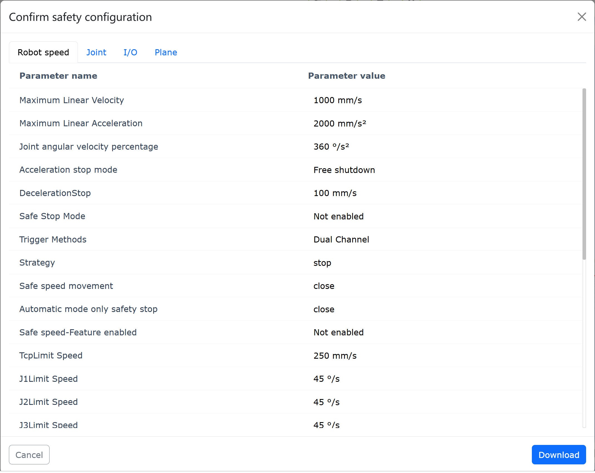

.. centered:: Rysunek 7.1-2 Parametry Konfiguracji Bezpieczeństwa

Parametry konfiguracji bezpieczeństwa obsługują eksport raportów PDF. Kliknij Pobierz, aby wyświetlić podgląd raportu PDF, a także obsługuje eksport. Kliknij przycisk Zapisz, aby pobrać raport PDF.

.. image:: safety/003.png
   :width: 6in
   :align: center

.. centered:: Rysunek 7.1-3 Podgląd PDF Raportu Konfiguracji Bezpieczeństwa

Zarządzanie Parametrami Konfiguracji Bezpieczeństwa
----------------------------------------------------------------

Wszystkie parametry konfiguracji bezpieczeństwa związane z robotem są zarządzane jednolicie na stronie internetowej "Ustawienia Początkowe" -> "Bezpieczeństwo". Modyfikacja parametrów konfiguracji bezpieczeństwa wymaga najpierw wprowadzenia "Hasła Konfiguracji Bezpieczeństwa" do weryfikacji. Dopiero po pomyślnej weryfikacji można dokonać modyfikacji konfiguracji parametrów bezpieczeństwa.

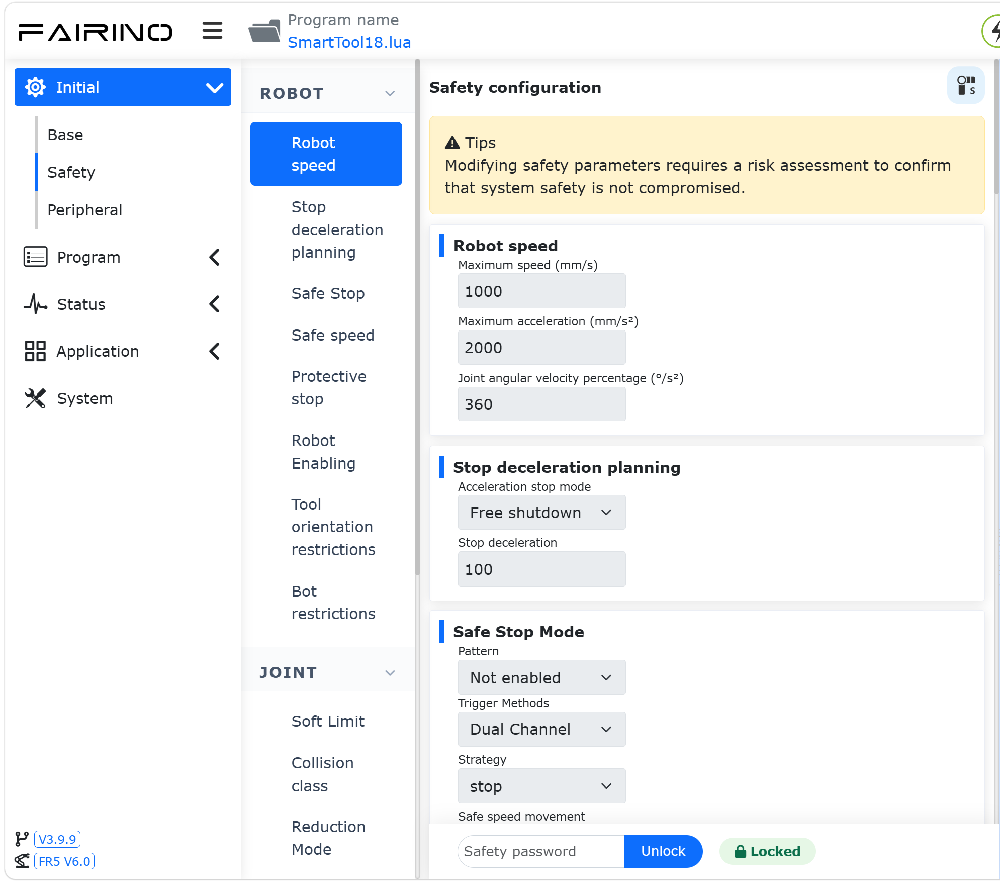

.. centered:: Rysunek 7.2-1 Weryfikacja Hasła Konfiguracji Bezpieczeństwa

Po modyfikacji parametrów konfiguracji bezpieczeństwa kliknij "Zastosuj". Wymagane jest drugie potwierdzenie zmodyfikowanych parametrów konfiguracji bezpieczeństwa. Kliknij "Potwierdź", aby zastosować parametry. Po pomyślnym zastosowaniu parametrów suma kontrolna konfiguracji bezpieczeństwa zostanie odpowiednio zaktualizowana.

.. image:: safety/005.png
   :width: 6in
   :align: center

.. centered:: Rysunek 7.2-2 Drugie Potwierdzenie Parametrów Konfiguracji Bezpieczeństwa

Funkcje Cyberbezpieczeństwa
------------------------------------------------------------------------

Zarządzanie Hasłem Bezpieczeństwa
~~~~~~~~~~~~~~~~~~~~~~~~~~~~~~~~~~~~~~~~~~~~~~~~~~~~~~~~~~~~~~~~~~~~~~~~~~~~~~

Modyfikacja Hasła Bezpieczeństwa
+++++++++++++++++++++++++++++++++++++++++++++++++++++++++++++++++++++

Domyślne hasło bezpieczeństwa to „12345678”. Hasło bezpieczeństwa można zmodyfikować na stronie „Bezpieczeństwo”. Kliknij przycisk „Zmień hasło bezpieczeństwa”, aby otworzyć okno modyfikacji hasła bezpieczeństwa. Wprowadź odpowiednio stare hasło i nowe hasło, aby zakończyć modyfikację hasła bezpieczeństwa.

.. centered:: Rysunek 7.3-1 Przycisk Modyfikacji Hasła Bezpieczeństwa

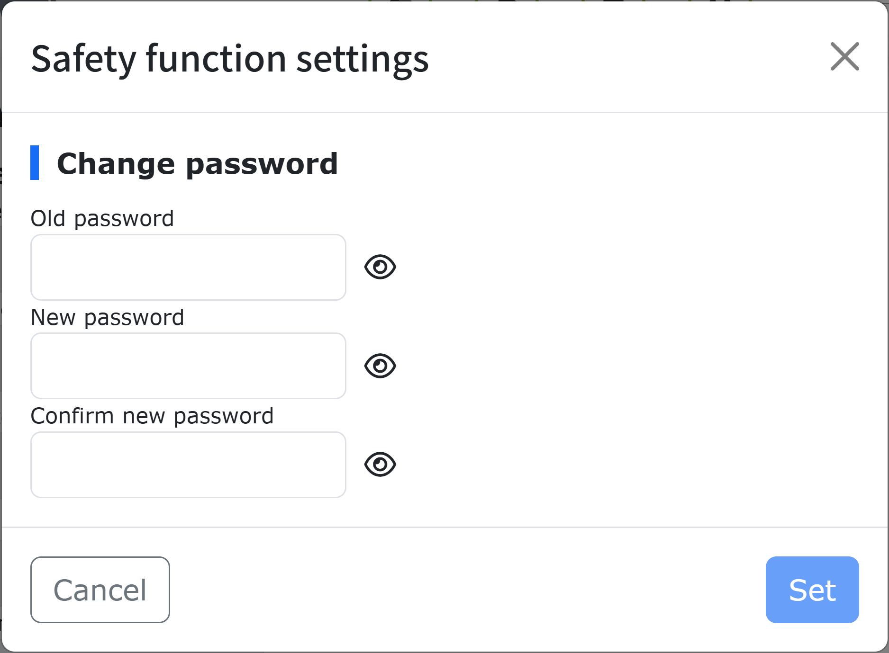

.. centered:: Rysunek 7.3-2 Okno Modyfikacji Hasła Bezpieczeństwa

Nowe i stare hasło bezpieczeństwa nie mogą być takie same. Hasło bezpieczeństwa musi mieć co najmniej 8 znaków i musi zawierać wielkie i małe litery, cyfry oraz znaki specjalne.

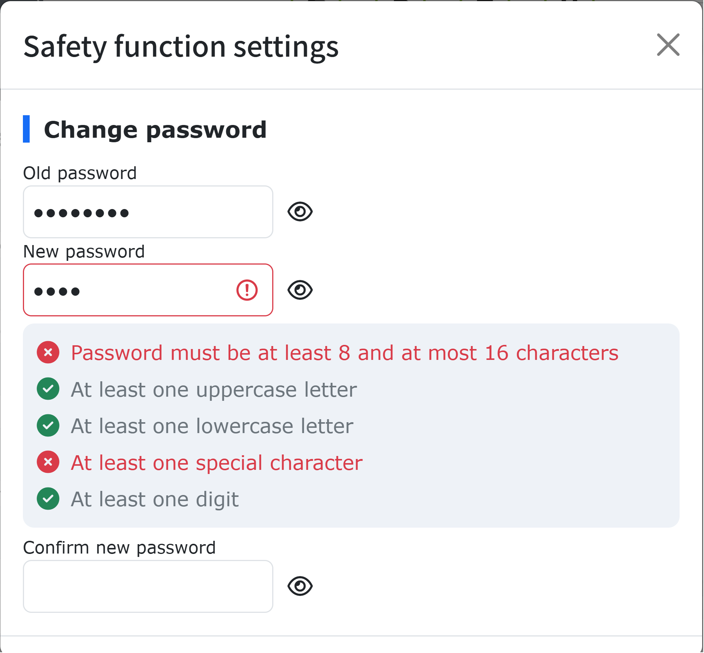

.. centered:: Rysunek 7.3-3 Weryfikacja Złożoności Hasła Bezpieczeństwa

Ochrona Hasła Bezpieczeństwa
+++++++++++++++++++++++++++++++++++++++++++++++++++++++++++++++++++++

Odblokowanie przez wprowadzenie hasła bezpieczeństwa robota posiada funkcję ochrony przed atakiem brute-force. Jeśli nieprawidłowe hasło zostanie wprowadzone 5 razy z rzędu, a odstęp między każdą próbą jest krótszy niż 1 minuta, wprowadzanie hasła bezpieczeństwa zostanie zablokowane na 1 minutę. W ciągu tej 1 minuty hasło nie może zostać wprowadzone w celu odblokowania, a w WebApp wyświetlany jest licznik odliczania.

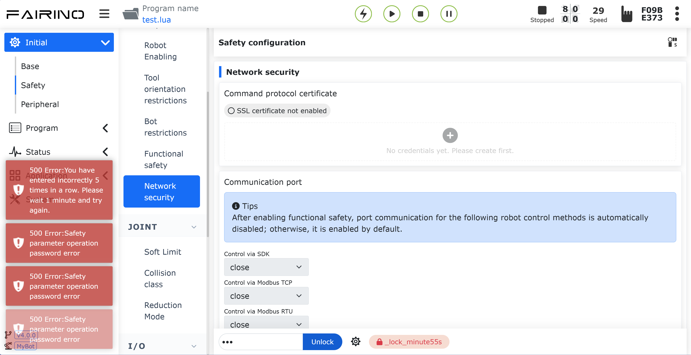

.. centered:: Rysunek 7.3-4 Blokada Anty-Brute-Force Hasła Bezpieczeństwa

Cyberbezpieczeństwo
~~~~~~~~~~~~~~~~~~~~~~~~~~~~~~~~~~~~~~~~~~~~~~~~~~~~~~~~~~~~~~~~~~~~~~~~

Funkcje cyberbezpieczeństwa robota obejmują szyfrowaną komunikację protokołów poleceń, domyślne wyłączanie niezaszyfrowanych portów komunikacyjnych, aktualizacje oprogramowania, weryfikację integralności podczas uruchamiania itp., które są używane do uwierzytelniania tożsamości, ochrony przed podsłuchem i manipulacją, odpierania ataków sieciowych oraz zapewnienia kontrolowalnej i bezpiecznej komunikacji.

Informacje o środowisku bezpieczeństwa sieciowego
+++++++++++++++++++++++++++++++++++++++++++++++++++++++++++++++++++++

Użytkownicy muszą spełnić następujące wymagania środowiskowe, aby zapewnić skuteczność funkcji bezpieczeństwa sieciowego robota współpracującego; jeśli środowisko nie spełnia wymagań, zdolność ochrony bezpieczeństwa robota współpracującego może zostać zmniejszona i mogą wystąpić zagrożenia bezpieczeństwa.

Fizyczne środowisko bezpieczeństwa
*******************************************************************************

① Kontroler robota oraz wszelkie przechodzące przez niego przełączniki muszą być zainstalowane w szafie sterowniczej wyposażonej w urządzenie blokujące. Nieupoważnionym osobom surowo zabrania się otwierania drzwi szafy. Bez upoważnienia zabrania się dotykania portów Ethernet kontrolera, portów bezpieczeństwa I/O oraz wszelkich innych interfejsów.

② Port Ethernet kontrolera robota służy wyłącznie do podłączenia komputera przemysłowego. Zabrania się podłączania komputera prywatnego bezpośrednio lub przez przełącznik do portu sieciowego kontrolera. Nieupoważnionym osobom zabrania się dotykania komputera przemysłowego połączonego sieciowo z robotem. Ustaw hasło logowania do komputera przemysłowego.

③ Teach pendant i skrzynka przycisków robota powinny być umieszczone w bezpiecznym obszarze roboczym. Nieupoważnionym osobom zabrania się wstępu do tego obszaru.

Konfiguracja bezpieczeństwa robota
*******************************************************************************

① Ustaw konta logowania WebApp z odpowiednimi uprawnieniami dla osób o różnych uprawnieniach, w szczególności uprawnienia do aktualizacji oprogramowania/oprogramowania układowego oraz konfiguracji parametrów bezpieczeństwa;

② Zmień hasło logowania administratora WebApp robota oraz hasło konfiguracji bezpieczeństwa; przechowuj hasła bezpiecznie, aby uniknąć ich wycieku;

③ Podczas komunikacji za pomocą protokołu poleceń włącz szyfrowanie i bezpiecznie przechowuj wszelkie certyfikaty szyfrowania komunikacji sieciowej pobrane z robota. Wyciek certyfikatów jest surowo zabroniony.

④ Niezaszyfrowane porty komunikacyjne pozostawiaj domyślnie wyłączone; nie włączaj ich, jeśli nie jest to konieczne.

Wymagania dotyczące wersji funkcji bezpieczeństwa sieciowego
+++++++++++++++++++++++++++++++++++++++++++++++++++++++++++++++++++++

Oprogramowanie robota w wersji V4.0.0 i nowszej obsługuje funkcje bezpieczeństwa sieciowego. Oprogramowanie robota o niższym numerze wersji nie obsługuje funkcji bezpieczeństwa sieciowego.

Szyfrowanie Komunikacji WebApp
+++++++++++++++++++++++++++++++++++++++++++++++++++++++++++++++++++++

Komunikacja WebApp robota wykorzystuje szyfrowaną komunikację HTTPS TLS 1.2. Podczas korzystania z WebApp należy zainstalować certyfikat (jeśli certyfikat nie zostanie zainstalowany, przeglądarka wyświetli niebezpieczne połączenie). Konkretne kroki są następujące:

① Wprowadź adres IP robota w przeglądarce, np. 192.168.58.2, i naciśnij Enter, aby uzyskać dostęp do strony WebApp robota. W tym momencie przeglądarka wyświetli ostrzeżenie o niebezpiecznym połączeniu.

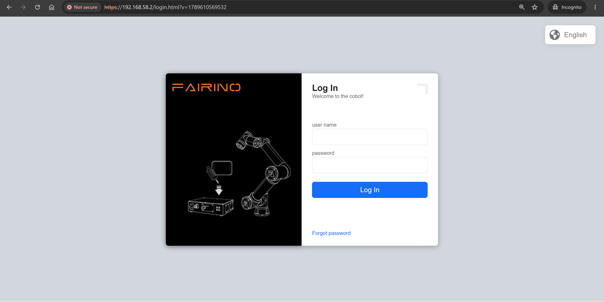

.. centered:: Rysunek 7.3-5 Wyświetlane Niebezpieczne Połączenie

② Kliknij „Nie zabezpieczono” po lewej stronie pola wprowadzania adresu IP, aby otworzyć okno szczegółów połączenia.

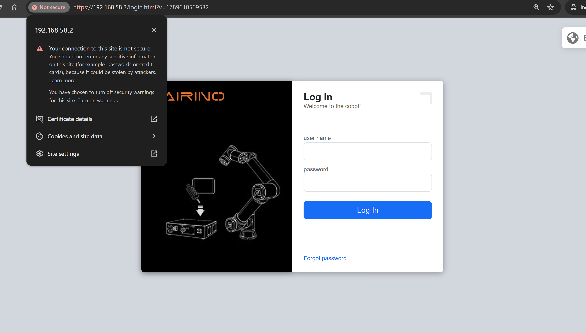

.. centered:: Rysunek 7.3-6 Okno Szczegółów Połączenia Otwarte

③ W oknie kliknij „Szczegóły certyfikatu”, aby otworzyć okno szczegółów certyfikatu. Wybierz „Szczegóły” na górnej karcie i kliknij przycisk „Eksportuj”, aby pobrać certyfikat. Nazwa pobranego certyfikatu to zazwyczaj adres IP robota. Należy zmienić nazwę pliku i dodać rozszerzenie „.crt”, na przykład zmienić „192.168.58.2” na „192.168.58.2.crt”.

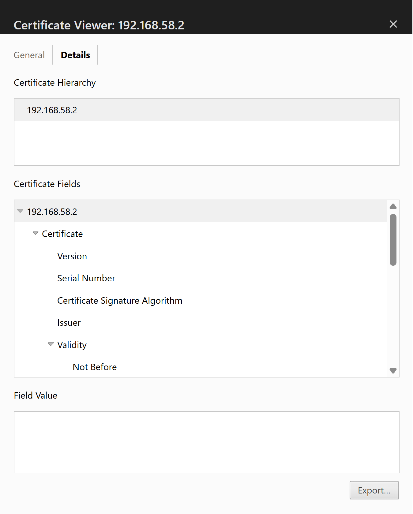

.. centered:: Rysunek 7.3-7 Okno Szczegółów Certyfikatu

.. image:: safety/053.png
   :width: 4in
   :align: center

.. centered:: Rysunek 7.3-8 Nazwa Pliku Certyfikatu

④ Kliknij dwukrotnie plik certyfikatu, aby otworzyć okno instalacji certyfikatu, i kliknij „Zainstaluj certyfikat”.

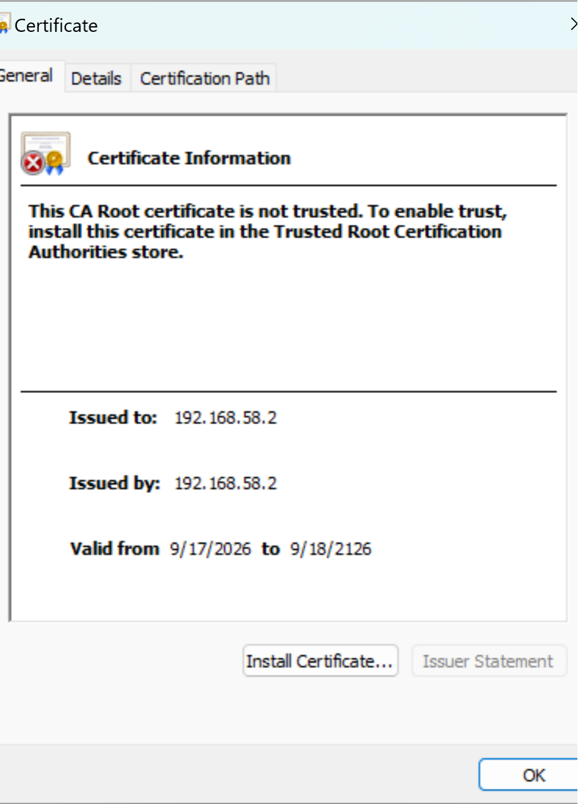

.. centered:: Rysunek 7.3-9 Okno Instalacji Certyfikatu

⑤ W wyświetlonym kreatorze instalacji certyfikatu wybierz lokalizację przechowywania jako Komputer lokalny i kliknij Dalej.

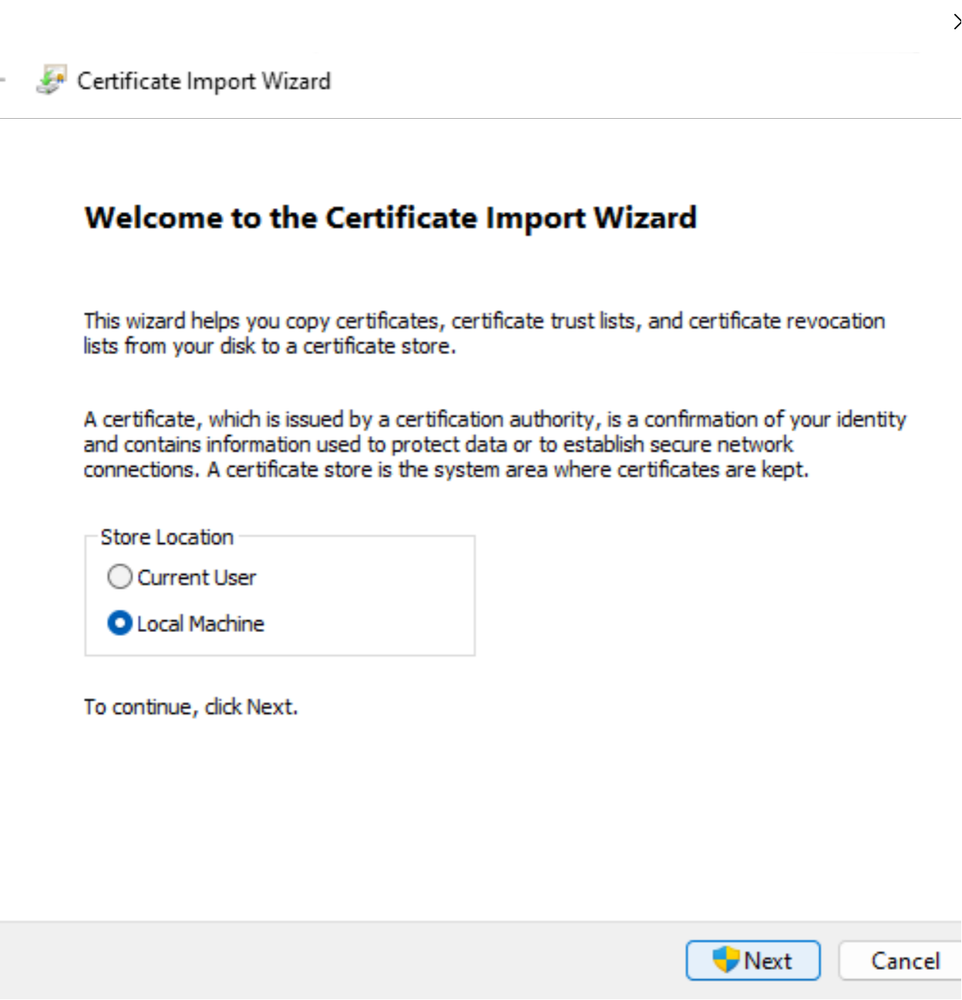

.. centered:: Rysunek 7.3-10 Wybierz Lokalizację Przechowywania jako Komputer Lokalny

⑥ W oknie kreatora certyfikatu wybierz „Umieść wszystkie certyfikaty w następującym magazynie”, kliknij przycisk „Przeglądaj” i wybierz „Zaufane główne urzędy certyfikacji”. Kliknij Dalej.

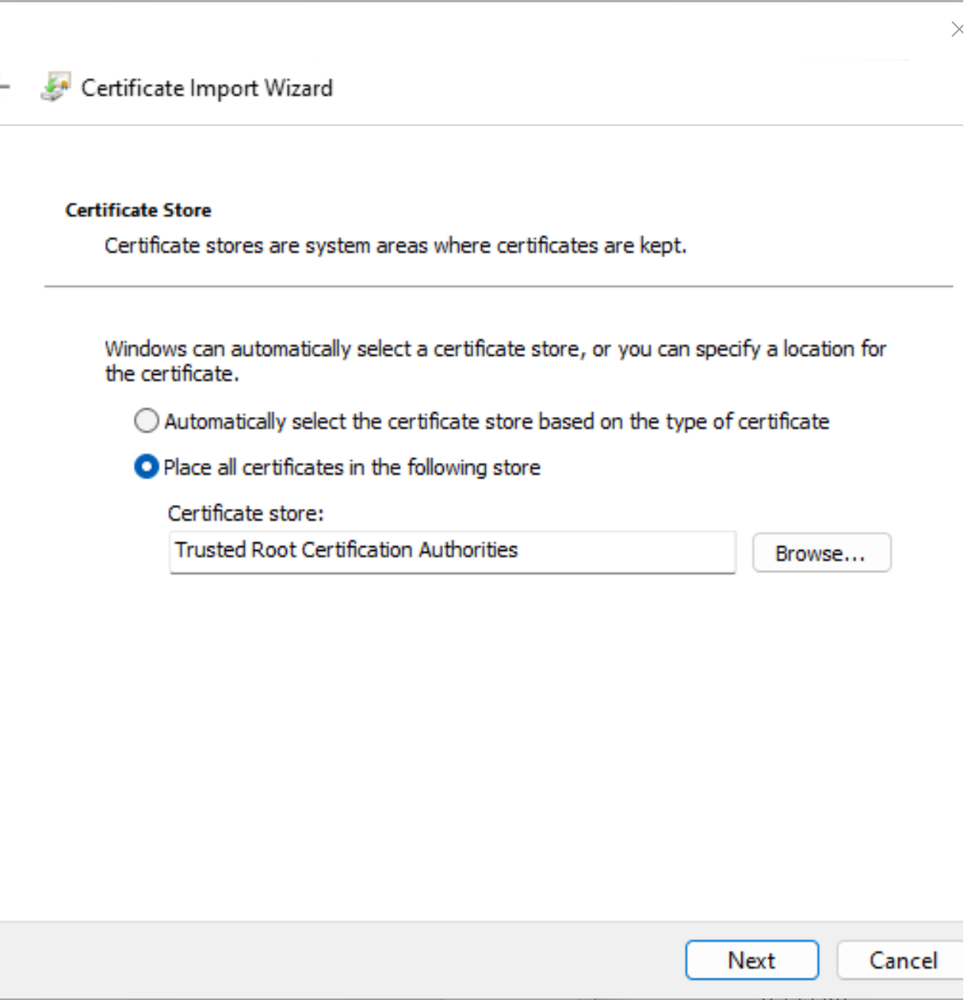

.. centered:: Rysunek 7.3-11 Wybierz Zaufany Główny Urząd Certyfikacji

⑦ Kliknij „Zakończ”.

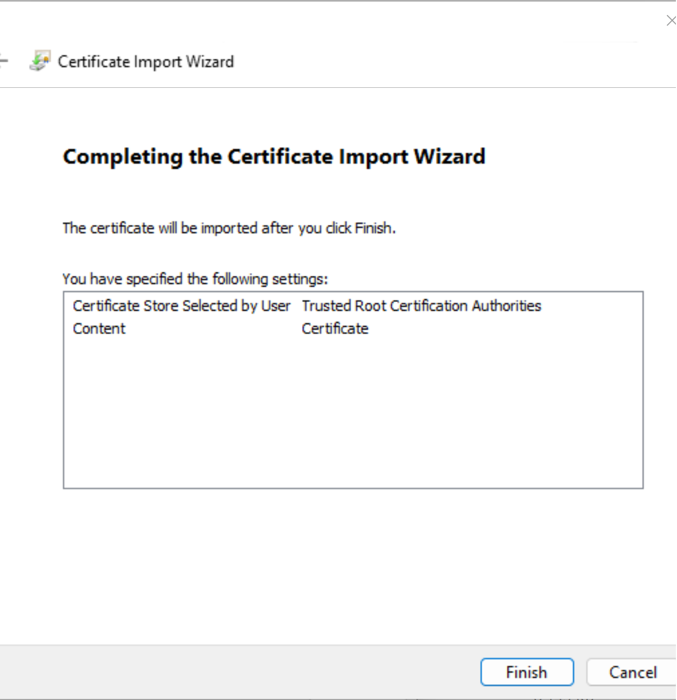

.. centered:: Rysunek 7.3-12 Instalacja Certyfikatu WebApp Zakończona

Uruchom ponownie przeglądarkę i zaloguj się do WebApp; zostanie wyświetlone normalne bezpieczne połączenie.

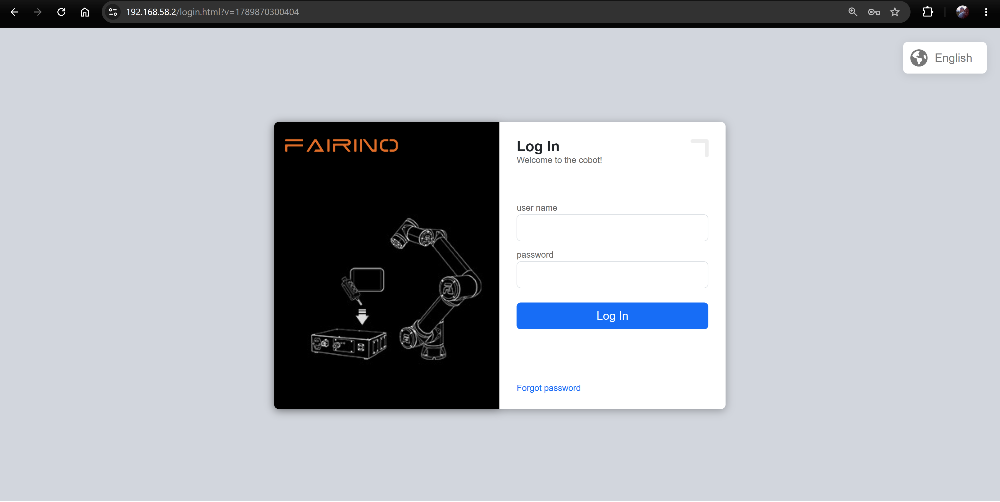

.. centered:: Rysunek 7.3-13 Bezpieczne Połączenie Wyświetlane po Zainstalowaniu Certyfikatu WebApp

Szyfrowanie Protokołu Poleceń
+++++++++++++++++++++++++++++++++++++++++++++++++++++++++++++++++++++

Protokoły poleceń 8080-TCP i 20007-UDP robota mogą być skonfigurowane do komunikacji za pomocą szyfrowania z wzajemnym uwierzytelnianiem TLS 1.2. Użytkownicy pobierają z robota certyfikat główny, certyfikat klienta i klucz prywatny klienta. Każdy robot ma własny oddzielny certyfikat główny; certyfikaty klienta i klucze prywatne pobrane z różnych robotów nie mogą być mieszane. Pojedynczy robot obsługuje tylko jeden zestaw certyfikatu klienta i klucza prywatnego.

W WebApp robota kliknij kolejno „Ustawienia Początkowe”, „Bezpieczeństwo”, „Cyberbezpieczeństwo”, wprowadź hasło bezpieczeństwa, aby odblokować, i znajdź „Certyfikat Protokołu Poleceń” w „Cyberbezpieczeństwo”.

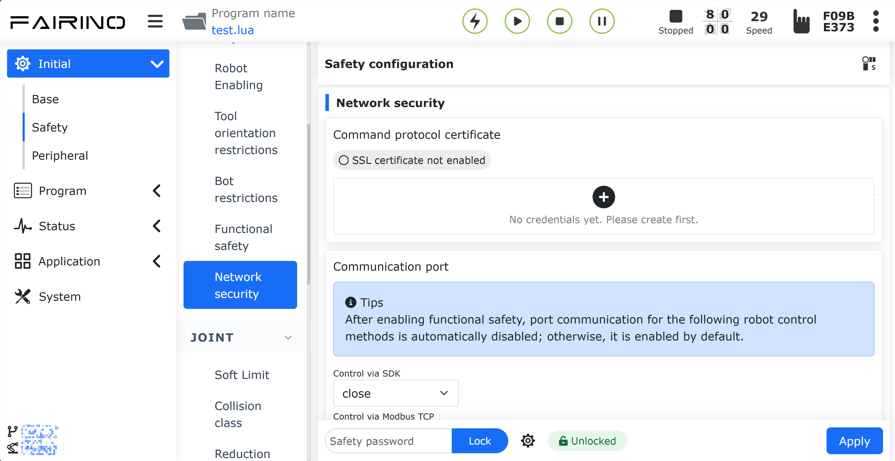

.. centered:: Rysunek 7.3-14 Strona Konfiguracji Certyfikatu Protokołu Poleceń

Kliknij przycisk „Brak certyfikatu, najpierw utwórz”, wprowadź liczbę dni ważności certyfikatu protokołu poleceń od bieżącego dnia. Kliknij przycisk „Utwórz”. Po pomyślnym utworzeniu certyfikatu wyświetlona zostanie nazwa certyfikatu klienta, numer seryjny i data ważności obliczona na podstawie liczby dni ważności.

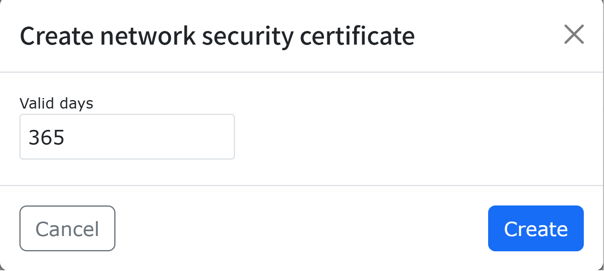

.. centered:: Rysunek 7.3-15 Konfiguracja Okresu Ważności Certyfikatu Protokołu Poleceń

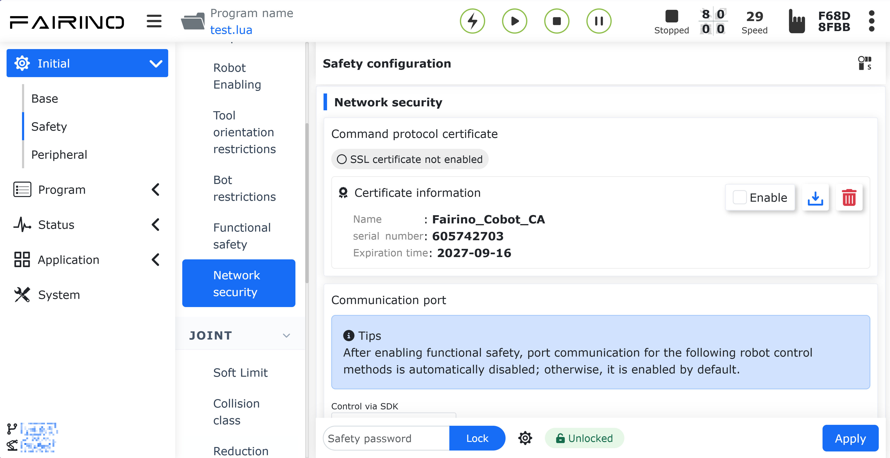

.. centered:: Rysunek 7.3-16 Informacje o Certyfikacie Protokołu Poleceń

Kliknij przycisk pobierania po prawej stronie, aby pobrać archiwum „client_certs.tar.gz”. Archiwum zawiera trzy pliki: „ca.crt”: certyfikat główny; „client.crt”: certyfikat klienta; „client.key”: klucz klienta.

Kliknij „Włącz” i kliknij przycisk „Zastosuj”. W wyświetlonym oknie potwierdzenia konfiguracji bezpieczeństwa robota potwierdź włączenie szyfrowania certyfikatu protokołu poleceń i kliknij ponownie przycisk „Potwierdź”, aby włączyć szyfrowanie protokołu poleceń.

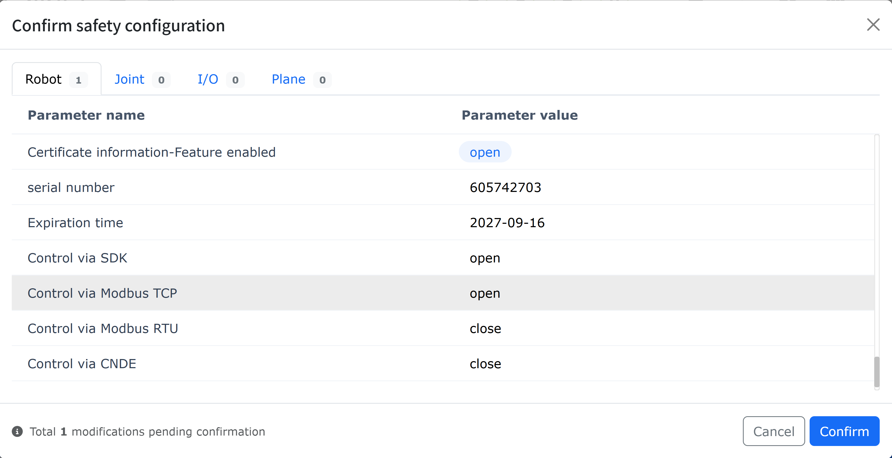

.. centered:: Rysunek 7.3-17 Potwierdzenie Włączenia Certyfikatu Protokołu Poleceń

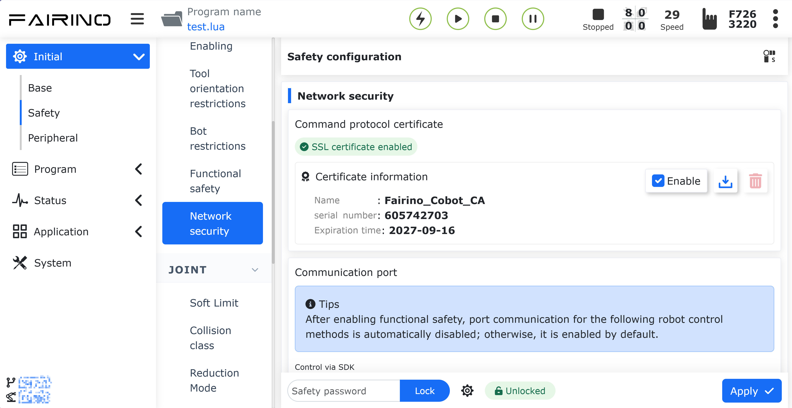

.. centered:: Rysunek 7.3-18 Szyfrowanie Certyfikatu Protokołu Poleceń Włączone

Kliknij przycisk „Usuń” po prawej stronie pola informacji o certyfikacie, aby wyłączyć certyfikat odpowiadający temu numerowi seryjnemu. Przed usunięciem certyfikatu szyfrowanie protokołu poleceń musi być najpierw ustawione jako wyłączone.

Konfiguracja Włączania Niezaszyfrowanych Funkcji Komunikacji Sieciowej
+++++++++++++++++++++++++++++++++++++++++++++++++++++++++++++++++++++++++++++++++++

Niektóre niezaszyfrowane funkcje komunikacji sieciowej robota można skonfigurować jako włączone lub wyłączone; domyślnie są wyłączone.

.. note:: Uwaga: funkcja wyłączania portów komunikacyjnych robota działa tylko wtedy, gdy włączona jest "Bezpieczeństwo funkcjonalne". W trybie innym niż "Bezpieczeństwo funkcjonalne" wszystkie funkcje komunikacji sieciowej robota są włączone!

W WebApp robota kliknij kolejno "Ustawienia początkowe", "Bezpieczeństwo" i "Bezpieczeństwo sieciowe", a następnie znajdź "Porty komunikacyjne". Funkcje poszczególnych portów opisano poniżej:

.. centered:: Rysunek 7.3-19 Konfiguracja Włączania Portów Komunikacyjnych

- **Sterowanie przez SDK**: Sterowanie robotem przez port komunikacyjny XMLRPC w SDK robota. Gdy nie jest włączone, robot nie może być sterowany przez XMLRPC.
- **Sterowanie przez ModbusTCP**: Gdy robot działa jako slave ModbusTCP, wyjście DO robota, start/stop programu, przełączanie ręczne/automatyczne, tryb zmniejszony itp. mogą być sterowane przez „Funkcjonalne Wejście Cyfrowe (Cewka)”. Po wyłączeniu „Sterowania przez ModbusTCP” powyższe funkcje sterowania przez „Funkcjonalne Wejście Cyfrowe (Cewka)” są wszystkie wyłączone.
- **Sterowanie przez ModbusRTU**: Gdy robot działa jako slave ModbusRTU, wyjście DO robota, start/stop programu, przełączanie ręczne/automatyczne, tryb zmniejszony itp. mogą być sterowane przez „Funkcjonalne Wejście Cyfrowe (Cewka)”. Po wyłączeniu „Sterowania przez ModbusRTU” powyższe funkcje sterowania przez „Funkcjonalne Wejście Cyfrowe (Cewka)” są wszystkie wyłączone.
- **Sterowanie przez CNDE**: Wejście CNDE robota może być skonfigurowane dla wyjścia DO robota, wyjścia AO, prędkości pracy i innych kontroli. Po wyłączeniu „Sterowania przez CNDE” klient CNDE nie może kontrolować powyższych funkcji.
- **Funkcja resetu IP skrzynki przycisków**: Skrzynka przycisków robota V2.0 ma przycisk resetu IP. Wyłączenie „Funkcji resetu IP skrzynki przycisków” uniemożliwi reset IP robota przez skrzynkę przycisków.

Wprowadź hasło bezpieczeństwa na stronie konfiguracji bezpieczeństwa i odblokuj je, ustaw porty komunikacyjne do włączenia na „Włączone”, kliknij „Zastosuj”, potwierdź włączone funkcje w wyświetlonym oknie potwierdzenia konfiguracji bezpieczeństwa i kliknij przycisk „Potwierdź”.

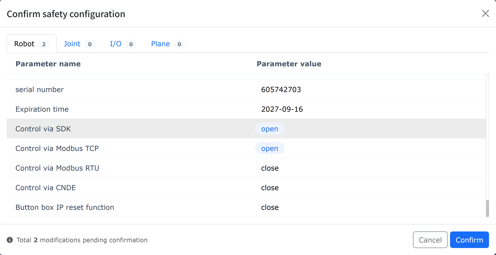

.. centered:: Rysunek 7.3-20 Potwierdzenie Włączenia Portów Komunikacyjnych

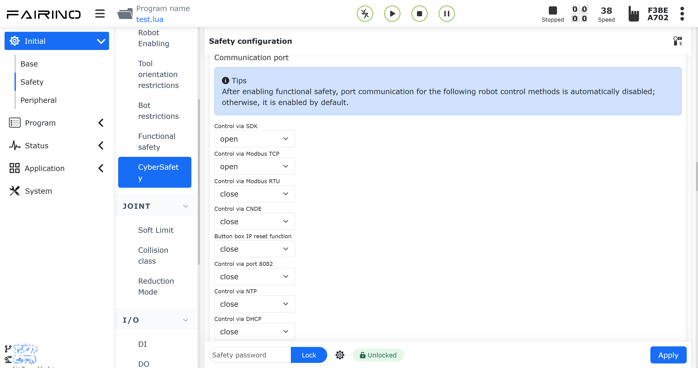

.. centered:: Rysunek 7.3-21 Porty Komunikacyjne Włączone

Weryfikacja Integralności Oprogramowania Robota
+++++++++++++++++++++++++++++++++++++++++++++++++++++++++++++++++++++

Aktualizacja oprogramowania robota i uruchamianie oprogramowania wykonają weryfikację integralności pakietu oprogramowania, aby zapobiec manipulacji pakietem oprogramowania robota.

Weryfikacja integralności aktualizacji oprogramowania robota: podczas aktualizacji oprogramowania robota weryfikowana jest integralność pakietu oprogramowania do aktualizacji. Jeśli pakiet oprogramowania jest niekompletny, podczas aktualizacji zostanie zgłoszony komunikat o błędzie i aktualizacja zostanie zatrzymana.

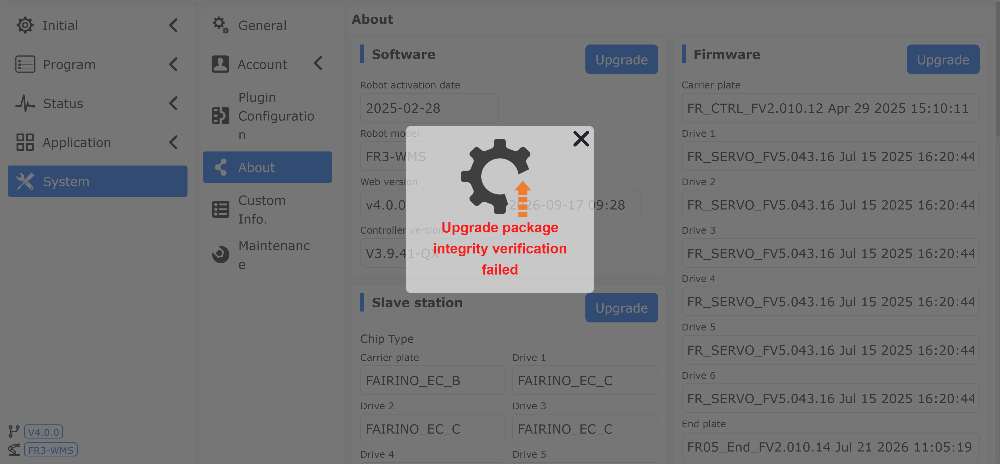

.. centered:: Rysunek 7.3-22 Błąd Niepowodzenia Weryfikacji Integralności Aktualizacji Oprogramowania

Weryfikacja integralności uruchamiania oprogramowania robota: podczas uruchamiania oprogramowania robota weryfikowana jest integralność pakietu oprogramowania w bieżącym systemie. Jeśli pakiet oprogramowania jest kompletny, oprogramowanie robota uruchomi się normalnie; w przeciwnym razie oprogramowanie robota nie uruchomi się, a w WebApp zostanie wyświetlony komunikat o błędzie.

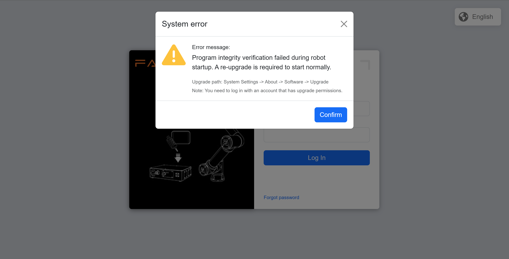

.. centered:: Rysunek 7.3-23 Błąd Niepowodzenia Weryfikacji Integralności Podczas Uruchamiania Oprogramowania

Deklaracja Ryzyk Resztkowych Cyberbezpieczeństwa
+++++++++++++++++++++++++++++++++++++++++++++++++++++++++++++++++++++

.. centered:: Tabela 2-1 Ryzyka Resztkowe Cyberbezpieczeństwa i Środki Kompensacyjne Użytkownika

.. list-table::
   :widths: 10 20 25 45
   :header-rows: 0
   :align: center

   * - **Nr**
     - **Ryzyko Resztkowe**
     - **Podjęte Środki Łagodzące**
     - **Środki Kompensacyjne Użytkownika**

   * - 1
     - Protokół komunikacyjny SDK - XMLRPC robota jest przesyłany jako tekst jawny
     - | ① Funkcja sterowania robotem przez SDK jest domyślnie wyłączona;
       | ② SDK integralnie zawiera protokoły poleceń 8080-TCP i 20007-UDP, a protokoły poleceń mają szyfrowanie TLS 1.2; jeśli uzgadnianie szyfrowania protokołu poleceń nie powiedzie się, SDK nie może正常 połączyć się z robotem.
     - | ① Komunikacja SDK między komputerem nadrzędnym a robotem powinna być wdrażana wyłącznie w zaufanym, izolowanym środowisku sieciowym; podłączanie do niezaufanych sieci jest niedozwolone; łącza sieciowe i porty sieciowe powinny mieć ochronę fizyczną, aby zapobiec nieautoryzowanemu dostępowi;
       | ② SDK zawiera komunikację protokołu poleceń 20007-UDP i udostępnia interfejs SendUDPFrame() do wysyłania niestandardowych ramek poleceń. Jednocześnie komunikacja protokołu poleceń 20007-UDP ma szyfrowanie DTLS. Wrażliwe informacje muszą być wysyłane do robota przez ten interfejs;
       | ③ Gdy nie jest to konieczne, wyłącz funkcję sterowania robotem przez SDK w modułach „Bezpieczeństwo” i „Cyberbezpieczeństwo” WebApp;

   * - 2
     - Komunikacja CNDE wymiany danych konfigurowalna 20005 - TCP / 20006 - UDP robota jest przesyłana jako tekst jawny
     - | ① Funkcja sterowania robotem przez CNDE jest domyślnie wyłączona;
     - | ① Komunikacja CNDE między komputerem nadrzędnym a robotem powinna być wdrażana wyłącznie w zaufanym, izolowanym środowisku sieciowym; podłączanie do niezaufanych sieci jest niedozwolone; łącza sieciowe i porty sieciowe powinny mieć ochronę fizyczną, aby zapobiec nieautoryzowanemu dostępowi;
       | ② Gdy nie jest to konieczne, wyłącz funkcję sterowania robotem przez CNDE w modułach „Bezpieczeństwo” i „Cyberbezpieczeństwo” WebApp;

   * - 3
     - Komunikacja ModbusTCP robota jest przesyłana jako tekst jawny
     - | ① Funkcja sterowania robotem przez ModbusTCP jest domyślnie wyłączona;
     - | ① Komunikacja ModbusTCP między komputerem nadrzędnym a robotem powinna być wdrażana wyłącznie w zaufanym, izolowanym środowisku sieciowym; podłączanie do niezaufanych sieci jest niedozwolone; łącza sieciowe i porty sieciowe powinny mieć ochronę fizyczną, aby zapobiec nieautoryzowanemu dostępowi;
       | ② Gdy nie jest to konieczne, wyłącz funkcję sterowania robotem przez ModbusTCP w modułach „Bezpieczeństwo” i „Cyberbezpieczeństwo” WebApp;

   * - 4
     - Komunikacja ModbusRTU robota jest przesyłana jako tekst jawny
     - | ① Funkcja sterowania robotem przez ModbusRTU jest domyślnie wyłączona;
     - | ① Komunikacja ModbusRTU między komputerem nadrzędnym a robotem powinna być wdrażana wyłącznie w zaufanym, izolowanym środowisku sieciowym; podłączanie do niezaufanych sieci jest niedozwolone; łącza sieciowe i porty sieciowe powinny mieć ochronę fizyczną, aby zapobiec nieautoryzowanemu dostępowi;
       | ② Gdy nie jest to konieczne, wyłącz funkcję sterowania robotem przez ModbusRTU w modułach „Bezpieczeństwo” i „Cyberbezpieczeństwo” WebApp;

   * - 5
     - Atakujący mogą użyć domyślnego konta i hasła logowania administratora WebApp do modyfikacji parametrów konfiguracji bezpieczeństwa robota
     - Nie
     - | ① Użytkownicy muszą zmienić domyślne hasło logowania administratora WebApp robota i odpowiednio je przechowywać;
       | ② Użytkownicy muszą ustawić odpowiednie konta i hasła logowania WebApp dla personelu o różnych uprawnieniach konfiguracji bezpieczeństwa i odpowiednio je przechowywać;

   * - 6
     - Atakujący mogą użyć domyślnego konta i hasła logowania WebApp do modyfikacji wersji oprogramowania/firmware'u robota
     - Nie
     - | ① Użytkownicy muszą zmienić domyślne hasło logowania administratora WebApp robota i odpowiednio je przechowywać;
       | ② Użytkownicy muszą ustawić odpowiednie konta i hasła logowania WebApp dla personelu o różnych uprawnieniach aktualizacji oprogramowania/firmware'u i odpowiednio je przechowywać;

   * - 7
     - Atakujący mogą użyć domyślnego hasła bezpieczeństwa do modyfikacji parametrów konfiguracji bezpieczeństwa
     - Nie
     - | ① Użytkownicy muszą zmienić hasło bezpieczeństwa robota; używanie domyślnego hasła bezpieczeństwa jest zabronione;

   * - 8
     - Atakujący mogą fizycznie uszkodzić porty Ethernet LAN1 / LAN2 robota, powodując awarię komunikacji Ethernet robota
     - Brak
     - | ① Użytkownicy muszą zainstalować szafę sterowniczą robota w szafie sterowniczej z urządzeniem blokującym i zabronić nieautoryzowanemu personelowi dotykania szafy sterowniczej robota;

   * - 9
     - Atakujący mogą fizycznie uszkodzić port komunikacyjny RS-485 robota, powodując awarię sterowania osiami rozszerzonymi i komunikacji ModbusRTU robota
     - Brak
     - | ① Użytkownicy muszą zainstalować szafę sterowniczą robota w szafie sterowniczej z urządzeniem blokującym i zabronić nieautoryzowanemu personelowi dotykania szafy sterowniczej robota;

   * - 10
     - Atakujący mogą fizycznie uszkodzić przycisk zatrzymania awaryjnego na skrzynce przycisków robota, powodując awarię przycisku zatrzymania awaryjnego robota
     - Brak
     - | ① Użytkownicy muszą umieścić skrzynkę przycisków robota w bezpiecznym obszarze roboczym i zabronić nieautoryzowanemu personelowi wstępu do tego obszaru;

   * - 11
     - Atakujący mogą fizycznie uszkodzić przycisk zatrzymania awaryjnego na panelu operatorskim robota, powodując awarię przycisku zatrzymania awaryjnego robota
     - Brak
     - | ① Użytkownicy muszą umieścić panel operatorski robota w bezpiecznym obszarze roboczym i zabronić nieautoryzowanemu personelowi wstępu do tego obszaru;

Parametry Konfiguracji Bezpieczeństwa
--------------------------------------------------------------------------------------------------

Parametry Bezpieczeństwa Robota
~~~~~~~~~~~~~~~~~~~~~~~~~~~~~~~~~~~~~~~~~~~~~~~~~~~~~~~~~~~~~~~~~~~~~~~

Prędkość Robota
++++++++++++++++++++++++++++++++++++++++++++++++++++++++++++++

Kliknij na pasku menu "Ustawienia Początkowe" -> "Bezpieczeństwo" i kliknij podmenu "Prędkość Robota", aby przejść do interfejsu konfiguracji.

Prędkość robota jest używana do ograniczania maksymalnej prędkości liniowej, przyspieszenia liniowego i przyspieszenia kątowego stawów robota.

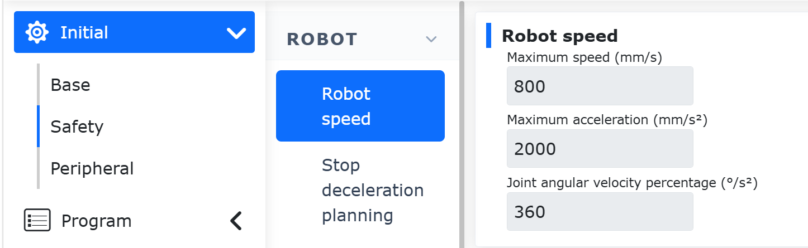

.. centered:: Rysunek 7.4-1 Prędkość Robota
 
Planowanie Opóźnienia Zatrzymania
++++++++++++++++++++++++++++++++++++++++++++++++++++++++++++++

Kliknij na pasku menu "Ustawienia Początkowe" -> "Bezpieczeństwo" i kliknij podmenu "Planowanie Opóźnienia Zatrzymania", aby przejść do interfejsu konfiguracji.

- Swobodne Zatrzymanie: Po wejściu w stan zatrzymania, prędkość kątowa każdej osi zwalnia i zatrzymuje się zgodnie z ustawionym procentem opóźnienia zatrzymania pomnożonym przez maksymalne przyspieszenie stawu;
- Zsynchronizowane Zatrzymanie: Po wejściu w stan zatrzymania, prędkość pozy TCP zwalnia i zatrzymuje się zgodnie z ustawionym procentem opóźnienia zatrzymania pomnożonym przez maksymalne przyspieszenie pozy;

Opóźnienie zatrzymania jest procentem przyspieszenia.

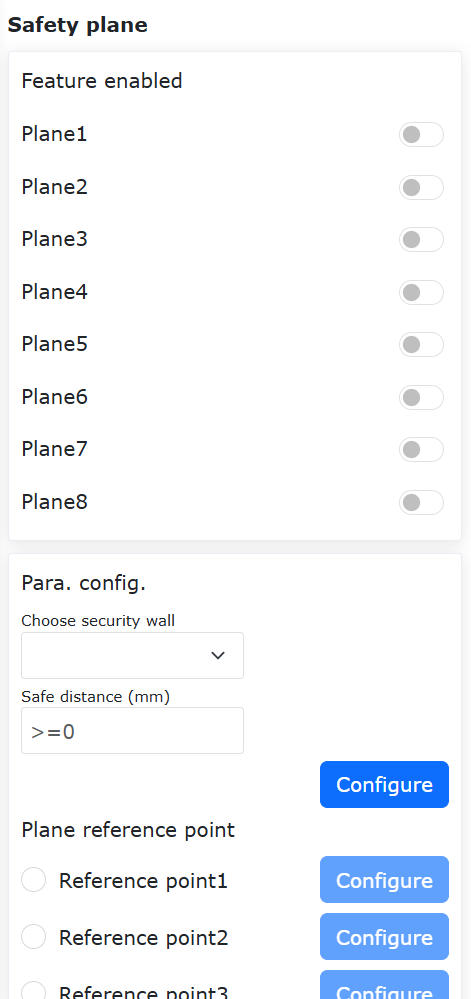

.. centered:: Rysunek 7.4-2 Planowanie Opóźnienia Zatrzymania Robota

Bezpieczne Zatrzymanie
++++++++++++++++++++++++++++++++++++++++++++++++++++++++++++++

Kliknij na pasku menu "Ustawienia Początkowe" -> "Bezpieczeństwo" i kliknij "Bezpieczne Zatrzymanie", aby przejść do interfejsu konfiguracji w celu ustawienia trybu bezpiecznego zatrzymania i parametrów strategii bezpiecznego zatrzymania.

Gdy tryb wyzwalania bezpiecznego zatrzymania jest ustawiony na "Dwukanałowy", oba kanały muszą zostać wyczyszczone, a ostrzeżenie musi zostać ręcznie usunięte na interfejsie operacyjnym, zanim robot będzie mógł zostać zresetowany. Ponadto dodano opcję trybu zmniejszonego w konfiguracji strategii. Gdy użytkownik wybierze tę strategię, robot przejdzie do ruchu w trybie zmniejszonym.

**Krok 1**: Kliknij "Ustawienia Początkowe" -> "Bezpieczeństwo" -> "Bezpieczne Zatrzymanie". Tryb wyzwalania można wybrać jako "Domyślny" lub "Dwukanałowy". Różnica między nimi polega na tym, że w trybie "Domyślnym" błąd interfejsu jest automatycznie usuwany po wyzwoleniu i przywróceniu; w trybie "Dwukanałowym" błąd interfejsu musi być ręcznie usunięty po wyzwoleniu i przywróceniu. "Strategia Bezpiecznego Zatrzymania" może być wybrana jako "Zatrzymaj", "Wstrzymaj", "Tryb Zmniejszony Poziom 1" i "Tryb Zmniejszony Poziom 2". Szczegółowe opisy są następujące: gdy wybrano "Zatrzymaj", robot zatrzyma bieżący ruch; gdy wybrano "Wstrzymaj", robot wstrzyma bieżący ruch, a po przywróceniu i usunięciu błędu wznowi wstrzymanie; gdy wybrano "Tryb Zmniejszony Poziom 1", robot przejdzie do ruchu w trybie zmniejszonym poziomu 1; gdy wybrano "Tryb Zmniejszony Poziom 2", robot przejdzie do ruchu w trybie zmniejszonym poziomu 2.

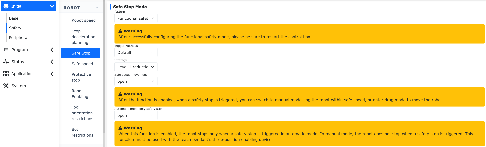

.. centered:: Rysunek 7.4-3 Planowanie Opóźnienia Zatrzymania Robota

**Krok 2**: Gdy tryb wyzwalania jest ustawiony na "Domyślny", błąd interfejsu może być automatycznie usunięty po przywróceniu wyzwolenia. Gdy tryb wyzwalania jest ustawiony na "Dwukanałowy", operacja jest następująca: po przywróceniu wyzwolenia, ręcznie kliknij "Wyczyść" w prawym górnym rogu, aby zresetować robota.

Prędkość Bezpieczeństwa
++++++++++++++++++++++++++++++++++++++++++++++++++++++++++++++

Kliknij na pasku menu "Ustawienia Początkowe" -> "Bezpieczeństwo" i kliknij "Prędkość Bezpieczeństwa", aby przejść do interfejsu konfiguracji w celu ustawienia prędkości bezpieczeństwa. Zakres ręcznej prędkości TCP wynosi 1-1500mm/s.

Funkcja prędkości bezpieczeństwa robota jest używana w środowiskach współpracy człowiek-robot lub dynamicznych, aby aktywnie ograniczać prędkość operacyjną robota, kontrolując energię kinetyczną i siłę uderzenia w granicach bezpieczeństwa, zapobiegając w ten sposób obrażeniom personelu w przypadku przypadkowego kontaktu i skutecznie chroniąc sprzęt i przedmioty obrabiane przed uszkodzeniami spowodowanymi kolizją.

**Krok 1**: Kliknij "Ustawienia Początkowe" -> "Bezpieczeństwo" -> "Prędkość Bezpieczeństwa", aby ustawić parametry prędkości bezpieczeństwa, głównie trzy części: "Włączenie Funkcji", "Ograniczenie Prędkości" i "Tryb Po Przekroczeniu Prędkości".

Wśród nich, Włączenie Funkcji można wybrać jako "Wyłącz", "Włącz w Trybie Ręcznym" i "Włącz we Wszystkich Trybach";

W Ograniczeniu Prędkości ustaw limit prędkości. Gdy prędkość liniowa robota osiągnie ten limit, zostanie przetworzona zgodnie z parametrami ustawionymi w "Trybie Po Przekroczeniu Prędkości". "Tryb Po Przekroczeniu Prędkości" można wybrać jako "Zatrzymaj i Alarm", "Automatyczne Ograniczenie Prędkości" i "Wyłącz Po Zatrzymaniu i Alarmie". Automatyczne ograniczenie prędkości jest dostępne tylko w "Włącz w Trybie Ręcznym".

Po ustawieniu wymaganych parametrów nie są potrzebne żadne dodatkowe operacje. Ruch robota będzie przetwarzany zgodnie z ustawionymi parametrami. Ustawienia parametrów są pokazane na rysunku.

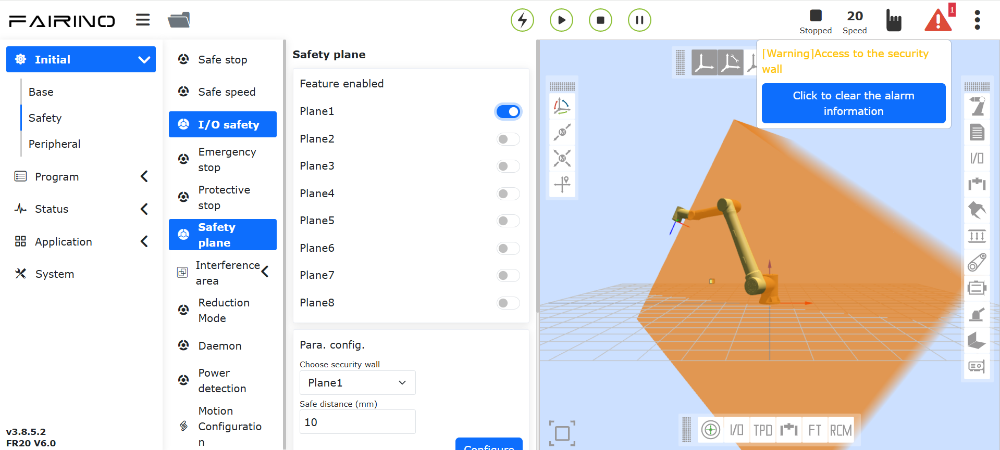

.. centered:: Rysunek 7.4-4 Ustawienia Parametrów Prędkości Bezpieczeństwa

Awaryjne Zatrzymanie
++++++++++++++++++++++++++++++++++++++++++++++++++++++++++++++

Kliknij na pasku menu "Ustawienia Początkowe" -> "Bezpieczeństwo" i kliknij "Awaryjne Zatrzymanie", aby przejść do interfejsu konfiguracji.

Typy awaryjnego zatrzymania 0, 1a, 1b, 2 mogą być ustawione, limit czasu zatrzymania może być ustawiony, a limit odległości zatrzymania może być ustawiony.

Poprzez kontroler wysyłający do płytki szafy sterowniczej, awaryjne zatrzymanie typu 0 bezpośrednio odcina zasilanie płytki szafy sterowniczej;

- Awaryjne zatrzymanie typu 1a: po zatrzymaniu z opóźnieniem, odcina zasilanie korpusu robota;
- Awaryjne zatrzymanie typu 1b: po zatrzymaniu z opóźnieniem, nie odcina zasilania korpusu robota, ale wyłącza korpus robota;
- Awaryjne zatrzymanie typu 2: po naciśnięciu awaryjnego zatrzymania, robot zwalnia do zatrzymania i pozostaje włączony. Po zwolnieniu awaryjnego zatrzymania, robot powinien być w stanie normalnie działać.

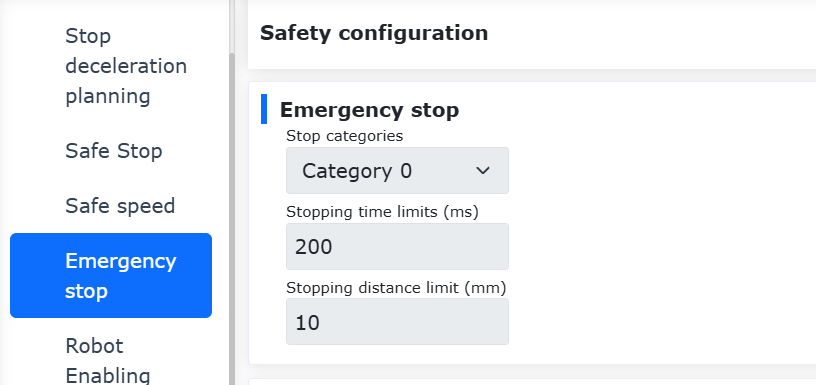

.. centered:: Rysunek 7.4-5 Ustawienia Awaryjnego Zatrzymania

Ochronne Zatrzymanie
++++++++++++++++++++++++++++++++++++++++++++++++++++++++++++++

Kliknij na pasku menu "Ustawienia Początkowe" -> "Bezpieczeństwo" i kliknij podmenu "Ochronne Zatrzymanie", aby przejść do interfejsu konfiguracji.

Typy ochronnego zatrzymania 0, 1, 2. Ochronne zatrzymanie typu 0 bezpośrednio odcina zasilanie płytki szafy sterowniczej. Ochronne zatrzymanie typu 1: płytka szafy sterowniczej najpierw powiadamia kontroler, aby kontrolował zatrzymanie robota, następnie kontroler przekazuje informację zwrotną do płytki szafy sterowniczej w celu odcięcia zasilania. Ochronne zatrzymanie typu 2: płytka szafy sterowniczej powiadamia kontroler, aby kontrolował zatrzymanie robota.

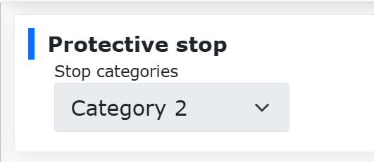

.. centered:: Rysunek 7.4-6 Konfiguracja Ochronnego Zatrzymania

Automatyczne Włączanie przy Starcie
++++++++++++++++++++++++++++++++++++++++++++++++++++++++++++++

Kliknij na pasku menu "Ustawienia Początkowe" -> "Bezpieczeństwo" i kliknij podmenu "Włączanie Robota", aby przejść do interfejsu konfiguracji. Możesz wybrać, czy robot włącza się automatycznie przy starcie, czy nie.

.. centered:: Rysunek 7.4-7 Automatyczne Włączanie przy Starcie

Ograniczenie Orientacji Narzędzia (Używane tylko w systemie LA)
+++++++++++++++++++++++++++++++++++++++++++++++++++++++++++++++++++++

Kliknij na pasku menu "Ustawienia Początkowe" -> "Bezpieczeństwo" i kliknij podmenu "Ograniczenie Orientacji Narzędzia", aby przejść do interfejsu konfiguracji.

Ograniczenie orientacji narzędzia jest funkcją ochronną działającą w przestrzeni kartezjańskiej końcówki narzędzia robota, mającą na celu ograniczenie zakresu ruchu postawy końcówki robota. Obejmuje ustawienie włączenia funkcji, ustawienie referencyjnego kierunku narzędzia i ustawienie maksymalnego kąta odchylenia. Maksymalny kąt odchylenia definiuje maksymalną wartość graniczną kąta między osią Z kartezjańskiego układu współrzędnych końcówki narzędzia a referencyjnym kierunkiem narzędzia, co zwykle można rozumieć jako przestrzeń stożkową.

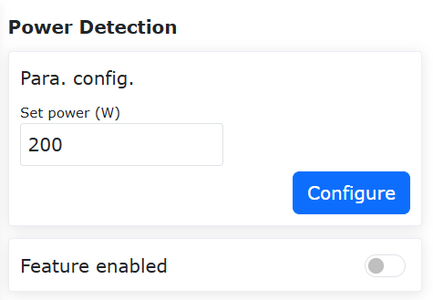

.. centered:: Rysunek 7.4-8 Ograniczenie Orientacji Narzędzia

Ograniczenia Robota (Używane tylko w systemie LA)
++++++++++++++++++++++++++++++++++++++++++++++++++++++++++++++

Kliknij na pasku menu "Ustawienia Początkowe" -> "Bezpieczeństwo" i kliknij podmenu "Ograniczenia Robota", aby przejść do interfejsu konfiguracji.

Ograniczenia robota obejmują pęd i moc, gdzie ograniczenie pędu jest używane do ograniczania maksymalnego pędu robota, a ograniczenie mocy jest używane do ograniczania pracy mechanicznej wykonywanej przez robota.

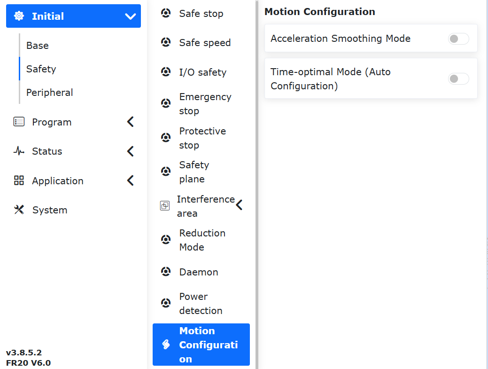

.. centered:: Rysunek 7.4-9 Ograniczenia Robota

Stawy
~~~~~~~~~~~~~~~~~~~~~~~~~~~~~~~~~~~~~~~~~~~~~

Miękkie Ograniczenia Stawów
++++++++++++++++++++++++++++++++++++++++++++++++++++++++++++++

Na pasku menu "Ustawienia Początkowe" -> "Bezpieczeństwo" -> "Stawy" kliknij "Miękkie Ograniczenia Stawów", aby przejść do interfejsu miękkich ograniczeń.

W zakresie ruchu robota mogą znajdować się inne urządzenia. Kąty ograniczeń mogą przeprowadzić miękkie ograniczenie robota, zapobiegając przemieszczaniu się robota poza określone wartości współrzędnych i zapobiegając kolizjom. Wyzwolenie miękkiego ograniczenia powoduje automatyczne zatrzymanie robota, bez odległości zatrzymania.

Administratorzy mogą używać wartości domyślnych lub wprowadzać wartości kątowe. Wprowadzając wartości kątowe, dodatnie i ujemne kąty stawów robota mogą być ograniczane oddzielnie. Gdy wprowadzona wartość przekracza wartości kątów miękkich ograniczeń stawów robota wymienione w tabeli podstawowych parametrów robota w Sekcji 2.1-Podstawowe Parametry, kąt ograniczenia zostanie dostosowany do maksymalnej wartości możliwej do ustawienia. Gdy robot zgłosi błąd przekroczenia limitu polecenia stawu, należy przejść do trybu przeciągania i przeciągnąć staw robota z powrotem w zakres kąta ograniczenia.

Funkcja ochrony miękkich ograniczeń stawów jest aktywnym mechanizmem ochrony, który monitoruje stan ruchu stawów ramienia robota w czasie rzeczywistym i dynamicznie ogranicza operatora przed przekroczeniem ustawionego zakresu miękkich ograniczeń podczas nauczania przez przeciąganie. Ta funkcja sprawia, że miękkie ograniczenia mają znaczenie nawet w nauczaniu przez przeciąganie, zwiększając w ten sposób bezpieczeństwo współpracy człowieka z robotem.

- **Krok 1**: Zaloguj się do interfejsu internetowego i kliknij kolejno "Ustawienia Początkowe" -> "Bezpieczeństwo" -> "Stawy" -> "Miękkie Ograniczenia Stawów", aby przejść do modułu ustawiania miękkich ograniczeń robota.
- **Krok 2**: Na podstawie rzeczywistego zakresu pracy robota, racjonalnie ustaw miękkie ograniczenia dla każdego stawu. W tym momencie sprawdź, czy bieżąca pozycja kątowa każdego stawu robota mieści się w zakresie wstępnie ustawionych miękkich ograniczeń. Jeśli tak, kliknij "Zastosuj", aby wysłać wstępnie ustawione miękkie ograniczenia. Jeśli nie, przesuń każdy staw w zakres wstępnie ustawiony; w przeciwnym razie po kliknięciu "Zastosuj" pojawi się komunikat o przekroczeniu limitu, jak pokazano na poniższym rysunku. W tym momencie możesz przesunąć lub przeciągnąć przekroczony staw w kierunku zakresu miękkich ograniczeń, aby usunąć błąd.
- **Krok 3**: Po pomyślnym ustawieniu zakresu miękkich ograniczeń, wybierz "Włącz" dla "Ochrony Miękkich Ograniczeń Stawów", aby aktywować tę funkcję, jak pokazano na poniższym rysunku. W trybie przeciągania, ustawione miękkie ograniczenia będą obowiązywać, a podczas przeciągania w pobliżu miękkich ograniczeń wyczuwalny będzie opór.
- **Krok 4**: Aby wyłączyć funkcję ochrony miękkich ograniczeń stawów, kliknij "Ochrona Miękkich Ograniczeń Stawów", aby ją wyłączyć.

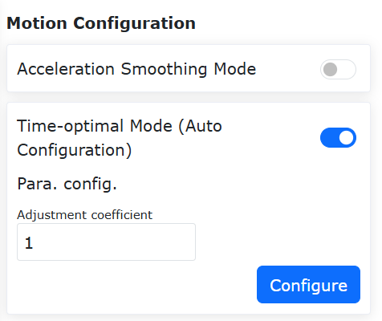

.. centered:: Rysunek 7.4-10 Miękkie Ograniczenia Stawów

Poziom Kolizji
++++++++++++++++++++++++++++++++++++++++++++++++++++++++++++++

Na pasku menu "Ustawienia Początkowe" -> "Bezpieczeństwo" -> "Stawy" kliknij "Poziom Kolizji", aby przejść do interfejsu poziomu kolizji.
Poziomy kolizji są podzielone na poziomy od 1 do 10. Poziomy 1 do 3 są bardziej czułe, a robot musi działać z zalecaną prędkością. Można również wybrać niestandardowe ustawienia procentowe, gdzie 100% odpowiada poziomowi 10. Jak pokazano na poniższym rysunku:

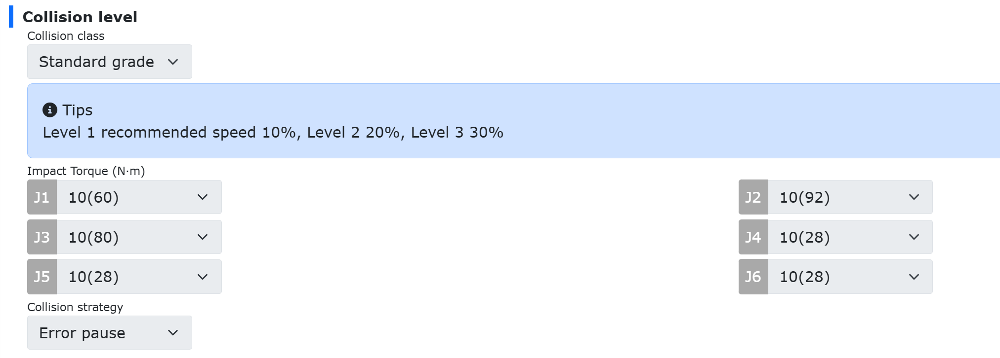

.. centered:: Rysunek 7.4-11 Diagram Poziomu Kolizji

Strategie kolizji to "Zatrzymaj przy Kolizji", "Wstrzymaj przy Kolizji" i "Kontynuuj Ruch". Aby uniknąć siły ściskającej między robotem a obiektami po kolizji, dodano strategie "Tryb Momentu Grawitacyjnego", "Tryb Reakcji Oscylacyjnej" i "Tryb Odbicia po Kolizji". Po wyzwoleniu wszystkie trzy strategie przełączą się z trybu automatycznego lub ręcznego na tryb przeciągania, a następnie z powrotem na tryb ręczny. Tryb momentu grawitacyjnego oddala się od punktu kolizji na podstawie wielkości i kierunku siły kolizji; tryb reakcji oscylacyjnej wraca do pozycji kolizji po oddaleniu się od niej; tryb odbicia po kolizji przyspiesza oddalanie się od punktu kolizji zgodnie z ustawionymi parametrami.

W sekcji "Strategia Kolizji" kliknij menu rozwijane, aby wybrać "Tryb Odbicia po Kolizji" i ustaw czas bezpieczeństwa na 1000ms, odległość bezpieczeństwa na 150mm, prędkość bezpieczeństwa na 150mm/s i współczynnik bezpieczeństwa dla każdego stawu na 5. Konkretny interfejs jest pokazany na poniższym rysunku.

.. image:: safety/018.png
   :width: 6in
   :align: center

.. centered:: Rysunek 7.4-12 Strategia Kolizji: Tryb Odbicia po Kolizji

Znaczenie każdego parametru:

- Czas Bezpieczeństwa: Określa czas trwania w trybie przeciągania po przełączeniu z trybu automatycznego na tryb przeciągania, zakres [1000-2000]ms;
- Odległość Bezpieczeństwa: Określa pozycję, w której robot oddala się od punktu kolizji po kolizji, zakres [150-200]mm;
- Prędkość Bezpieczeństwa: Określa maksymalną prędkość TCP, z jaką robot oddala się od punktu kolizji po kolizji. Przekroczenie tego limitu prędkości ograniczy siłę odbicia, zakres [50-250]mm/s;
- Współczynnik Bezpieczeństwa: Określa szybkość zanikania siły odbicia. Im mniejszy współczynnik, tym szybsze zanikanie i szybsza prędkość odbicia; im większy współczynnik, tym wolniejsze zanikanie. Zakres [1-10], bezwymiarowy.
- Przed wejściem robota w tryb przeciągania wymagane jest wykrycie momentu obrotowego. Ta funkcja ma na celu zapobieganie nieprawidłowym zjawiskom, takim jak unoszenie lub opadanie po wejściu robota w tryb przeciągania z powodu błędnych parametrów obciążenia lub błędnych ustawień trybu instalacji przez operatora. Jeśli moment obrotowy stawu zostanie wykryty poza dopuszczalnym zakresem, kontroler natychmiast zgłosi błąd i zabroni robotowi wejścia w tryb przeciągania.

Kroki włączenia funkcji wykrywania kolizji dla liniowej prowadnicy zębatkowej:

- Krok 1: Upewnij się, że zarówno prowadnica, jak i robot są zamontowane frontalnie. Przed włączeniem funkcji wykrywania kolizji dla liniowej prowadnicy zębatkowej sprawdź, czy metoda instalacji jest frontalna. W szczególności, najpierw upewnij się, że prowadnica i robot są zamontowane frontalnie. Następnie kliknij kolejno "Ustawienia Początkowe" -> "Podstawowe" -> "Instalacja", aby przejść do strony instalacji swobodnej. Jeśli zarówno "Obrot Podstawy" jak i "Nachylenie Podstawy" wynoszą 0, oprogramowanie jest ustawione na frontalne; w przeciwnym razie należy je zmienić na 0. Jeśli nie są 0, interfejs wyświetli błąd.
- Krok 2: Włącz funkcję wykrywania kolizji dla liniowej prowadnicy zębatkowej i ustaw parametry. Kliknij kolejno "Ustawienia Początkowe" -> "Bezpieczeństwo" -> "Stawy" -> "Poziom Kolizji", aby przejść do strony ustawień poziomu kolizji. Po kliknięciu suwaka funkcji "Wykrywanie Kolizji dla Liniowej Prowadnicy Zębatkowej" ustaw promień koła zębatego i masę suwaka. Promień koła zębatego można obliczyć na podstawie skoku i przełożenia. Masa suwaka nie obejmuje robota i jego obciążenia końcowego. Istnieje 11 opcji poziomu prowadnicy, gdzie Poziom 1 jest najłatwiejszy do wywołania kolizji, a Poziom 10 jest najtrudniejszy. Gdy kontroler jest włączony po raz pierwszy i przed wykonaniem programu adaptacji, poziom kolizji należy najpierw ustawić na "Wyłączony".

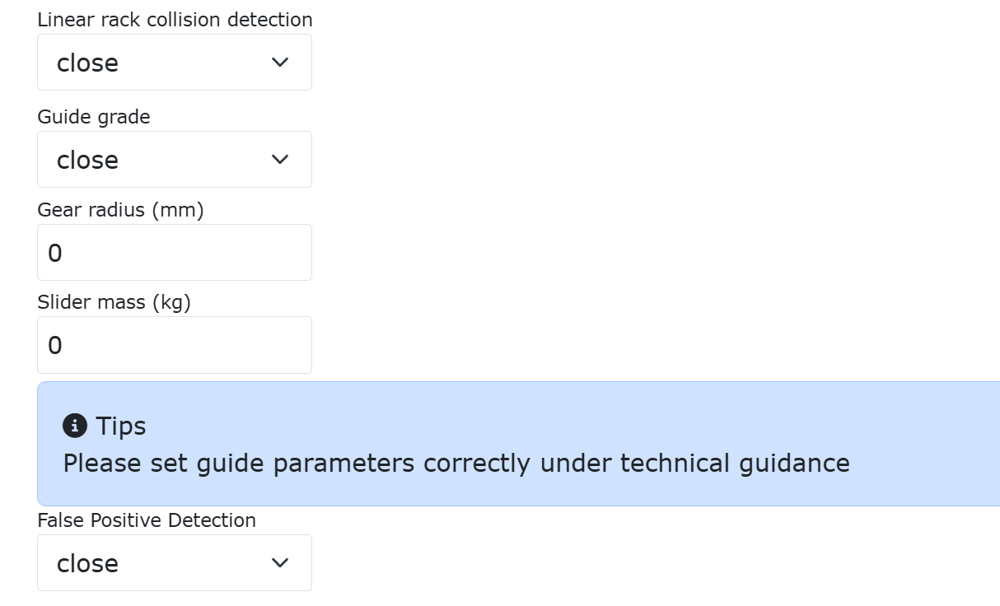

.. centered:: Rysunek 7.4-13 Funkcja Wykrywania Kolizji dla Liniowej Prowadnicy Zębatkowej

- Krok 3: Wykonaj program "Rail_Adaptation_Program.lua", aby dostosować się do bieżącej prowadnicy. Po każdym ponownym uruchomieniu kontrolera należy wykonać program "Rail_Adaptation_Program.lua" (aby zapobiec zmianom typu robota i innym czynnikom wpływającym na właściwości dynamiczne prowadnicy). Przed wykonaniem programu upewnij się, że poziom kolizji prowadnicy jest ustawiony na "Wyłączony". W trybie automatycznym uruchom program LUA z prędkością 100% prędkości interfejsu. Po wykonaniu jednego cyklu programu adaptacja jest zakończona i można zatrzymać wykonanie.

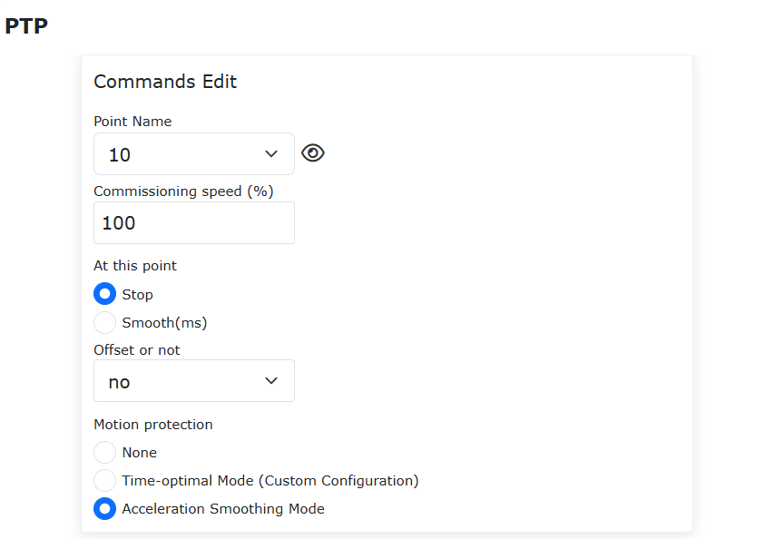

.. centered:: Rysunek 7.4-14 Wykonanie "Rail_Adaptation_Program.lua" w celu Dostosowania do Bieżącej Prowadnicy

- Krok 4: Racjonalnie ustaw poziom kolizji prowadnicy i wykonuj zadania. Użytkownicy mogą racjonalnie ustawić poziom kolizji prowadnicy na podstawie wydajności sterownika silnika i prędkości wykonywania zadania. Jeśli prowadnica i robot działają asynchronicznie, kolizja z robotem lub prowadnicą może wywołać "błąd kolizji 8 osi, możliwy do zresetowania". W tym przypadku prowadnica zatrzymuje się, jak pokazano na Rysunku 2-9. Jeśli prowadnica i robot działają synchronicznie, kolizja z robotem może wywołać alarm, powodując zatrzymanie prowadnicy, podczas gdy robot reaguje zgodnie z ustawioną strategią kolizji.

Tryb Zmniejszony
++++++++++++++++++++++++++++++++++++++++++++++++++++++++++++++

Kliknij na pasku menu "Ustawienia Początkowe" -> "Bezpieczeństwo" i kliknij podmenu "Tryb Zmniejszony", aby przejść do interfejsu konfiguracji. Wybierz "Tryb Poziom 1/Poziom 2", aby skonfigurować prędkość stawów i prędkość TCP końcówki.

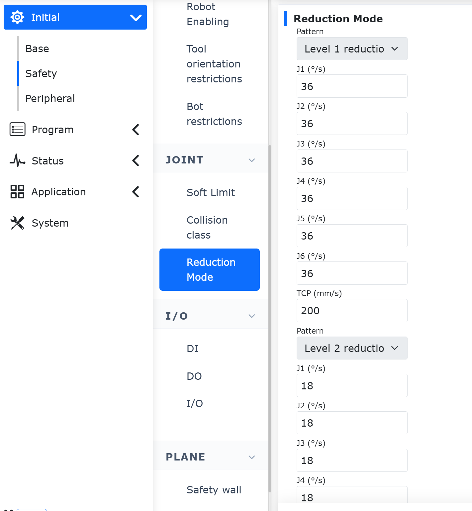

.. centered:: Rysunek 7.4-15 Tryb Zmniejszony

I/O
~~~~~~~~~~~~~~~~~~~~~~~~~~~~~~~~~~~~~~~~~~~~~~~~~~~
Kliknij na pasku menu "Ustawienia Początkowe" -> "Bezpieczeństwo" i kliknij podmenu "I/O", aby przejść do interfejsu konfiguracji.

HMI zapewnia możliwość ustawienia stanu bezpieczeństwa dla 16 wejść cyfrowych i 16 wyjść cyfrowych, które mogą być ustawione jako ważne lub nieważne. Gdy kontroler stwierdzi, że znajduje się w stanie bezpieczeństwa, 16 wejść cyfrowych i 16 wyjść cyfrowych jest ustawianych na stan bezpieczeństwa.

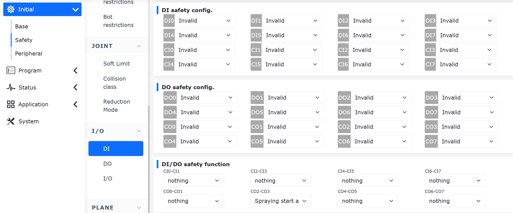

.. centered:: Rysunek 7.4-16 Konfiguracja Stanu Bezpieczeństwa I/O

W systemie LA:

"I/O Bezpieczeństwo" zapewnia funkcje bezpieczeństwa DIO. Funkcja bezpieczeństwa to dwukanałowe DI lub DO. Gdy sygnał bezpieczeństwa DI lub flaga stanu bezpieczeństwa zostanie wyzwolona, DO jest wysyłane.

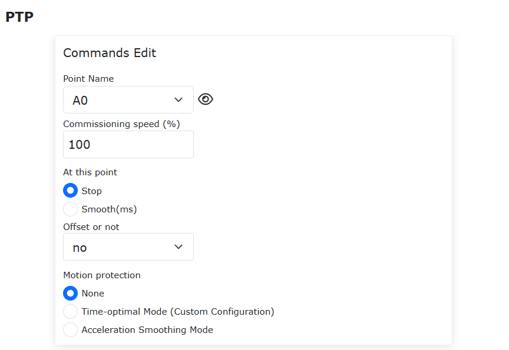

.. centered:: Rysunek 7.4-17 Konfiguracja Funkcji Bezpieczeństwa I/O

Sprzęt
~~~~~~~~~~~~~~~~~~~~~~~~~~~~~~~~~~~~~~~~~~~~~~~~~~~

Wykrywanie Mocy ServoJT (Używane tylko w systemie QX)
+++++++++++++++++++++++++++++++++++++++++++++++++++++++++++++++++++++++++++++++++++++++++++++++++++++++
Kliknij na pasku menu "Ustawienia Początkowe" -> "Bezpieczeństwo" i kliknij podmenu "Wykrywanie Mocy", aby przejść do interfejsu konfiguracji.

Gdy działa bezpośrednio na pętlę prądową robota (tylko servoJT), jest używane do ograniczania pracy wykonywanej przez robota. Gdy całka prędkości i momentu obrotowego robota zostanie wykryta jako przekraczająca limit, aktywowana jest ochrona mocy.

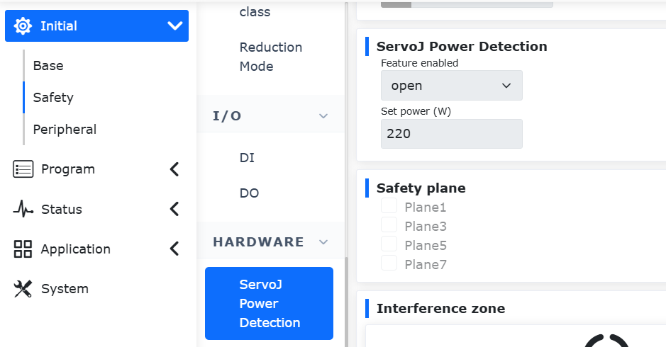

.. centered:: Rysunek 7.4-18 Wykrywanie Mocy ServoJT

Płaszczyzny
~~~~~~~~~~~~~~~~~~~~~~~~~~~~~~~~~~~~~~~~~~~

Ściana Bezpieczeństwa
+++++++++++++++++++++++++++++++++++++++++++++++++++++++++++++++++++++++++++++++++++++++++++++++++++++++

Kliknij na pasku menu "Ustawienia Początkowe" -> "Bezpieczeństwo" i kliknij podmenu "Konfiguracja Ściany Bezpieczeństwa", aby przejść do interfejsu konfiguracji.

- Konfiguracja Ściany Bezpieczeństwa: Kliknij przycisk Włącz, aby włączyć odpowiednią ścianę bezpieczeństwa. Gdy dla ściany bezpieczeństwa nie skonfigurowano zakresu bezpieczeństwa, wyświetlony zostanie błąd. Kliknij przycisk konfiguracji w prawym górnym rogu, wybierz ścianę bezpieczeństwa, którą chcesz ustawić, automatycznie wyświetlona zostanie odległość bezpieczeństwa (opcjonalna, domyślnie 0), a następnie kliknij przycisk "Ustaw", aby ustawić pomyślnie.
- Konfiguracja Punktów Referencyjnych Ściany Bezpieczeństwa: Po wybraniu ściany bezpieczeństwa można ustawić cztery punkty referencyjne. Pierwsze trzy punkty to punkty referencyjne płaszczyzny, używane do potwierdzenia płaszczyzny ustawionej ściany bezpieczeństwa. Czwarty punkt to punkt referencyjny zakresu bezpieczeństwa, używany do potwierdzenia zakresu bezpieczeństwa ustawionej ściany bezpieczeństwa.

Jeśli punkty referencyjne zostaną ustawione pomyślnie, zaświeci się zielone światło. W przeciwnym razie zaświeci się żółte światło, aż do momentu pomyślnego ustawienia punktów referencyjnych i zmiany koloru na zielony. Gdy wszystkie cztery punkty referencyjne zostaną pomyślnie ustawione, można obliczyć zakres bezpieczeństwa. Po pomyślnym obliczeniu stan punktu parametru zakresu bezpieczeństwa powraca do domyślnego.

.. image:: safety/025.png
   :width: 6in
   :align: center

.. centered:: Rysunek 7.4-19 Ustawienia Punktów Referencyjnych Zakresu Bezpieczeństwa

- Efekt Zastosowania: Włącz pomyślnie skonfigurowaną ścianę bezpieczeństwa. Przeciągnij robota. Jeśli TCP końcówki robota znajduje się w ustawionym zakresie bezpieczeństwa, system działa prawidłowo. Jeśli znajduje się poza ustawionym zakresem bezpieczeństwa, wyświetlony zostanie błąd.

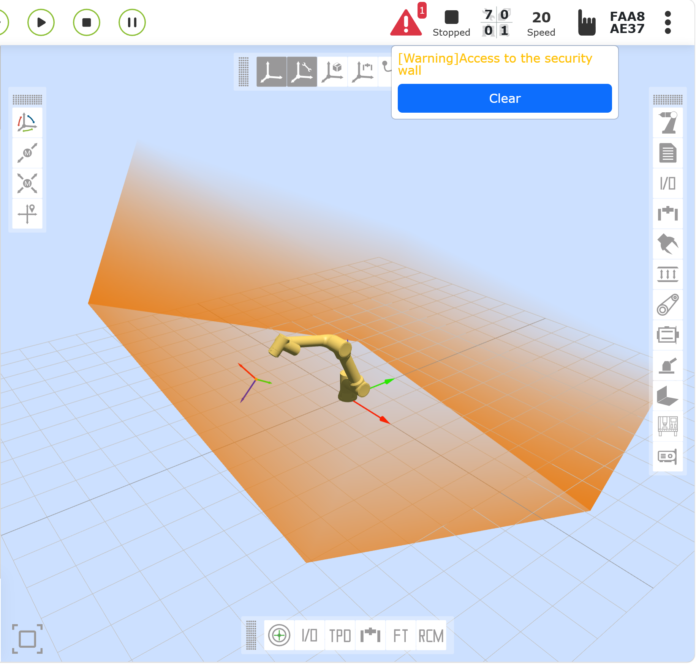

.. centered:: Rysunek 7.4-20 Efekt po Pomyślnym Ustawieniu Zakresu Bezpieczeństwa

Strefa Interferencji
+++++++++++++++++++++++++++++++++++++++++++++++++++++++++++++++++++++++++++++++++++++++++++++++++++++++

Na pasku menu "Ustawienia Początkowe" -> "Bezpieczeństwo" -> "Strefa Interferencji" kliknij pozycję podmenu "Pojedyncza", aby przejść do interfejsu konfiguracji strefy interferencji.

Musimy skonfigurować metodę interferencji i operację po wejściu do strefy interferencji. Metody interferencji są podzielone na "Interferencję Osi" i "Interferencję Prostopadłościanu".

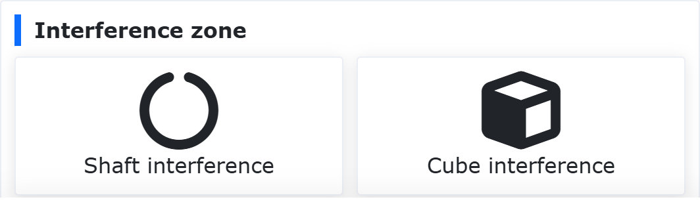

.. centered:: Rysunek 7.4-21 Metody Strefy Interferencji

Kliknij ikonę strefy interferencji, użyj przełącznika, aby kontrolować, czy jest włączona, i kliknij przycisk konfiguracji w prawym górnym rogu w celu konfiguracji parametrów.

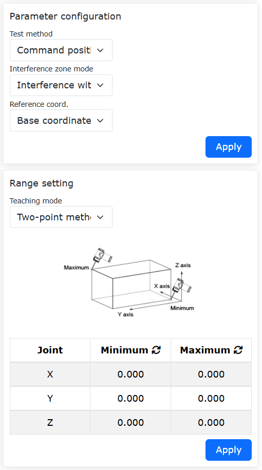

.. centered:: Rysunek 7.4-22 Konfiguracja Strefy Interferencji

Najpierw skonfiguruj ruch strefy interferencji jako "Kontynuuj Ruch" lub "Zatrzymaj". Następnie ustaw konfigurację przeciągania po wejściu do strefy interferencji. Użytkownicy mogą ustawić strategię po wejściu do strefy interferencji w trybie przeciągania zgodnie ze swoimi potrzebami: brak ograniczeń przeciągania, powrót impedancji lub przełączenie na tryb ręczny.

Przy wyborze Interferencji Osi, należy skonfigurować parametry interferencji osi. Metoda wykrywania może być "Pozycja Polecenia" lub "Pozycja Sprzężenia Zwrotnego". Tryb strefy interferencji może być "Interferencja w Zakresie" lub "Interferencja poza Zakresem". Następnie ustaw zakres dla każdego stawu i czy zakres dla każdego stawu jest włączony. Możesz wprowadzać wartości lub użyć ikony "Odśwież" po "Min" i "Max", aby zapisać bieżącą pozycję robota, a na końcu kliknij Konfiguruj.

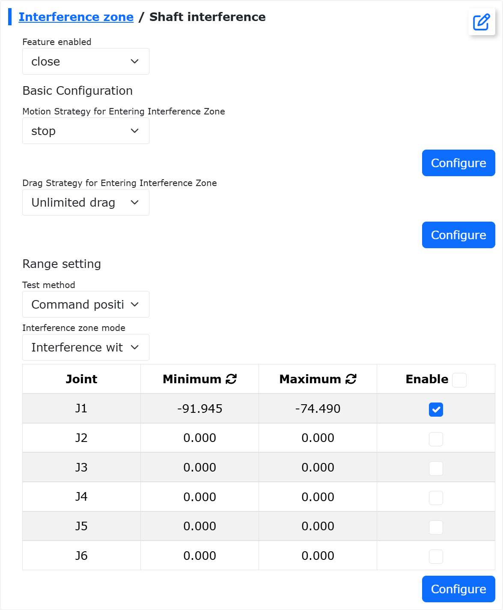

.. centered:: Rysunek 7.4-23 Konfiguracja Interferencji Osi

Przy wyborze Interferencji Prostopadłościanu, należy skonfigurować parametry interferencji prostopadłościanu. Metoda wykrywania może być "Pozycja Polecenia" lub "Pozycja Sprzężenia Zwrotnego". Tryb strefy interferencji może być "Interferencja w Zakresie" lub "Interferencja poza Zakresem". Układ współrzędnych odniesienia może być "Współrzędna Bazowa" lub "Współrzędna Przedmiotu", wybierany zgodnie z rzeczywistym użyciem. Następnie ustaw zakres. Istnieją dwie metody ustawiania zakresu. Pierwsza metoda to "Metoda Dwóch Punktów", która wykorzystuje dwa przeciwległe wierzchołki prostopadłościanu. Pozycje mogą być wprowadzane lub rejestrowane poprzez nauczanie robota. Na koniec kliknij Zastosuj.

.. image:: safety/030.png
   :width: 6in
   :align: center

.. centered:: Rysunek 7.4-24 Konfiguracja Interferencji Prostopadłościanu

Druga metoda to "Metoda Punkt Centralny + Długość Boku", gdzie punkt centralny prostopadłościanu i długość boku prostopadłościanu tworzą strefę interferencji. Pozycje mogą być wprowadzane lub rejestrowane poprzez nauczanie robota. Na koniec kliknij Zastosuj.

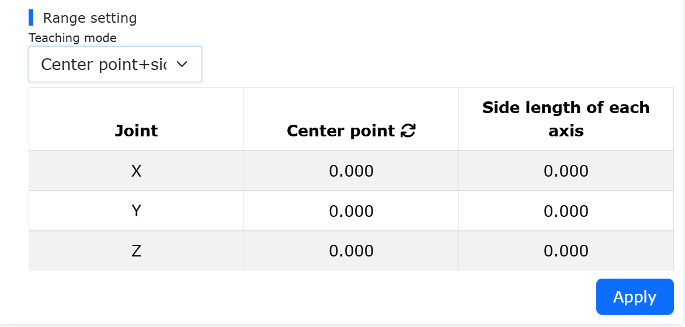

.. centered:: Rysunek 7.4-25 Konfiguracja Interferencji Prostopadłościanu

Funkcja Zapisywania Dziennika Bezpieczeństwa
~~~~~~~~~~~~~~~~~~~~~~~~~~~~~~~~~~~~~~~~~~~~~~~~~~~~~~~~~~~~~~~~~~~~~~~~~~~~~~~~~~~~~~~~~~~~~~~

Tło
+++++++++++++++++++++++++++++++++++++++++++++++++++++++++

Certyfikacja CE dla robotów serii FR wymaga, aby wszystkie dzienniki związane z operacjami bezpieczeństwa urządzenia były rejestrowane i utrzymywane oddzielnie. Wymaga również wyraźnie, aby przechowywanie dzienników obejmowało co najmniej ostatni dowód interwencji dla każdego typu interwencji, aby dane dziennika śledzenia dla każdej interwencji były przechowywane przez co najmniej 5 lat oraz aby dzienniki były chronione przed manipulacją.

Zarządzanie Dziennikiem Bezpieczeństwa
+++++++++++++++++++++++++++++++++++++++++++++++++++++++++

Zarządzanie dziennikiem bezpieczeństwa jest utrzymywane na stronie internetowej w "Ustawienia Początkowe" -> "Bezpieczeństwo". Najpierw należy wprowadzić "Hasło Konfiguracji Bezpieczeństwa" do weryfikacji, a zarządzanie dziennikiem bezpieczeństwa można przeprowadzić dopiero po pomyślnej weryfikacji.

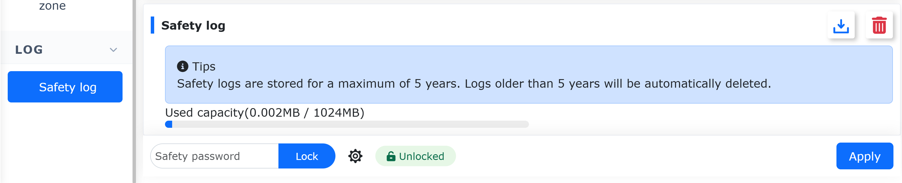

.. centered:: Rysunek 7.4-26 Zarządzanie Dziennikiem Bezpieczeństwa

Dzienniki bezpieczeństwa są zarządzane jednolicie. Aby zapobiec nadmiernej ilości dzienników spowodowanej nieprawidłowymi operacjami, bieżąca ilość przechowywanych dzienników może być intuicyjnie zobaczona na stronie. Dzienniki bezpieczeństwa przechowują tylko ostatnie 5 lat, a dzienniki każdego roku są przechowywane jednolicie w oddzielnych plikach zgodnie z typem dziennika. Kliknij Eksportuj, aby wyeksportować wszystkie dzienniki.

Typy dzienników są podzielone na następujące trzy kategorie:

.. centered:: Tabela 1-2 Klasyfikacja Dzienników Bezpieczeństwa

.. list-table::
   :widths: 30 30 40
   :header-rows: 0
   :align: center

   * - **Kategoria Dziennika**
     - **Nazwa Pliku Dziennika**
     - **Opis**

   * - Modyfikacja Parametrów
     - safetylog_params_2026.log
     - Modyfikacja parametrów konfiguracji bezpieczeństwa robota, modyfikacja hasła bezpieczeństwa robota

   * - Wersja Oprogramowania/Firmware'u
     - safetylog_version_2026.log
     - Aktualizacja wersji oprogramowania/firmware'u

   * - Operacja Dziennika
     - safetylog_operate_2026.log
     - Usuwanie, eksport dziennika bezpieczeństwa

Ponieważ dzienniki bezpieczeństwa muszą być przechowywane przez 5 lat i nie mogą być usuwane, aby zapobiec nieprawidłowym zapisom powodującym anomalie pamięci przechowywania wpływające na działanie systemu, dzienniki bezpieczeństwa stosują warstwową strategię ograniczania szybkości opartą na wykorzystanej pojemności. Przed zapisem sprawdzana jest aktualnie wykorzystana przestrzeń dziennika, a częstotliwość zapisu jest dynamicznie dostosowywana.

.. centered:: Tabela 1-3 Strategia Ograniczania Szybkości Dzienników Bezpieczeństwa

.. list-table::
   :widths: 20 30 20 30
   :header-rows: 0
   :align: center

   * - **Etap**
     - **Wykorzystana Pojemność**
     - **Częstotliwość Zapisu**
     - **Opis**

   * - 1
     - <500M
     - Bez ograniczeń
     - Normalne użytkowanie (około 200M przez 5 lat)

   * - 2
     - 500M-1G
     - 1 sekunda/wpis
     - Lekkie ograniczenie, bez wpływu na doświadczenie

   * - 3
     - 1G-2.5G
     - 5 sekund/wpis
     - Wyraźna anomalia, proaktywne zmniejszenie szybkości

   * - 4
     - 2.5G-4G
     - 30 sekund/wpis
     - Poważna anomalia, ekstremalny czas opóźnienia

   * - 5
     - >4G
     - Zatrzymaj zapis
     - Limit wyczerpany, brak dalszego zapisu dziennika

W normalnym użytkowaniu, przy ilości zapisu 1000 wpisów dziennie, szacowane użycie przez 5 lat mieści się w granicach 200M. Dlatego gdy pamięć przekracza 1G, wyraźnie występuje sytuacja anomalna. Po przekroczeniu 1G kontroler proaktywnie zgłosi ostrzeżenie. Konieczne jest proaktywne eksportowanie i tworzenie kopii zapasowych dzienników, a także zaleca się terminowe czyszczenie dzienników.

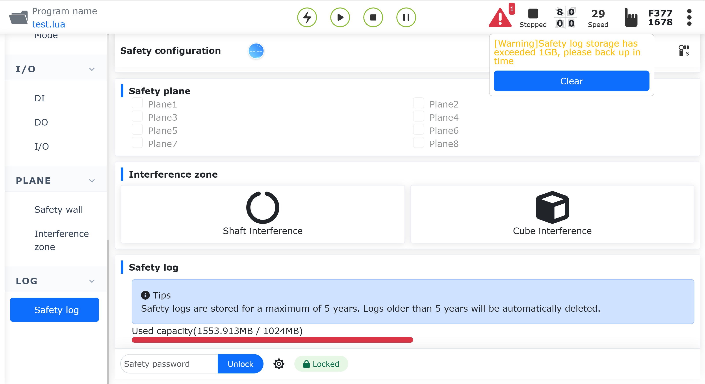

.. centered:: Rysunek 7.4-27 Ostrzeżenie o Anomalii Dziennika Bezpieczeństwa

Czas eksportu dziennika zależy od całkowitego rozmiaru dziennika. Teoretycznie całkowity rozmiar dziennika przez 5 lat nie przekroczy 200M. Gdy dzienniki przekraczają 1G, czas pobierania przekracza 1 minutę, a przy górnym limicie 4G czas pobierania wynosi około 5 minut. Po eksporcie można przeprowadzić czyszczenie dzienników. Aby zapewnić, że dowody anomalii nie zostaną wyczyszczone, bieżąca funkcja usuwania dziennika usuwa tylko dzienniki z lat innych niż bieżący rok.

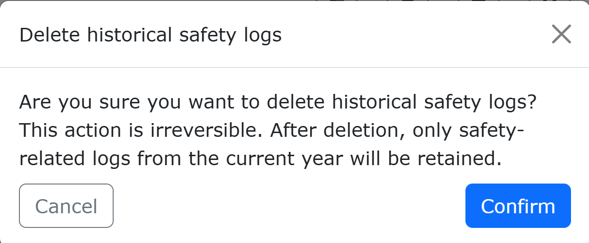

.. centered:: Rysunek 7.4-28 Usuwanie Dziennika Bezpieczeństwa

Funkcje bezpieczeństwa funkcjonalnego
----------------------------------------------------------------

Opis bezpieczeństwa funkcjonalnego
~~~~~~~~~~~~~~~~~~~~~~~~~~~~~~~~~~~~~~~~~~~~~~~~~~~~~~~~~~~~~~~~~

To urządzenie jest wyposażone w system sterowania związany z bezpieczeństwem, używany do automatycznego wykonywania działań bezpieczeństwa (takich jak zatrzymanie awaryjne, blokada drzwi ochronnych itp.) w przypadku wykrycia sytuacji niebezpiecznej. Te funkcje bezpieczeństwa zostały zaprojektowane i zweryfikowane zgodnie z normami EN ISO 13849-1 / EN IEC 62061 i są ważną częścią osiągnięcia zgodności CE.

Aby zapewnić ciągłą skuteczność funkcji bezpieczeństwa, należy pamiętać:

- Nie omijaj ani nie maskuj żadnego urządzenia bezpieczeństwa (takiego jak usuwanie przełączników blokady, zwieranie obwodów bezpieczeństwa, zasłanianie kurtyn świetlnych itp.), w przeciwnym razie może to spowodować poważne obrażenia ciała.
- Nie modyfikuj samodzielnie komponentów ani programów związanych z bezpieczeństwem. Wszelkie modyfikacje, zmiany parametrów lub aktualizacje oprogramowania systemu sterowania bezpieczeństwem muszą być wykonane przez producenta lub jego upoważniony personel, a ocena ryzyka musi zostać przeprowadzona ponownie.
- Bezpieczeństwo sieciowe: nie podłączaj systemu sterowania bezpieczeństwem tego urządzenia do nieautoryzowanej sieci; nieautoryzowany dostęp cyfrowy może spowodować awarię funkcji bezpieczeństwa.
- Konserwacja i usterki: jeśli jakiekolwiek urządzenie bezpieczeństwa działa nieprawidłowo lub ulegnie awarii, natychmiast zatrzymaj maszynę i skontaktuj się z producentem lub autoryzowanym personelem serwisowym. Tylko przeszkolony i upoważniony personel może wykonywać konserwację.

To urządzenie podlega ocenie zgodności zgodnie z Rozporządzeniem maszynowym UE (UE) 2023/1230. Komponenty funkcji bezpieczeństwa są wymienione w dokumentacji technicznej do wglądu. Poniżej znajduje się szczegółowa lista funkcji bezpieczeństwa.

.. centered:: Tabela 1-1  Lista funkcji bezpieczeństwa

.. list-table::
   :widths: 20 20 10 40 10
   :header-rows: 0
   :align: center

   * - **Identyfikator SF**
     - **Nazwa funkcji**
     - **Poziom**
     - **Opis**
     - **MTTFd***

   * - SF01
     - E-STOP on TPU-Zatrzymanie awaryjne na teach pendancie
     - PL d
     - | Execution monitoring of the emergency stop-Monitorowanie wykonania zatrzymania awaryjnego
       | Zawiera logikę wyzwalania dla różnych źródeł wyzwalania:
       | 1. W dowolnym trybie, gdy wyzwolony zostanie przełącznik zatrzymania awaryjnego teach pendantu, zostaje on przekształcony w sygnał zatrzymania awaryjnego skrzynki sterowniczej i wykonywane jest działanie zatrzymania Cat.0 lub Cat.1 zgodnie ze skonfigurowanym typem, z funkcją blokadowego utrzymania pozycji
       | 2. W dowolnym trybie, gdy wyzwolony zostanie bezpieczny DI skrzynki sterowniczej, zostaje on przekształcony w sygnał zatrzymania awaryjnego skrzynki sterowniczej i wykonywane jest działanie zatrzymania Cat.0 lub Cat.1 zgodnie ze skonfigurowanym typem, z funkcją blokadowego utrzymania pozycji
       | [Zdarzenie wyzwalające]: Sygnał zatrzymania awaryjnego wyzwolony
       | [Reakcja robota]:
       | Jeśli typ zatrzymania to 0, zasilanie korpusu zostaje odcięte, przeguby wykonują bezpieczny hamulec, a utrzymanie pozycji jest monitorowane
       | Jeśli typ zatrzymania to 1, wykonywane jest zatrzymanie z opóźnieniem, zasilanie korpusu zostaje odcięte, przeguby wykonują bezpieczny hamulec, a utrzymanie pozycji jest monitorowane	
     - 202.0512143

   * - SF02
     - Safeguard Stop-Zatrzymanie ochronne
     - PL d
     - | Execution monitoring of the safeguard stop-Monitorowanie wykonania zatrzymania ochronnego
       | W dowolnym trybie funkcja zatrzymania bezpieczeństwa jest wyzwalana zgodnie z sygnałem zatrzymania bezpieczeństwa skrzynki sterowniczej. Zgodnie ze skonfigurowanym poziomem zatrzymania bezpieczeństwa wykonywane są odpowiednie funkcje zatrzymania Cat.0, Cat.1, Cat.2 oraz odpowiednia blokadowa detekcja funkcji utrzymania pozycji (Cat.0, Cat.1) lub detekcja bezruchu + droga zatrzymania + czas zatrzymania (Cat.2).
       | [Zdarzenie wyzwalające]: Sygnał zatrzymania bezpieczeństwa wyzwolony;
       | [Reakcja robota]:
       | Jeśli typ zatrzymania to 0, zasilanie korpusu zostaje odcięte, przeguby wykonują bezpieczny hamulec, a utrzymanie pozycji jest monitorowane;
       | Jeśli typ zatrzymania to 1, wykonywane jest zatrzymanie z opóźnieniem, zasilanie korpusu zostaje odcięte, przeguby wykonują bezpieczny hamulec, a utrzymanie pozycji jest monitorowane;
       | Jeśli typ zatrzymania to 2, wykonywane jest zatrzymanie z opóźnieniem, zasilanie korpusu jest utrzymywane, przeguby nie wykonują bezpiecznego hamulca i pozostają włączone, a wykonywana jest detekcja bezruchu + droga zatrzymania + czas zatrzymania;	
     - 191.3170862

   * - SF03
     - Joint Position Limit-Ograniczenie pozycji przegubów
     - PL d
     - | Monitoring of the joint position limit-Monitorowanie ograniczenia pozycji przegubów
       | [Dla każdego przegubu można ustawić limity soft. Płyta bezpieczeństwa wykrywa pozycję przegubu w czasie rzeczywistym. Jeśli limit zostanie przekroczony, wykonywane jest działanie zatrzymania Cat.2, z blokadową detekcją bezruchu + droga zatrzymania + czas zatrzymania.
       | [Zdarzenie wyzwalające]: Przegub przesuwa się poza zakres pozycji granicznej;
       | [Reakcja robota]: Alarm usterki - przekroczono limit soft, wykonywane jest działanie zatrzymania Cat.2, z blokadową detekcją bezruchu + droga zatrzymania + czas zatrzymania;
     - 158.5302637

   * - SF04
     - Joint Speed Limit-Ograniczenie prędkości przegubów
     - PL d
     - | Monitoring of the joint speed limit-Monitorowanie ograniczenia prędkości przegubów	
       | Dla każdego przegubu można ustawić ograniczenie prędkości. Zgodnie z odpowiednią prędkością bezpieczeństwa sterownika, obwód bezpieczeństwa wykrywa, czy prędkość w czasie rzeczywistym każdego przegubu robota przekracza limit. Jeśli limit zostanie przekroczony, wykonywane jest zatrzymanie Cat.1 z blokadowym monitorowaniem utrzymania pozycji lub zatrzymanie Cat.2 z blokadową detekcją bezruchu + droga zatrzymania + czas zatrzymania.
       | [Zdarzenie wyzwalające]: Prędkość przegubu przekracza ustawioną wartość;
       | [Reakcja robota]: Alarm usterki - przekroczono prędkość. Opcjonalnie wykonać zatrzymanie Cat.1 z blokadowym monitorowaniem utrzymania pozycji lub domyślnie wykonać zatrzymanie Cat.2 z blokadową detekcją bezruchu + droga zatrzymania + czas zatrzymania;	
     - 158.5302637
          
   * - SF05
     - Joint Torque Limit-Ograniczenie momentu przegubów
     - PL d
     - | Monitoring of the joint torque limit-Monitorowanie ograniczenia momentu przegubów
       | Dla każdego przegubu można ustawić ograniczenie momentu. Zgodnie z odpowiednim momentem bezpieczeństwa sterownika, obwód bezpieczeństwa wykrywa, czy moment w czasie rzeczywistym każdego przegubu robota przekracza limit. Jeśli limit zostanie przekroczony, wykonywane jest zatrzymanie Cat.2, z blokadową detekcją bezruchu + droga zatrzymania + czas zatrzymania
       | [Zdarzenie wyzwalające]: Moment przegubu przekracza ustawioną wartość momentu
       | [Reakcja robota]: Alarm usterki - przekroczono moment przegubu x, wykonywane jest zatrzymanie Cat.2, z blokadową detekcją bezruchu + droga zatrzymania + czas zatrzymania
     - 67.48193213
     	          
   * - SF06
     - | TCP Pose Limit-Ograniczenie pozy TCP (płaszczyzna bezpieczeństwa, kierunek narzędzia)
       | (Dynamic Limit można dostosowywać dynamicznie; typ zatrzymania nie jest wymagany)
       | (Odpowiednie ograniczenia są dostosowywane dynamicznie przez konfigurowalne IO, podwójny obwód)
     - PL d
     - | Monitoring of the TCP pose limit-Monitorowanie ograniczenia pozy TCP
       | Zakres ograniczenia TCP i odpowiedni DI (maksymalnie 8 konfigurowalnych) są ustawiane z góry na odpowiedniej stronie sterownika. Gdy DI zostanie włączony, odpowiednie ograniczenie zostaje aktywowane. Gdy TCP przekroczy zakres ograniczenia, wykonywane jest zatrzymanie Cat.2, z blokadową detekcją bezruchu + droga zatrzymania + czas zatrzymania
       | [Zdarzenie wyzwalające]: Poza TCP przekracza ustawiony zakres
       | [Reakcja robota]: Alarm usterki - przekroczono płaszczyznę bezpieczeństwa/kierunek narzędzia, wykonywane jest działanie zatrzymania Cat.2, z blokadową detekcją bezruchu + droga zatrzymania + czas zatrzymania	
     - 70.07272665
          	          
   * - SF07
     - manual mode, reduced-speed-Tryb ręczny, prędkość zredukowana
     - PL d
     - | Monitoring of reduced-speed manual mode-Monitorowanie trybu ręcznego o zredukowanej prędkości
       | Gdy tryb sterownika jest w trybie ręcznym o zredukowanej prędkości, wykrywane jest, czy prędkość TCP jest ≤250mm/s. Jeśli prędkość zostanie przekroczona, wykonywane jest działanie zatrzymania Cat.0 lub Cat.1, z blokadowym monitorowaniem utrzymania pozycji.
       | [Zdarzenie wyzwalające]: Prędkość TCP przekracza ustawioną prędkość
       | [Reakcja robota]: Alarm usterki - przekroczenie prędkości TCP, wykonywane jest działanie zatrzymania Cat.0 lub Cat.1, z blokadowym monitorowaniem utrzymania pozycji.	
     - 70.07272665
             	          
   * - SF08
     - TCP Force Limit-Ograniczenie siły TCP
     - PL d
     - | Monitoring of the TCP force limit-Monitorowanie ograniczenia siły TCP  
       | Sterownik może skonfigurować ograniczenie siły TCP. Obwód bezpieczeństwa monitoruje siłę TCP robota w czasie rzeczywistym. Jeśli siła TCP przekroczy wartość graniczną, wykonywane jest zatrzymanie Cat.2, z blokadową detekcją bezruchu + droga zatrzymania + czas zatrzymania
       | [Zdarzenie wyzwalające]: Siła TCP przekracza ustawiony limit
       | [Reakcja robota]: Alarm usterki - usterka kolizji przegubu x, wykonywane jest zatrzymanie Cat.2, z blokadową detekcją bezruchu + droga zatrzymania + czas zatrzymania	
     - 124.720124  
             	          
   * - SF09
     - Momentum Limit-Ograniczenie pędu
     - PL d
     - | Monitoring of the momentum limit-Monitorowanie ograniczenia pędu
       | Sterownik może skonfigurować ograniczenie pędu robota. Obwód bezpieczeństwa monitoruje pęd robota w czasie rzeczywistym. Jeśli pęd robota przekroczy wartość graniczną, wykonywane jest zatrzymanie Cat.2, z blokadową detekcją bezruchu + droga zatrzymania + czas zatrzymania
       | [Zdarzenie wyzwalające]: Pęd przekracza ustawiony limit pędu
       | [Reakcja robota]: Alarm usterki - przekroczono pęd, wykonywane jest zatrzymanie Cat.2, z blokadową detekcją bezruchu + droga zatrzymania + czas zatrzymania	
     - 67.48193213
                	          
   * - SF10
     - Power Limit-Ograniczenie mocy
     - PL d
     - | Monitoring of the power limit-Monitorowanie ograniczenia mocy    
       | Sterownik może skonfigurować ograniczenie mocy robota. Obwód bezpieczeństwa monitoruje moc robota w czasie rzeczywistym. Jeśli moc robota przekroczy wartość graniczną, wykonywane jest zatrzymanie Cat.2, z blokadową detekcją bezruchu + droga zatrzymania + czas zatrzymania
       | [Zdarzenie wyzwalające]: Moc przekracza ustawiony limit mocy
       | [Reakcja robota]: Alarm usterki - przekroczono moc, wykonywane jest zatrzymanie Cat.2, z blokadową detekcją bezruchu + droga zatrzymania + czas zatrzymania
     - 67.48193213
                	          
   * - SF11
     - System Emergency Stop Output-Wyjście systemowego zatrzymania awaryjnego
     - PL d
     - | Monitoring of the System Emergency Stop Output-Monitorowanie wyjścia systemowego zatrzymania awaryjnego
       | Gdy sygnał zatrzymania awaryjnego zostanie wyzwolony, sterownik wyprowadza sygnał DO zatrzymania awaryjnego.
       | [Zdarzenie wyzwalające]: Sygnał zatrzymania awaryjnego wyzwolony
       | [Reakcja robota]:
       | Typ zatrzymania awaryjnego 0: Wyjście sygnału systemowego zatrzymania awaryjnego
       | Typ zatrzymania awaryjnego 1: Wyjście sygnału systemowego zatrzymania awaryjnego	
     - 191.3170862
                   	          
   * - SF12
     - Robot Moving State Output-Wyjście stanu ruchu robota
     - PL d
     - | Monitoring of the Robot Moving State Output-Monitorowanie wyjścia stanu ruchu robota
       | Gdy robot jest w stanie ruchu, sterownik wyprowadza sygnał DO ruchu
       | [Zdarzenie wyzwalające]: Robot jest w stanie ruchu
       | [Reakcja robota]: Wyjście sygnału ruchu robota	
     - 68.7283255
                	          
   * - SF13
     - Robot Not Stopping State Output-Wyjście stanu niezatrzymania robota
     - PL d
     - | Monitoring of the Robot Not Stopping State Output-Monitorowanie wyjścia stanu niezatrzymania robota
       | Gdy robot jest w stanie niezatrzymania, sterownik wyprowadza sygnał DO niezatrzymania
       | [Zdarzenie wyzwalające]: Robot jest w stanie niezatrzymania
       | [Reakcja robota]: Wyjście sygnału niezatrzymania robota	
     - 68.7283255

   * - SF14
     - Reduced Mode State Output-Wyjście stanu trybu zredukowanego
     - PL d
     - | Monitoring of the Reduced Mode State Output-Monitorowanie wyjścia stanu trybu zredukowanego
       | Gdy robot jest w stanie zredukowanym, sterownik wyprowadza sygnał DO zredukowany
       | [Zdarzenie wyzwalające]: Robot jest w trybie zredukowanym
       | [Reakcja robota]: Wyjście sygnału trybu zredukowanego	
     - 68.7283255
    
   * - SF15
     - Not Reduced Mode State Output-Wyjście stanu trybu niezredukowanego
     - PL d
     - | Monitoring of the Not Reduced Mode State Output-Monitorowanie wyjścia stanu trybu niezredukowanego
       | Gdy robot jest w stanie niezredukowanym, sterownik wyprowadza sygnał DO niezredukowany
       | [Zdarzenie wyzwalające]: Robot jest w trybie niezredukowanym
       | [Reakcja robota]: Wyjście sygnału trybu niezredukowanego	
     - 68.7283255
    
   * - SF16
     - 3P enabling function-Funkcja zezwolenia 3-pozycyjnego
     - PL d
     - | 3P enabling function-Funkcja zezwolenia 3-pozycyjnego
       | Gdy zezwolenie 3-pozycyjne jest w pozycji 1 lub 3, robot wykonuje zatrzymanie Cat.2, z blokadową detekcją bezruchu + droga zatrzymania + czas zatrzymania
       | Gdy zezwolenie 3-pozycyjne jest w pozycji 2, robot jest włączony, z blokadową aktywacją trybu ręcznego o zredukowanej prędkości i detekcji ręcznej zredukowanej prędkości
       | [Zdarzenie wyzwalające]: W trybie fizycznego teach pendantu przycisk zezwolenia 3-pozycyjnego zostaje wciśnięty do pozycji środkowej (pozycja 2)
       | [Reakcja robota]: Przeguby są włączone, bezpieczne hamulce przegubów są zwolnione, robot wchodzi w tryb ręczny o zredukowanej prędkości, z blokadową aktywacją trybu ręcznego o zredukowanej prędkości i detekcji ręcznej zredukowanej prędkości	
     - 68.7283255
         
   * - SF17
     - monitored-standstill-Monitorowany bezruch (po zatrzymaniu Cat.2)
     - PL d
     - | Monitored standstill-Monitorowany bezruch
       | Po zakończeniu zatrzymania Cat.2 obwód bezpieczeństwa wykrywa zmiany pozycji przegubów na podstawie polecenia robota i rzeczywistej pozycji. Jeśli odchylenie przekroczy limit, wykonywane jest zatrzymanie Cat.0 lub Cat.1
       | [Zdarzenie wyzwalające]: W bezruchu i bez ruchu pozycja robota zmienia się nieprawidłowo
       | [Reakcja robota]: Zakres zmiany pozycji robota przekracza ustawioną wartość, wykonywane jest działanie zatrzymania Cat.0 lub Cat.1	
     - 60.05290188
            
   * - SF18
     - stopping time limiting-Ograniczenie czasu zatrzymania (po zatrzymaniu Cat.2)
     - PL d
     - | Monitoring of stopping time limit-Monitorowanie ograniczenia czasu zatrzymania
       | Po wyzwoleniu sygnału zatrzymania Cat.2 obwód bezpieczeństwa wykrywa czas zatrzymania na podstawie czasu sygnału zakończenia zatrzymania robota. Jeśli odchylenie przekroczy limit, wykonywane jest zatrzymanie Cat.0 lub Cat.1
       | [Zdarzenie wyzwalające]: Gdy robot wyzwala zatrzymanie
       | [Reakcja robota]: Gdy robot wyzwala zatrzymanie, jeśli czas zatrzymania przekracza ustawiony czas, wykonywane jest działanie zatrzymania Cat.0 lub Cat.1	
     - 60.05290188 
            
   * - SF19
     - stopping distance limiting-Ograniczenie drogi zatrzymania (po zatrzymaniu Cat.2)
     - PL d
     - | Monitoring of stopping distance limit-Monitorowanie ograniczenia drogi zatrzymania
       | Gdy sygnał zatrzymania Cat.2 jest wyzwolony, pozycja robota jest rejestrowana. Obwód bezpieczeństwa oblicza drogę zatrzymania, odejmując zarejestrowaną pozycję od rzeczywistej pozycji robota w czasie rzeczywistym. Jeśli odchylenie przekroczy limit, wykonywane jest zatrzymanie Cat.0 lub Cat.1
       | [Zdarzenie wyzwalające]: Gdy robot wyzwala zatrzymanie
       | [Reakcja robota]: Gdy robot wyzwala zatrzymanie, jeśli droga zatrzymania przekracza ustawioną drogę zatrzymania, wykonywane jest działanie zatrzymania Cat.0 lub Cat.1	
     - 60.05290188
                  
   * - SF20
     - hold-to-run control-Sterowanie hold-to-run
     - PL d
     - | Hold-to-run control-Sterowanie hold-to-run
       | Gdy przełącznik zezwolenia 3-pozycyjnego wejdzie w pozycję środkową, a sterownik jest w trybie ręcznym, po naciśnięciu przycisku końcowego robot wchodzi w stan przeciągania
       | Gdy przełącznik zezwolenia 3-pozycyjnego wejdzie w pozycję środkową, a sterownik jest w trybie ręcznym, po zwolnieniu przycisku końcowego robot wchodzi w zatrzymanie Cat.2, z blokadową detekcją bezruchu + droga zatrzymania + czas zatrzymania
       | [Zdarzenie wyzwalające]: Przełącznik zezwolenia 3-pozycyjnego wchodzi w pozycję środkową, sterownik jest w trybie ręcznym, a przycisk końcowy jest naciśnięty
       | [Reakcja robota]: Robot wchodzi w stan przeciągania
       | [Zdarzenie wyzwalające]: Przełącznik zezwolenia 3-pozycyjnego wchodzi w pozycję środkową, sterownik jest w trybie ręcznym, a przycisk końcowy jest zwolniony
       | [Reakcja robota]: Robot wchodzi w zatrzymanie Cat.2, z blokadową detekcją bezruchu + droga zatrzymania + czas zatrzymania
     - 68.7283255
                      
   * - SF21
     - start/restart interlock-Blokada rozruchu/ponownego rozruchu
     - PL d
     - | Start/restart interlock-Blokada rozruchu/ponownego rozruchu
       | Przy rozruchu/ponownym rozruchu/przełączeniu trybu wyzwalany jest stan zatrzymania bezpieczeństwa Cat.2. Po wykonaniu zatrzymania sterownik nie może się poruszać, z blokadową detekcją bezruchu. Stan zatrzymania musi zostać zresetowany poprzez reset zatrzymania bezpieczeństwa przez DI, zanim będzie można wykonać dalsze operacje
       | [Zdarzenie wyzwalające]: Rozruch/ponowny rozruch/przełączenie trybu sterownika
       | [Reakcja robota]: Blokada wyzwolona, wejście w zatrzymanie bezpieczeństwa Cat.2	
     - 191.3170862
                      
   * - SF22
     - reset safety-Reset stanu zatrzymania bezpieczeństwa
     - PL d
     - | Reset safety-Reset stanu zatrzymania bezpieczeństwa
       | W stanie wyzwolonego zatrzymania bezpieczeństwa najpierw wykonaj reset błędu/usterki przez DI. Po pomyślnym resecie błędu/usterki wykonaj ponownie reset stanu zatrzymania przez DI, po czym robot może wyjść ze stanu zatrzymania
       | [Zdarzenie wyzwalające]: DI resetu stanu zatrzymania bezpieczeństwa wyzwolony
       | [Reakcja robota]: Robot wychodzi z zatrzymania bezpieczeństwa	
     - 191.3170862
                         
   * - SF23
     - normal stop-Zatrzymanie normalne
     - PL d
     - | Normal stop-Zatrzymanie normalne
       | Podczas ruchu robota zatrzymanie normalne jest wyzwalane przez sygnał DI. Zgodnie ze skonfigurowanym typem zatrzymania bezpieczeństwa wykonywane jest działanie zatrzymania Cat.0 lub Cat.1
       | [Zdarzenie wyzwalające]: Zatrzymanie ruchu wyzwolone
       | [Reakcja robota]: Robot wykonuje działanie zatrzymania Cat.0 lub Cat.1, z blokadowym monitorowaniem utrzymania pozycji	
     - 191.3170862
                         
   * - SF24
     - mode activation-Aktywacja trybu
     - PL a
     - | Mode activation-Aktywacja trybu
       | Tryb sterownika może przechodzić w różne tryby poprzez przełącznik trybu interfejsu oprogramowania i przełącznik przycisku końcowego, w tym ręczny o zredukowanej prędkości/ręczny o wysokiej prędkości/automatyczny/przeciąganie
       | [Zdarzenie wyzwalające]: Przełączenie przełącznika interfejsu oprogramowania
       | [Reakcja robota]: Robot może przełączać się między trybami ręczny o zredukowanej prędkości/ręczny o wysokiej prędkości/automatyczny, z blokadowym monitorowaniem ręcznym o zredukowanej prędkości/monitorowaniem ręcznym o wysokiej prędkości + monitorowaniem czasu ręcznego o wysokiej prędkości/monitorowaniem ręcznym o zredukowanej prędkości/monitorowaniem prędkości przegubów
       | [Zdarzenie wyzwalające]: Przełączenie przełącznika przeciągania końcowego
       | [Reakcja robota]: Robot może przełączać się między trybami ręczny o zredukowanej prędkości/przeciąganie, z blokadowym monitorowaniem ręcznym o zredukowanej prędkości/monitorowaniem prędkości przeciągania/monitorowaniem bezruchu	
     - /
                             
   * - SF25
     - Position Holding Monitoring-Monitorowanie utrzymania pozycji
     - PL d
     - | Monitoring of the Position Holding-Monitorowanie utrzymania pozycji
       | Gdy sterownik przechodzi ze stanu włączonego w stan wyłączony, pozycja jest rejestrowana podczas załączania hamulca, i stale wykrywane jest, czy różnica między pozycją przegubów robota a zarejestrowaną pozycją przekracza próg graniczny. Jeśli próg zostanie przekroczony, wykonywana jest operacja Cat.0
       | [Zdarzenie wyzwalające]: Podczas załączania hamulca zmiana pozycji przegubów robota przekracza próg
       | [Reakcja robota]: Wykonywana jest operacja Cat.0	
     - 60.05290188
                                
   * - SF26
     - single-point-of-control-Pojedynczy punkt sterowania (tryb sterowania lokalny/zdalny)
     - PL a
     - | single-point-of-control-Pojedynczy punkt sterowania
       | Tryb lokalny sterownika i tryb sterowania zdalnego wykluczają się wzajemnie. Tryb jest przełączany ręcznie na interfejsie sterownika i tylko jeden z nich może być wybrany do sterowania
       | [Zdarzenie wyzwalające]: Ręczne przełączenie trybu sterowania na interfejsie sterownika
       | [Reakcja robota]: Sterownik może wybrać tylko jeden tryb jednocześnie, maskując działanie drugiego źródła sterowania	
     - /
                                   
   * - SF27
     - external control enable-Zezwolenie na sterowanie zewnętrzne
     - PL a
     - | external control enable-Zezwolenie na sterowanie zewnętrzne
       | Sterownik ma tryb sterowania zdalnego. Wejście i wyjście z trybu zdalnego są wykonywane ręcznie i lokalnie na interfejsie sterownika. W tym trybie inne lokalne funkcje sterowania są maskowane
       | [Zdarzenie wyzwalające]: Przełączenie trybu sterowania zdalnego na interfejsie lokalnym
       | [Reakcja robota]: Sterownik wchodzi w tryb zdalny, maskując działanie lokalnego źródła sterowania	
     - /
                                   
   * - SF28
     - manual mode, high-speed-Tryb ręczny, wysoka prędkość
     - PL d
     - | Monitoring of high-speed manual mode-Monitorowanie trybu ręcznego o wysokiej prędkości
       | Kliknij przycisk przełączenia ręcznego o wysokiej prędkości na stronie ręcznego o zredukowanej prędkości. Sterownik może przełączyć się z trybu ręcznego o zredukowanej prędkości na tryb ręczny o wysokiej prędkości. Obwód bezpieczeństwa wykrywa, czy prędkość TCP jest ≤1000mm/s. Jeśli prędkość zostanie przekroczona, wykonywane jest działanie zatrzymania Cat.0 lub Cat.1, z blokadowym monitorowaniem utrzymania pozycji
       | [Zdarzenie wyzwalające]: W trybie wysokiej prędkości prędkość TCP przekracza ustawiony limit
       | [Reakcja robota]: Wykonywane jest zatrzymanie z opóźnieniem, alarm usterki - przekroczenie prędkości TCP, wykonywane jest działanie zatrzymania Cat.0 lub Cat.1, z blokadowym monitorowaniem utrzymania pozycji	
     - 60.05290188

   * - SF29
     - manual mode, high-speed time limitation-Tryb ręczny, ograniczenie czasu wysokiej prędkości
     - PL d
     - | Monitoring of high-speed manual mode time limitation-Monitorowanie ograniczenia czasu trybu ręcznego o wysokiej prędkości
       | Gdy tryb sterownika jest w trybie ręcznym o wysokiej prędkości i przełącznik 3-pozycyjny wyjdzie z pozycji środkowej, obwód bezpieczeństwa wykrywa czas trwania. Jeśli przekroczy 5 min, skrzynka sterownicza obniża globalną prędkość ręczną o wysokiej prędkości do 25% (prędkość TCP 250mm/s), z blokadowym monitorowaniem odpowiedniej prędkości (prędkość TCP ≤250mm/s)
       | [Zdarzenie wyzwalające]: W trybie ręcznym o wysokiej prędkości przełącznik 3P jest zwolniony przez ponad 5 min
       | [Reakcja robota]: Skrzynka sterownicza obniża prędkość ręczną o wysokiej prędkości do 250mm/s, z blokadowym monitorowaniem 250mm/s	
     - 49.81517752
   
   * - SF30
     - hand-guided control-Sterowanie prowadzone ręcznie
     - PL d
     - | Monitoring of hand-guided control-Monitorowanie sterowania prowadzonego ręcznie
       | Gdy przełącznik 3-pozycyjny jest w pozycji środkowej i przycisk przeciągania końcowego jest wciśnięty, tryb sterownika wchodzi w tryb przeciągania. Obwód bezpieczeństwa wykrywa, czy prędkość TCP jest ≤250mm/s (konfigurowalny limit prędkości), prędkość każdego przegubu jest ≤45°/s (monitorowana przez SF04, konfigurowalny limit prędkości, konfigurowalny Cat.0/Cat.1), ograniczenie pozycji każdego przegubu (monitorowane przez SF03, konfigurowalny zakres, Cat.2), ograniczenie pozy TCP (monitorowane przez SF06, konfigurowalny zakres, Cat.2). Jeśli prędkość zostanie przekroczona, wykonywane jest działanie zatrzymania Cat.0 lub Cat.1, z blokadowym monitorowaniem utrzymania pozycji
       | [Zdarzenie wyzwalające]: Prędkość TCP przekracza limit prędkości przeciągania (domyślnie 250mm/s, regulowany)
       | [Reakcja robota]: Wykonywane jest zatrzymanie z opóźnieniem, alarm usterki - przekroczenie prędkości TCP, wykonywane jest działanie zatrzymania Cat.0 lub Cat.1, z blokadowym monitorowaniem utrzymania pozycji
     - 49.81517752 	
   
   * - SF31
     - Speed and separation monitoring (SSM)-Monitorowanie prędkości i separacji
     - PL d
     - | Speed and separation monitoring-Monitorowanie prędkości i separacji
       | Gdy tryb sterownika jest w trybie automatycznym, przełącznik fotoelektryczny/przełącznik czujnika odległości podłączony zewnętrznie przez DI skrzynki sterowniczej wykrywa względną pozycję maszyny i personelu. Gdy odpowiedni DI odległości otrzyma sygnał, skrzynka sterownicza wykonuje reakcję bezpieczeństwa. Zgodnie z odpowiednią odległością wchodzi w redukcję poziomu 1 (konfigurowalna prędkość, domyślnie 200mm/s), redukcję poziomu 2 (konfigurowalna prędkość, domyślnie 100mm/s) lub redukcję poziomu 3 (zatrzymanie ruchu). Jednocześnie obwód bezpieczeństwa wchodzi w monitorowanie prędkości i separacji. Jeśli prędkość po wejściu w redukcję przekroczy prędkość odpowiadającą danemu poziomowi redukcji, wykonywane jest działanie zatrzymania Cat.0 lub Cat.1, z blokadowym monitorowaniem utrzymania pozycji
       | [Zdarzenie wyzwalające]: Prędkość TCP przekracza ustawioną prędkość
       | [Reakcja robota]: Wykonywane jest zatrzymanie z opóźnieniem, alarm usterki - przekroczenie prędkości TCP, wykonywane jest działanie zatrzymania Cat.0 lub Cat.1, z blokadowym monitorowaniem utrzymania pozycji	
     - 60.05290188

.. note:: Uwaga: ***MTTFd**: Średni czas do niebezpiecznej awarii (jednostka: lata).

Ograniczenie prędkości przegubów
~~~~~~~~~~~~~~~~~~~~~~~~~~~~~~~~~~~~~~~~~~~~~~~~~~~~~~~~~~~~~~~~~
Po włączeniu bezpieczeństwa funkcjonalnego funkcja ta monitoruje prędkość sprzężenia zwrotnego przegubów robota. Gdy prędkość ruchu przekroczy ustawioną wartość, wykonywane jest zatrzymanie bezpieczeństwa.

Zakres ustawianej prędkości granicznej przegubów wynosi 1-180°/s, domyślnie 45°/s.

.. centered:: Rysunek 7.5-1 Monitorowanie ograniczenia prędkości przegubów

.. note:: Uwaga: gdy wybrano "Nie włączaj", funkcja nie działa; po włączeniu funkcja działa i rozpoczyna monitorowanie.

Tryb ręczny - prędkość zredukowana
~~~~~~~~~~~~~~~~~~~~~~~~~~~~~~~~~~~~~~~~~~~~~~~~~~~~~~~~~~~~~~~~~

Po włączeniu bezpieczeństwa funkcjonalnego funkcja ta monitoruje prędkość TCP sprzężenia zwrotnego robota w trybie ręcznym o zredukowanej prędkości. Gdy prędkość ruchu przekroczy ustawioną wartość, wykonywane jest zatrzymanie bezpieczeństwa.

Zakres ustawianej prędkości granicznej TCP wynosi 1-1000mm/s, domyślnie 250mm/s.

.. centered:: Rysunek 7.5-2 Monitorowanie trybu ręcznego - prędkość zredukowana

Tryb ręczny - wysoka prędkość
~~~~~~~~~~~~~~~~~~~~~~~~~~~~~~~~~~~~~~~~~~~~~~~~~~~~~~~~~~~~~~~~~

Po włączeniu bezpieczeństwa funkcjonalnego funkcja ta monitoruje prędkość TCP sprzężenia zwrotnego robota w trybie ręcznym o wysokiej prędkości (używając prędkości TCP odpowiadającej globalnej prędkości interfejsu jako limitu). Gdy prędkość ruchu przekroczy ustawioną wartość, wykonywane jest zatrzymanie bezpieczeństwa. Po ustawieniu prędkości powyżej 250mm/s monitorowany jest czas wyłączenia w trybie ręcznym o wysokiej prędkości. Gdy czas wyłączenia przekroczy ustawioną wartość, prędkość ręczna zostaje obniżona do 250mm/s.

Zakres limitu czasu prędkości wynosi 1-1000min, domyślnie 5min.

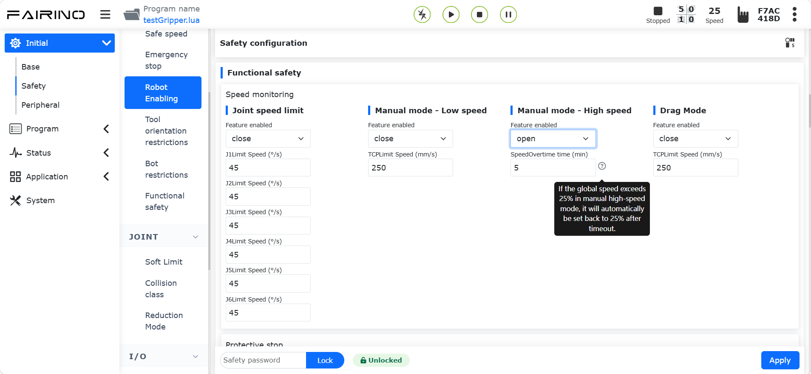

.. centered:: Rysunek 7.5-3 Monitorowanie trybu ręcznego - wysoka prędkość

Monitorowanie prędkości przeciągania
~~~~~~~~~~~~~~~~~~~~~~~~~~~~~~~~~~~~~~~~~~~~~~~~~~~~~~~~~~~~~~~~~

Po włączeniu bezpieczeństwa funkcjonalnego funkcja ta monitoruje prędkość TCP sprzężenia zwrotnego robota w trybie przeciągania. Gdy prędkość przeciągania przekroczy ustawioną wartość, wykonywane jest zatrzymanie bezpieczeństwa.

Zakres ustawianej prędkości granicznej TCP wynosi 1-1000mm/s, domyślnie 250mm/s.

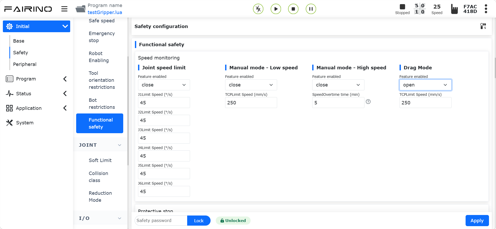

.. centered:: Rysunek 7.5-4 Monitorowanie prędkości przeciągania

Monitorowanie utrzymania pozycji
~~~~~~~~~~~~~~~~~~~~~~~~~~~~~~~~~~~~~~~~~~~~~~~~~~~~~~~~~~~~~~~~~

Po włączeniu bezpieczeństwa funkcjonalnego funkcja ta służy do monitorowania pozycji robota po wyłączeniu. Gdy zmiana każdego przegubu przekroczy ustawioną wartość, wykonywane jest zatrzymanie bezpieczeństwa.

Zakres ustawianej prędkości granicznej TCP wynosi 1-1000mm/s.

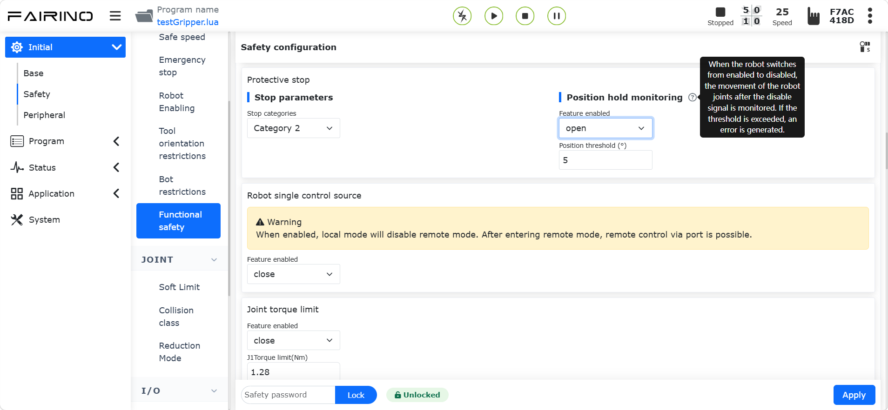

.. centered:: Rysunek 7.5-5 Monitorowanie utrzymania pozycji

Tryb ręczny o wysokiej prędkości
~~~~~~~~~~~~~~~~~~~~~~~~~~~~~~~~~~~~~~~~~~~~~~~~~~~~~~~~~~~~~~~~~

Po włączeniu bezpieczeństwa funkcjonalnego na interfejsie ręcznym o zredukowanej prędkości kliknij przycisk "Wejdź w ręczny o wysokiej prędkości", aby wejść w tryb ręczny o wysokiej prędkości. W tym trybie prędkość ruchu JOG i ruchu poleceniowego nie jest redukowana.

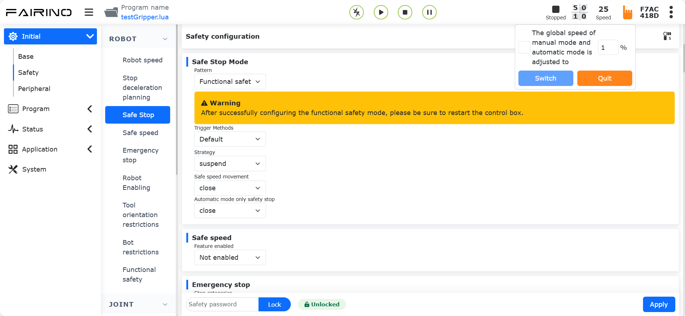

.. centered:: Rysunek 7.5-6 Tryb ręczny o wysokiej prędkości

Zatrzymanie normalne
~~~~~~~~~~~~~~~~~~~~~~~~~~~~~~~~~~~~~~~~~~~~~~~~~~~~~~~~~~~~~~~~~

Po włączeniu bezpieczeństwa funkcjonalnego na stronie CI bezpieczeństwa można wybrać opcję wejścia cyfrowego "Zatrzymanie normalne". Gdy odpowiedni CI zostanie wyzwolony, robot zatrzymuje się zgodnie ze skonfigurowanym poziomem zatrzymania ochronnego.

.. centered:: Rysunek 7.5-7 Zatrzymanie normalne

Ściana bezpieczeństwa
~~~~~~~~~~~~~~~~~~~~~~~~~~~~~~~~~~~~~~~~~~~~~~~~~~~~~~~~~~~~~~~~~

Po włączeniu bezpieczeństwa funkcjonalnego na stronie CI bezpieczeństwa można wybrać opcje wejścia cyfrowego od "Ściana bezpieczeństwa 1" do "Ściana bezpieczeństwa 8". Gdy odpowiedni CI zostanie wyzwolony, robot aktywuje monitorowanie odpowiedniej ściany bezpieczeństwa. Jeśli wejdzie w zakres ograniczenia ściany bezpieczeństwa, robot zatrzymuje się zgodnie ze skonfigurowanym poziomem zatrzymania ochronnego.

.. centered:: Rysunek 7.5-8 Ściana bezpieczeństwa

Reset stanu zatrzymania bezpieczeństwa
~~~~~~~~~~~~~~~~~~~~~~~~~~~~~~~~~~~~~~~~~~~~~~~~~~~~~~~~~~~~~~~~~

Po włączeniu bezpieczeństwa funkcjonalnego na stronie CI bezpieczeństwa można wybrać opcję wejścia cyfrowego "Reset stanu zatrzymania bezpieczeństwa". Gdy odpowiedni CI zostanie wyzwolony, robot usuwa kod błędu zatrzymania bezpieczeństwa i sterownik może wykonywać operacje.

.. centered:: Rysunek 7.5-8 Reset stanu zatrzymania bezpieczeństwa

Ograniczenie momentu przegubów
~~~~~~~~~~~~~~~~~~~~~~~~~~~~~~~~~~~~~~~~~~~~~~~~~~~~~~~~~~~~~~~~~

Ograniczenie momentu przegubów to funkcja monitorowania bezpieczeństwa. Po włączeniu system monitoruje moment każdego przegubu w czasie rzeczywistym. Gdy rzeczywisty moment dowolnego przegubu przekroczy ustawiony procent ograniczenia momentu, robot natychmiast się zatrzymuje, a interfejs wyświetla usterkę przekroczenia ograniczenia momentu przegubów.

Zakres ustawianego procentu wynosi 1%-100%, domyślnie 100%;

.. centered:: Rysunek 7.5-9 Procent ograniczenia momentu przegubów

Odpowiednie sugestie dotyczące postępowania z usterkami:

1. Jeśli usterka przekroczenia limitu jest nadal często wyzwalana przy limicie 100%, oznacza to, że bieżące warunki pracy są bliskie granicy wydajności robota. Zaleca się najpierw zmniejszenie prędkości ruchu lub zmniejszenie obciążenia/bezwładności.
2. Jeśli po regulacji usterka nadal występuje, oznacza to, że wymagania zadania mogą przekraczać możliwości fizyczne robota i konieczna jest ponowna ocena planowania pracy.